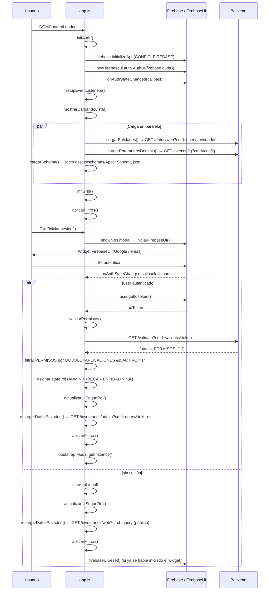
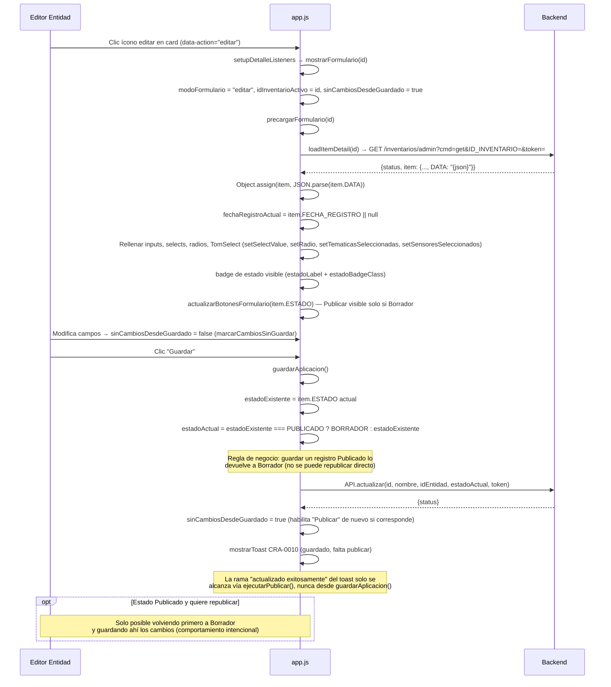
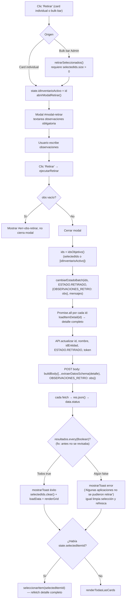
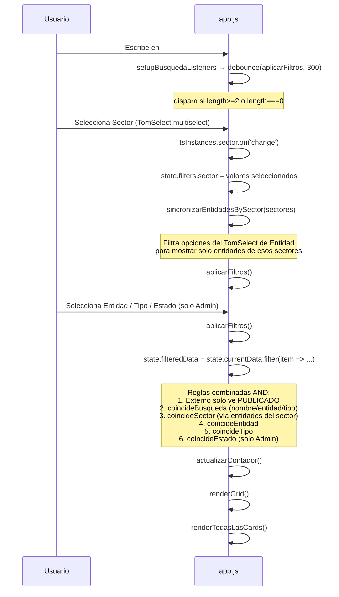
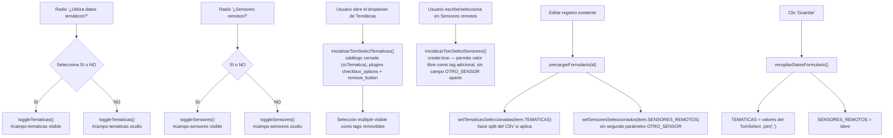

# Documentación Técnica: Módulo Aplicaciones (Inventario de Aplicaciones Geográficas)

## Propósito
Módulo de consulta pública y gestión privada del inventario de aplicaciones geográficas del Catálogo de Recursos IDECA. Permite a cualquier visitante consultar aplicaciones web/móviles PUBLICADAS de las entidades del Distrito, y a usuarios autenticados (según su rol) registrar, editar, publicar, retirar, reactivar o eliminar registros. Controla el ciclo de vida completo del inventario: **En Borrador → Publicado → Retirado**, con auditoría de observaciones en el retiro.

---

## Arquitectura de Referencia

### Stack Tecnológico
| Tecnología | Versión | Propósito |
|------------|---------|-----------|
| Vanilla JS | ES6+ | Lógica de aplicación (sin framework, dividida en `config.js`/`utils.js`/`app.js`) |
| GridJS | latest (CDN, sin pin) | Lista de resultados (panel izquierdo), paginada |
| TomSelect | 2.5.1 | Multiselect de filtros (Sector, Entidad, Tipo), temáticas/sensores del formulario y wrapper de selects simples (`inicializarTomSelectSelectFormulario`) |
| Firebase Auth (compat) | 12.15.0 | Identity provider |
| FirebaseUI | 6.1.0 (CDN) | Widget de login (Google + email/contraseña), montado dentro de `#modal-login` |
| Bootstrap 5 | 5.3.0 | Layout, modales, tooltips, formularios (**ya no usa `bootstrap.Tab`** — el formulario dejó de tener pestañas, ver "Funcionalidades principales" punto 4) |
| Bootstrap Icons | 1.11.3 | Cargado vía CDN — **sin uso real** (ver Código Muerto) |
| Font Awesome 6 Free | 6.5.0 | Iconografía (usada extensivamente, prefijo `fa-`) |
| Google Analytics 4 (gtag) | `G-NE8B8LP8Y6` | Tracking de eventos vía `trackEvent()` |

### Archivos del módulo

| Archivo | Líneas | Rol |
|---------|--------|-----|
| `aplicaciones/index.html` | 615 | HTML: banner hero, vista consulta (lista + tarjetas), vista formulario en **vista única con 2 secciones apiladas** (`.form-container` > `.form-section` × 2, sin tabs), barra sticky `.form-toolbar` (Volver + badge + Descartar/Guardar/Publicar), modal de login (FirebaseUI) + 3 modales de acción (publicar, retirar, eliminar) |
| `aplicaciones/js/config.js` | 235 | Constantes del módulo: `CONFIG_FIREBASE`, `API` (10 métodos generadores de URL), `FIELD_MAP`, `ROL`, `ESTADO`, `state` (objeto único de estado global) |
| `aplicaciones/js/utils.js` | 101 | Funciones utilitarias genéricas: `buildBody`, `fetchWithRetry`, `debounce`, `formatFecha`, `trackEvent`, `mostrarToast`, `ocultarToast` |
| `aplicaciones/js/app.js` | 2932 | Lógica de negocio: auth (Firebase + FirebaseUI), filtros, render de grid/cards, formulario, validación (incluye nombre único por entidad), CRUD, paginación real del listado, exportación CSV, contadores de caracteres, toggler de navbar móvil, offset sticky |
| `aplicaciones/css/fonts.css` | 81 | `@font-face` de Nunito Sans (compartido con el resto de módulos) |
| `aplicaciones/css/layout.css` | 231 | gov-bar, navbar, breadcrumb-hero y footer — layout compartido entre módulos |
| `aplicaciones/css/auth-modal.css` | 45 | Overrides de FirebaseUI del modal de login |
| `aplicaciones/css/estilos.css` | 667 | Estilos propios del módulo (tarjetas, grid, badges, formulario: `.form-toolbar`/`.form-container`/`.form-section-title`/`.info-value-texto`) |
| `aplicaciones/css/view-transitions.css` | 35 | Transiciones nativas de navegación entre páginas (`@view-transition`) |
| `aplicaciones/assets/schemas/Apps_Schema.json` | 124 | Contrato JSON Schema de los campos del formulario (fuente de validaciones y tooltips) |

---

## Análisis Funcional

### Variables globales (config.js)

```javascript
const API = {
  BASE: "https://catalogopmb.catastrobogota.gov.co/PMBWeb/cr",
  TIPO: "APLICACIONES",
  // 10 métodos generadores de URL — ver "URLs de API" más abajo
};

const ROL = {
  ENTIDAD: "ENTIDAD",
  ADMIN: "ADMIN",
  IDECA: "IDECA",
};

const ESTADO = {
  CREADO: "CREADO",
  BORRADOR: "BORRADOR",
  PUBLICADO: "PUBLICADO",
  RETIRADO: "RETIRADO",
  ELIMINADO: "ELIMINADO",
};

const state = {
  currentData: [], filteredData: [], selectedItemId: null,
  usuario: null, rol: null,
  idEntidad: null, nombreEntidad: "",
  modoFormulario: null, idInventarioActivo: null,
  sinCambiosDesdeGuardado: false, fechaRegistroActual: null,
  schema: null,
  tiposAplicacion: [], sectores: [], entidades: [], tematicas: [], sensoresRemotos: [],
  grid: null,
  selectedIds: new Set(),
};

const tsInstances = {}; // instancias TomSelect (sector, entidad, tipo, tipo aplicación, tematicas, sensores)
```

**Nota:** `state.filters`, `state.esBorradorActual` y `state.autoSeleccionPendiente` no están en el literal inicial — se añaden dinámicamente en runtime (`inicializarFiltros()`/`_inicializarFiltroTipo()`/`_inicializarTsEntidad()`/`limpiarFiltros()`, `actualizarBotonesFormulario()` y `renderGrid()`, respectivamente), igual que ya ocurría antes de esta iteración.

### `API` — objeto centralizador de endpoints (config.js:12-137)

Todas las URLs del módulo se construyen a partir de este objeto único; no hay strings de URL sueltos en el resto del archivo (salvo `cargarSchema()` que hace `fetch` a un JSON local).

| Método | Firma | Devuelve |
|---|---|---|
| `listar` | `(start, length, filtros)` | URL pública `GET /inventarios/web?cmd=query...` con filtros opcionales `search`, `sector`, `entidad`, `tipo` |
| `obtener` | `(id)` | URL pública `GET /inventarios/web?cmd=get&...` |
| `listarAdmin` | `(token, start, length)` | URL privada `GET /inventarios/admin?cmd=query...&token=` |
| `obtenerAdmin` | `(id, token)` | URL privada `GET /inventarios/admin?cmd=get...&token=` |
| `crear` | `(nombre, idEntidad, token)` | URL `GET/POST /inventarios/admin?cmd=create...` |
| `actualizar` | `(id, nombre, idEntidad, estado, token)` | URL `GET/POST /inventarios/admin?cmd=update...` |
| `eliminar` | `(id, token)` | URL `POST /inventarios/admin?cmd=delete...` |
| `entidades` | `()` | URL `GET /datos/web?cmd=query_entidades&query=` |
| `config` | `()` | URL `GET /hie/config?cmd=config` (parámetros de dominio) |
| `validate` | `(token)` | URL `GET /validate?cmd=validate&token=` |

### `FIELD_MAP` — mapeo schema → DOM (config.js:142-188)

Único punto de acoplamiento entre las claves del JSON Schema (`Apps_Schema.json`) y los IDs de los campos del formulario HTML. Cada entrada tiene `{ id, err, type }` donde `type` es `"text" | "select" | "radio"`. `validarFormulario()` itera este mapa para aplicar las reglas del schema (`required`, `maxLength`) de forma genérica, sin condicionales por campo. `SECTOR_DISTRITAL` (requerido en el schema) **no** está en `FIELD_MAP`: no es un campo editable por el usuario, se calcula automáticamente a partir del sector de `state.idEntidad` (ver `recopilarDatosFormulario()`), así que no necesita validación manual.

### Inventario completo de funciones (config.js / utils.js / app.js)

| # | Función | Archivo | Líneas | Tipo |
|---|---------|---------|--------|------|
| 1 | `buildBody(datos)` | `utils.js` | 9-16 | Utilidad — codifica DATA en base64 |
| 2 | `fetchWithRetry(url, retries)` | `utils.js` | 27-35 | Utilidad — fetch con reintentos exponenciales |
| 3 | `debounce(fn, delay)` | `utils.js` | 43-49 | Utilidad |
| 4 | `formatFecha(str)` | `utils.js` | 56-65 | Utilidad — formato fecha es-CO |
| 5 | `estadoBadgeClass(estado)` | `app.js` | 14-22 | Utilidad — clase CSS del badge |
| 6 | `estadoLabel(estado)` | `app.js` | 29-38 | Utilidad — etiqueta legible del estado |
| 7 | `trackEvent(nombre, params)` | `utils.js` | 72-75 | GA4 analytics |
| 8 | `initAuth()` | `app.js` | 49-78 | Auth — init Firebase + `firebaseui.auth.AuthUI` + listener |
| 9 | `iniciarFirebaseUI()` | `app.js` | 83-101 | Auth — monta el widget FirebaseUI (Google + email) dentro de `#firebaseui-auth-container`, una sola vez (`firebaseUIIniciado`) |
| 10 | `validarPermisos()` | `app.js` | 107-149 | Auth → backend — asigna `state.rol`; captura `state.idEntidad`/`state.nombreEntidad` (campo real del backend: `ENTIDAD`) para cualquier rol asignado |
| 11 | `recargarDatosPrivados()` | `app.js` | 155-178 | Data loading (tras logout/login); pagina todo el listado vía `fetchTodosLosItems()` y ordena con `ordenarPorNombre()` (ver filas siguientes); si ya había un ítem seleccionado (`state.selectedItemId`), vuelve a pedir su detalle completo con `seleccionarItem()` en vez de renderizar solo campos mínimos |
| 12 | `actualizarUISegunRol()` | `app.js` | 179-233 | UI — visibilidad según rol + escribe nombre/rol directamente en `#texto-nombre-usuario`/`#texto-rol-usuario` vía `textContent` (sin construir un banner de 2 líneas con `<br>`) |
| 12-bis | `ordenarPorNombre(items)` | `app.js` | 244-251 | Utilidad — **nueva** (limpieza DRY). Ordena por `NOMBRE` (localeCompare es-CO, sin distinguir mayúsculas/acentos); extraída porque `loadData()` y `recargarDatosPrivados()` repetían el mismo comparador inline |
| 13-bis | `fetchTodosLosItems(token)` | `app.js` | 261-283 | Data loading. El endpoint es tipo DataTables (`start`/`length`, tope de 1000 por página); esta función hace loop incrementando `start` hasta acumular tantos ítems como reporta `recordsTotal`, para no perder registros más allá de la primera página. Único punto de acceso a `API.listar`/`API.listarAdmin`; usada por `loadData()` y `recargarDatosPrivados()` |
| 13 | `loadData()` | `app.js` | 290-297 | Data loading — listado (público o admin), delega la paginación a `fetchTodosLosItems()` y el orden a `ordenarPorNombre()` |
| 13-ter | `refrescarListadoSilencioso()` | `app.js` | 306-315 | Data loading — **nueva** (limpieza DRY). Envuelve `await loadData()` en un `try/catch` que solo hace `console.warn` si falla; extraída porque `guardarAplicacion()` y `confirmarPublicar()` repetían el mismo bloque antes de chequear nombre duplicado |
| 14 | `loadItemDetail(id)` | `app.js` | 322-340 | Data loading — detalle + parseo `item.DATA` |
| 15 | `cargarSchema()` | `app.js` | 343-352 | Data loading — `Apps_Schema.json` + tooltips + contadores de caracteres |
| 16 | `inicializarContadoresCaracteres()` | `app.js` | 307-318 | Form — monta un contador bajo cada campo `type: "text"` de `FIELD_MAP` con `maxLength` en el schema, y bajo `modal-retirar-obs` |
| 17 | `montarContadorCaracteres(fieldId, maxLength)` | `app.js` | 325-336 | Form — crea el `<small class="contador-caracteres">` y su listener `input` |
| 18 | `actualizarContadorCaracteres(fieldId)` | `app.js` | 342-352 | Form — recalcula "N caracteres restantes" / "N caracteres de más" (clase `text-danger` si excede) |
| 19 | `actualizarTodosLosContadoresCaracteres()` | `app.js` | 358-360 | Form — refresca todos los contadores tras poblar/limpiar el formulario por código |
| 20 | `aplicarTooltipsDesdeSchema()` | `app.js` | 365-410 | UI — hints por campo (toggle click) |
| 21 | `cargarParametrosDominio()` | `app.js` | 416-434 | Data loading — tipos/temáticas/sensores desde `/hie/config` |
| 22 | `cargarEntidades()` | `app.js` | 440-454 | Data loading — entidades + sectores derivados |
| 23 | `separarEtiquetaDescripcion(texto)` | `app.js` | 484-487 | Utilidad — separa `"Etiqueta \|Descripción"` en `{label, descripcion}` (convención de enums tipo `proy_sensores_remotos`) |
| 24 | `inicializarTomSelectSensores()` | `app.js` | 496-546 | Form — TomSelect de sensores remotos (`remove_button`, `create: true`, valor libre); cada opción del enum puede traer descripción tras `\|`, mostrada bajo la etiqueta en el desplegable |
| 25 | `setSensoresSeleccionados(sensores)` | `app.js` | 552-564 | Form — precarga el TomSelect de sensores. Firma sin segundo parámetro `otroSensor`: el campo `OTRO_SENSOR` (legado, previo a habilitar `create:true`) fue eliminado del schema y de todo el código, ya no se lee como fallback |
| 26 | `inicializarTomSelectTematicas()` | `app.js` | 571-594 | Form — TomSelect de temáticas (catálogo cerrado, plugins `checkbox_options` + `remove_button`) |
| 27 | `setTematicasSeleccionadas(tematicas)` | `app.js` | 600-606 | Form — precarga el TomSelect de temáticas (acepta array o CSV) |
| 27-bis | `multiConfig(placeholder, extraOpts)` | `app.js` | 656-680 | Filtros — **nueva a nivel de módulo** (limpieza DRY). Config compartida de TomSelect para los multiselect de filtros (checkboxes, sin cierre al seleccionar, `maxOptions: null`); antes estaba definida dos veces de forma idéntica, una dentro de `inicializarFiltros()` y otra dentro de `_inicializarTsEntidad()` |
| 28 | `inicializarFiltros()` | `app.js` | 685-725 | Filtros — TomSelect sector/entidad/tipo + select estado (usa `multiConfig()`) |
| 29 | `_inicializarFiltroTipo()` | `app.js` | 727-758 | Filtros — TomSelect de tipo de aplicación |
| 30 | `_inicializarTsEntidad()` | `app.js` | 761-788 | Filtros — instancia TomSelect entidad (usa `multiConfig()`) |
| 31 | `_sincronizarEntidadesBySector(sectores)` | `app.js` | 749-765 | Filtros — filtra opciones de entidad por sector |
| 32 | `limpiarFiltros()` | `app.js` | 770-789 | Filtros — reset total |
| 33 | `aplicarFiltros()` | `app.js` | 794-840 | Filtros — pipeline de filtrado + render |
| 34 | `initGrid()` | `app.js` | 848-905 | Render — instancia GridJS |
| 35 | `actualizarVisibilidadFooter(container, total)` | `app.js` | 912-915 | Render — oculta el footer de paginación de GridJS cuando hay 10 registros o menos |
| 36 | `renderGrid()` | `app.js` | 920-943 | Render — actualiza data de GridJS; marca `state.autoSeleccionPendiente` cuando auto-selecciona el primer resultado |
| 37 | `actualizarContador()` | `app.js` | 948-955 | Render — contador de resultados; además deshabilita `#btn-exportar` (`toggleAttribute("disabled", ...)`) cuando `state.filteredData.length === 0`. Se invoca desde `aplicarFiltros()`, `recargarDatosPrivados()` **y `loadData()`**, para que el contador quede correcto tras cualquier acción CRUD que recargue el listado |
| 38 | `renderTodasLasCards()` | `app.js` | 963-1004 | Render — panel derecho (todas las cards); si `state.autoSeleccionPendiente` está activo, dispara `seleccionarItem()` para cargar el detalle sin esperar clic del usuario |
| 39 | `renderCardsAgrupadasPorEntidad(items)` | `app.js` | 1011-1027 | Render — agrupación Admin/IDECA |
| 40 | `calcularPermisosCard(item, estado)` | `app.js` | 1034-1048 | **Eliminada**: solo calculaba `esRetirado`, y el módulo solo muestra registros PUBLICADOS (el motivo de retiro se ve en inventario) |
| 41 | `renderAccionesCard(item, permisos)` | `app.js` | 1056-1108 | Render — botones editar/republicar/retirar/reactivar/eliminar |
| 42 | `construirCamposTablaCard(item)` | `app.js` | 1168-1188 | Render — pares [label, valor] filtrando vacíos; incluye Descripción y Necesidad a satisfacer en la misma lista que el resto de atributos. **Firma corregida**: tenía un segundo parámetro `esExterno` que nunca se usaba dentro de la función (copy/paste de `construirMetaEncabezadoCard`) y un docstring que hablaba de ocultar "Dependencias" — cosa que esta función ni siquiera lista. Se quitó el parámetro muerto y se corrigió el comentario |
| 43 | `construirMetaEncabezadoCard(item)` | `app.js` | 1145-1173 | Render — línea de metadatos del encabezado de la card (Sigla, Tipo, Entidad, Sector, Dependencias), descartando vacíos. No oculta campos por rol (no existe regla de negocio para ello; antes ocultaba Dependencias con un `esExterno` fijo en `true`) |
| 44 | `renderUrlAccesoCard(item)` | `app.js` | 1181-1195 | Render — fila URL de acceso, visible para todos (antes quedaba siempre oculta por el mismo `esExterno` fijo) |
| 45 | `renderCard(item)` | `app.js` | 1202-1271 | Render — HTML completo de una card; incluye "Fecha de registro" (si existe) justo antes de "Fecha de actualización", ambas al final del cuerpo de la card |
| 46 | `seleccionarItem(id)` | `app.js` | 1277-1325 | UI/Data — selección + carga de detalle async |
| 47 | `mostrarCargandoLista()` | `app.js` | 1330-1339 | UI — spinner |
| 48 | `mostrarErrorLista(msg)` | `app.js` | 1345-1354 | UI — mensaje de error |
| 49 | `mostrarFormulario(idInventario)` | `app.js` | 1408-1444 | Form — abre en modo crear/editar; **ya no hay pestañas Bootstrap**: ambas secciones (Información básica / Relacionar datos geográficos) quedan siempre visibles en `.form-container`. Oculta `.search-filters-section` mientras el formulario está abierto; en modo "crear" estampa `state.fechaRegistroActual = new Date().toISOString()` una sola vez (en "editar" queda en `null` hasta que `precargarFormulario()` la reemplace por el valor real del registro) |
| 50 | `ocultarFormulario()` | `app.js` | 1445-1458 | Form — cierra, vuelve a consulta, restaura `.search-filters-section` |
| 51 | `descartarCambios()` | `app.js` | 1421-1427 | Form — reset + cierre + refresco del listado |
| 52 | `refrescarListado()` | `app.js` | 1432-1438 | Data loading — refresco manual del listado respetando filtros activos |
| 53 | `precargarFormulario(id)` | `app.js` | 1448-1489 | Form — precarga datos de edición; toma `state.fechaRegistroActual = item.FECHA_REGISTRO \|\| null` (nunca inventa una fecha para un registro viejo que no la tenga); incluye `setTematicasSeleccionadas`/`setSensoresSeleccionados` y refresco de contadores |
| 54 | `resetearFormulario()` | `app.js` | 1532-1583 | Form — limpia todos los campos, incluidos los TomSelect de temáticas/sensores y los contadores. **Fix**: ahora también quita `is-invalid` del select `#f-tipo` y de `el.tomselect.wrapper`, y limpia `err-tipo` — antes el borde rojo quedaba "pegado" tras la primera validación fallida aunque se cerrara y reabriera el formulario, porque solo se llamaba `tomselect.clear()` (limpia el valor, no el estado visual de error) |
| 55 | `actualizarBotonesFormulario(estado)` | `app.js` | 1584-1594 | Form — calcula y guarda `state.esBorradorActual`; delega la visibilidad de botones a `sincronizarBotonesFormulario()` |
| 56 | `sincronizarBotonesFormulario()` | `app.js` | 1595-1605 | Form — **renombrada** (antes `sincronizarBotonesPorTab()`, ya no existe el concepto de pestaña activa). Muestra "Publicar" únicamente si `state.esBorradorActual`; ya no hay botón "Siguiente" que alternar. Sincroniza además "Guardar" (`actualizarEstadoBotonGuardar`) |
| 57 | `actualizarEstadoBotonPublicar()` | `app.js` | 1606-1614 | Form — disabled del botón Publicar: exige que no haya cambios sin guardar (`state.sinCambiosDesdeGuardado`) **y** que `validarFormulario(true)` pase en modo silencioso (incluye ahora la validación de nombre duplicado) |
| 58 | `actualizarEstadoBotonGuardar()` | `app.js` | 1615-1638 | Form — **ya no usa el atributo `disabled` real** (bloqueaba el hover y el tooltip explicativo no se veía). En su lugar aplica la clase visual `.btn-restringido` (opacidad reducida) cuando `#f-nombre` está vacío y controla un `bootstrap.Tooltip` sobre el botón (`.enable()`/`.disable()` + `.hide()`) con el texto "Ingresa el nombre para poder guardar". El botón sigue siendo clicable: `guardarAplicacion()` valida igual y muestra el error al intentar guardar |
| 59 | `marcarCambiosSinGuardar(evento)` | `app.js` | 1592-1597 | Form — pone `state.sinCambiosDesdeGuardado = false` (deshabilita "Publicar" hasta volver a guardar), refresca "Guardar" y limpia la advertencia visual del campo tocado (`limpiarAdvertenciaCampo`) |
| 60 | `limpiarAdvertenciaCampo(el)` | `app.js` | 1604-1625 | Form — quita `is-invalid` y el mensaje `err-*` de un campo apenas se edita, sin esperar al próximo intento de guardar |
| 61 | `setSelectValue(id, value)` | `app.js` | 1635-1644 | Form helper |
| 62 | `setRadio(name, value)` | `app.js` | 1651-1654 | Form helper |
| 63 | `popularSelectFormulario(id, opciones)` | `app.js` | 1661-1671 | Form helper — puebla un `<select>` y lo envuelve en TomSelect vía `inicializarTomSelectSelectFormulario()` |
| 64 | `inicializarTomSelectSelectFormulario(id)` | `app.js` | 1678-1689 | Form — envuelve un select de valor único del formulario (p. ej. `#f-tipo`) en TomSelect, reutilizando el render que oculta la opción vacía |
| 65 | `resolverEnumTexto(lista, valor)` | `app.js` | 1698-1706 | Utilidad — resuelve el texto legible de un id/value guardado contra una lista de opciones de enum (fallback: devuelve el valor tal cual) |
| 66 | `resolverEnumLista(lista, valores)` | `app.js` | 1714-1719 | Utilidad — igual que `resolverEnumTexto` pero para selección múltiple (array o CSV), unida por coma |
| 67 | `toggleTematicas()` | `app.js` | 1724-1731 | Form — toggle bloque temáticas |
| 68 | `toggleSensores()` | `app.js` | 1736-1743 | Form — toggle bloque sensores |
| 69 | `validarCampoTexto(map, prop, isRequired, silent)` | `app.js` | 1805-1833 | Validación |
| 70 | `validarCampoSelect(map, prop, isRequired, silent)` | `app.js` | 1834-1859 | Validación |
| 71 | `validarCampoRadio(map, prop, isRequired, silent)` | `app.js` | 1860-1913 | Validación |
| 72 | `validarSeleccionCondicional(c, silent)` | `app.js` | 1914-1931 | Validación — grupo condicional de `CAMPOS_CONDICIONALES` (radio SI/NO + selección mínima en el TomSelect asociado de temáticas/sensores) |
| 73 | `validarUrlHttps()` | `app.js` | 1932-1950 | Validación — warning no bloqueante |
| 73-bis | `existeNombreDuplicado(nombre)` | `app.js` | 1951-1965 | Validación — **nueva**. Regla de negocio: dos registros del mismo módulo no pueden tener el mismo `NOMBRE` (normalizado, sin mayúsculas ni espacios) dentro de la misma entidad. Compara contra `state.currentData` filtrando por `ID_ENTIDAD === state.idEntidad` y excluyendo `state.idInventarioActivo`. Es una verificación *best-effort* en cliente (no hay restricción de unicidad atómica en el backend) |
| 73-ter | `validarNombreDuplicado(silent)` | `app.js` | 1966-1988 | Validación — envuelve `existeNombreDuplicado()` marcando `is-invalid` + `err-nombre` si aplica; invocada desde `validarFormulario()` |
| 74 | `validarFormulario(silent)` | `app.js` | 1989-2026 | Validación — orquesta `FIELD_MAP` **+ `validarNombreDuplicado(silent)`** al final |
| 75 | `guardarAplicacion()` | `app.js` | 2030-2144 | API/CRUD — crear o actualizar. Antes de chequear duplicados, llama `refrescarListadoSilencioso()` (best-effort) para refrescar `state.currentData` contra el backend justo en el momento de guardar — reduce la ventana de datos obsoletos (la lista pudo cargarse horas antes). Si el nombre está duplicado, bloquea igual que el chequeo de nombre vacío (borde rojo + `err-nombre` + toast, sin llamar a la API). Al guardar con éxito actualiza también el badge de estado (`#form-badge-estado`: texto, clase y visibilidad) además de los botones del formulario |
| 76 | `recopilarDatosFormulario()` | `app.js` | 2150-2193 | Form — arma payload de schema a partir de los campos del formulario, incluyendo `FECHA_REGISTRO: state.fechaRegistroActual` y `SECTOR_DISTRITAL` calculado desde `state.idEntidad` |
| 77 | `extraerDatosSchema(item)` | `app.js` | 2194-2225 | Utilidad — extrae del detalle completo de un inventario los campos del schema `DATA`, en el mismo formato que `recopilarDatosFormulario()`. El backend reemplaza el blob `DATA` completo en cada actualización (no hace merge), así que `ejecutarRetirar()`/`ejecutarReactivar()` la usan para no perder la información ya guardada al no pasar por el formulario |
| 78 | `confirmarPublicar()` | `app.js` | 2222-2239 | UI — abre modal publicar. Es `async`: primero llama `refrescarListadoSilencioso()`, luego valida (`validarFormulario()`, que incluye nombre duplicado) antes de mostrar el modal |
| 79 | `ejecutarPublicar()` | `app.js` | 2240-2300 | API/CRUD — cambia estado a Publicado; si ya había un ítem seleccionado, vuelve a pedir su detalle completo con `seleccionarItem()` en vez de solo re-renderizar cards |
| 79-bis | `idsObjetivo()` | `app.js` | 2302-2308 | Utilidad — **nueva** (limpieza DRY). Resuelve sobre qué IDs debe operar una acción masiva: la selección múltiple (`state.selectedIds`) si hay algo marcado, o `state.idInventarioActivo` como fallback (acción sobre una sola card). Reemplaza el mismo ternario que antes estaba copiado 3 veces en `ejecutarEliminar()`/`ejecutarRetirar()`/`ejecutarReactivar()` |
| 80 | `abrirModalEliminar()` | `app.js` | 2313-2323 | UI — modal eliminar (single/bulk) |
| 81 | `ejecutarEliminar()` | `app.js` | 2329-2368 | API/CRUD — `DELETE` definitivo, en paralelo (`Promise.all`); si el/los id(s) eliminados incluyen a `state.selectedItemId`, lo limpia a `null` antes de refrescar, para no dejar el panel de detalle en blanco. Usa `idsObjetivo()` |
| 82 | `eliminarSeleccionados()` | `app.js` | 2373-2376 | UI — abre modal si hay selección |
| 83 | `toggleSeleccion(id)` | `app.js` | 2385-2394 | Bulk — toggle set de IDs |
| 84 | `limpiarSeleccion()` | `app.js` | 2399-2403 | Bulk — reset selección |
| 85 | `actualizarCheckboxes()` | `app.js` | 2408-2412 | Bulk — sincroniza checkboxes visuales |
| 86 | `actualizarBulkBar()` | `app.js` | 2417-2440 | Bulk — contador + visibilidad botones retirar/reactivar |
| 87 | `abrirModalRetirar()` | `app.js` | 2445-2458 | UI — modal retirar (single/bulk); refresca el contador de `modal-retirar-obs` |
| 87-bis | `cambiarEstadoBatch(ids, nuevoEstado, extraCampos, mensajes)` | `app.js` | 2471-2520 | API/CRUD — **nueva** (limpieza DRY + fix de bug). Reemplaza los cuerpos casi idénticos que antes tenían `ejecutarRetirar()` y `ejecutarReactivar()` por separado: por cada id, refetch (`loadItemDetail`) + `extraerDatosSchema()` + `fetch` en paralelo (`Promise.all`), y ahora **sí revisa `data.status` de cada respuesta individual** (`resultados.every(Boolean)`) antes de mostrar éxito — antes ninguna de las dos funciones lo hacía, y un fallo parcial (ej. 1 de 3 ítems rechazado por el backend) mostraba igual el toast de éxito genérico. `mensajes` trae los textos de éxito/error/error de conexión y el nombre del evento de tracking, para que la única diferencia real entre retirar y reactivar sea el `nuevoEstado` y los `extraCampos` (`OBSERVACIONES_RETIRO` en el caso de retiro). Se llama "batch" y no "lote" para no chocar con el sentido catastral de "lote" (predio) en este dominio |
| 88 | `ejecutarRetirar()` | `app.js` | 2526-2546 | API/CRUD — valida que las observaciones no estén vacías, cierra el modal y delega en `cambiarEstadoBatch(idsObjetivo(), ESTADO.RETIRADO, {OBSERVACIONES_RETIRO: obs}, mensajes)` |
| 89 | `ejecutarReactivar()` | `app.js` | 2552-2565 | API/CRUD — retirado → Borrador; delega en `cambiarEstadoBatch(idsObjetivo(), ESTADO.BORRADOR, {}, mensajes)` |
| 90 | `retirarSeleccionados()` | `app.js` | 2570-2573 | UI — abre modal si hay selección |
| 91 | `reactivarSeleccionados()` | `app.js` | 2579-2582 | UI — ejecuta directo si hay selección |
| 91-bis | `csvEscape(valor)` | `app.js` | 2592-2594 | Utilidad — **nueva** (limpieza DRY). Envuelve un valor en comillas dobles escapando comillas internas (`"${v.replace(/"/g,'""')}"`); reemplaza 16 repeticiones inline del mismo `.replace` dentro de `exportarCSV()` |
| 92 | `exportarCSV()` | `app.js` | 2600-2662 | Exportación — CSV con BOM, 16 columnas, usa `csvEscape()` por columna |
| 93 | `mostrarToast(mensaje, tipo)` | `utils.js` | 85-94 | UI — notificación (auto-hide 8s) |
| 94 | `ocultarToast()` | `utils.js` | 99-101 | UI |
| 95 | `setupBusquedaListeners()` | `app.js` | 2663-2689 | Eventos — buscador |
| 96 | `setupBotonesGlobalesListeners()` | `app.js` | 2690-2749 | Eventos — botones estáticos; **ya no incluye `#btn-siguiente` ni el listener `shown.bs.tab` sobre `#form-tabs`** (eliminados junto con las pestañas); mantiene `#modal-login` `shown.bs.modal` → `iniciarFirebaseUI` |
| 97 | `setupRadiosFormularioListeners()` | `app.js` | 2750-2761 | Eventos — radios temáticos/sensores |
| 98 | `setupListaListeners()` | `app.js` | 2762-2778 | Eventos — delegación en lista izquierda |
| 99 | `setupDetalleListeners()` | `app.js` | 2779-2832 | Eventos — delegación en panel de cards (data-action) |
| 100 | `setupTooltips()` | `app.js` | 2833-2841 | Eventos — Bootstrap Tooltip (`[data-bs-toggle='tooltip']:not([data-schema-field])`); desde esta iteración también inicializa el tooltip estático de `#btn-guardar` ("Ingresa el nombre para poder guardar"), controlado dinámicamente por `actualizarEstadoBotonGuardar()` |
| 101 | `setupUrlWarningListener()` | `app.js` | 2842-2853 | Eventos — blur en `#f-url` |
| 102 | `setupEventListeners()` | `app.js` | 2854-2876 | Orquestador de todos los `setup*`; registra `marcarCambiosSinGuardar` en `input`/`change` de `#vista-formulario` y el listener que oculta `err-obs-retirar` al escribir en `modal-retirar-obs` |
| 103 | `initNavbarToggler()` | `app.js` | 2877-2896 | UI — alterna el ícono hamburguesa/cerrar (`fa-bars`/`fa-times`) del navbar colapsable al mostrar/ocultar `#navbarNav` (eventos `shown.bs.collapse`/`hidden.bs.collapse`); invocada una sola vez al inicio, desde `DOMContentLoaded` |
| 104 | `ajustarOffsetToolbarFormulario()` | `app.js` | 2897-2932 | UI — Mide `document.querySelector("nav.navbar").offsetHeight` y lo expone como variable CSS `--form-toolbar-top`, para que `.form-toolbar` (sticky, justo debajo del navbar también sticky) se posicione sin taparlo ni dejar hueco. Invocada en `DOMContentLoaded` y en cada `resize` de la ventana |

**Nota de conteo:** el módulo pasó de 107 a 113 funciones top-level en `app.js` tras la limpieza DRY de esta iteración (sin cambios en `utils.js`). Se agregaron 6 funciones puramente extractivas — no introducen comportamiento nuevo, solo eliminan duplicación: `ordenarPorNombre`, `refrescarListadoSilencioso`, `multiConfig` (hoisteada a nivel de módulo; antes existía duplicada e inline dentro de `inicializarFiltros()` y `_inicializarTsEntidad()`), `idsObjetivo`, `cambiarEstadoBatch` y `csvEscape`. `ejecutarRetirar()`/`ejecutarReactivar()` se mantienen como funciones públicas (mismos nombres, misma firma sin parámetros) pero ahora son wrappers delgados sobre `cambiarEstadoBatch()`. `construirCamposTablaCard()` perdió el parámetro `esExterno` que nunca usaba. No se eliminó ninguna función top-level en esta iteración.
>
> Iteración anterior (histórico): se eliminaron `setBannerDosLineas` (el banner de rol ahora se escribe con `textContent` directo sobre dos `<span>` separados, sin construir manualmente 2 líneas con `<br>`), `poblarSectorFormulario` y `precargarSectorEntidad` (ya no existe un campo `#f-sector` en el formulario: `SECTOR_DISTRITAL` se calcula automáticamente a partir del sector de `state.idEntidad`, no se pide al usuario). Se agregaron `iniciarFirebaseUI`, `actualizarVisibilidadFooter`, `actualizarEstadoBotonGuardar`, `inicializarTomSelectSelectFormulario`, `extraerDatosSchema` e `initNavbarToggler`.

> **Bug corregido (esta revisión) en `setupDetalleListeners()`:** hacer clic en cualquier parte de una card de detalle ya seleccionada volvía a disparar `seleccionarItem()` — y por lo tanto un GET redundante a `loadItemDetail` — incluso si el ítem ya estaba abierto. `setupDetalleListeners()` ahora compara `card.dataset.cardId` contra `state.selectedItemId` antes de re-consultar, y solo llama a `seleccionarItem()` cuando son distintos. El mismo fix se aplicó en `proyectos/js/app.js` y `servicios/js/app.js`.

> **Bug corregido (esta revisión) en `ejecutarRetirar()`/`ejecutarReactivar()`:** el `Promise.all()` de ambas funciones nunca revisaba el `data.status` de cada respuesta individual (a diferencia de `ejecutarEliminar()`, que sí lo hacía con `resultados.every(Boolean)`). Si el backend rechazaba uno de varios IDs en una acción masiva, el usuario veía igual el toast de éxito genérico para todos. Al fusionar ambas funciones en el helper compartido `cambiarEstadoBatch()` (ver tabla de funciones, fila 87-bis) se corrigió también este bug: ahora se aplica el mismo patrón `resultados.every(Boolean)` que ya usaba `ejecutarEliminar()`, y se avisa explícitamente si algún ítem del lote falló. El mismo fix se aplicó en `proyectos/js/app.js` y `servicios/js/app.js`.

> **Limpieza DRY (esta revisión):** se extrajeron 6 funciones para eliminar lógica duplicada dentro de `app.js` (ver notas "**nueva**" en la tabla de funciones): `ordenarPorNombre()`, `refrescarListadoSilencioso()`, `multiConfig()` (hoisteada, antes duplicada e inline en dos funciones distintas), `idsObjetivo()`, `cambiarEstadoBatch()` y `csvEscape()`. Se eliminaron además 3 propiedades muertas de `state` en `config.js` (`tsFilterSector`/`tsFilterEntidad`/`tsFilterTipo`, nunca leídas ni escritas — ver "Código Muerto") y el parámetro `esExterno` no usado de `construirCamposTablaCard()`. Ninguno de estos cambios altera comportamiento visible salvo el fix de `cambiarEstadoBatch()` descrito arriba. El mismo refactor se replicó en `proyectos/js/app.js` y `servicios/js/app.js`.

### Funcionalidades principales

1. **Consulta pública + privada unificada**: la misma vista (`#vista-consulta`) sirve para Externo, Editor Entidad, IDECA y Admin; el contenido se filtra en `aplicarFiltros()` (app.js:848: `if (state.rol === null && estado !== ESTADO.PUBLICADO) return false;`).
2. **Lista + detalle maestro-detalle**: GridJS renderiza solo Nombre+badge en el panel izquierdo (columnas `ID` y `Estado` ocultas); el panel derecho muestra **todas** las cards pero solo la seleccionada es visible (`.app-card` vs `.app-card.d-none`), truco que evita reconstruir el DOM en cada clic.
3. **Agrupación por entidad**: Admin e IDECA ven las cards agrupadas con encabezado de sección (`renderCardsAgrupadasPorEntidad`); Editor Entidad y Externo ven lista plana.
4. **Formulario en vista única con secciones (ya no hay tabs)**: `.form-container` agrupa dos `.form-section` siempre visibles y apiladas — "Información básica" y "Relacionar datos geográficos" (radios SI/NO condicionan la visibilidad de los bloques de temáticas/sensores) — cada una con un encabezado `.form-section-title` no interactivo a modo de divisor. Se eliminó la navegación por pestañas de Bootstrap (`nav.custom-tabs`, `tab-pane`, `bootstrap.Tab`) y el botón "Siguiente" que servía para saltar entre ellas (ver punto 12). `SECTOR_DISTRITAL`, requerido por el schema, no aparece como campo del formulario: se deriva automáticamente de la entidad del usuario en `recopilarDatosFormulario()`.
5. **Selección múltiple (bulk)**: solo visible para Admin (checkbox en cada fila de grid vía `data-action="toggle-seleccion"`), habilita retirar/reactivar/eliminar en lote.
6. **Validación dirigida por schema**: `FIELD_MAP` (ahora en `config.js`) + `Apps_Schema.json` generan validación de requeridos y `maxLength` sin hardcodear reglas por campo.
7. **Botón "Guardar" y "Publicar" con guardas independientes**: `actualizarEstadoBotonGuardar()` marca "Guardar" como visualmente restringido (clase `.btn-restringido`, sin el atributo `disabled` real) mientras no haya un Nombre ingresado, y controla un `bootstrap.Tooltip` sobre el botón que explica la restricción al hacer hover — se evitó `disabled` porque bloquea los eventos de mouse y el tooltip no llegaba a mostrarse. El botón sigue siendo clicable: `guardarAplicacion()` valida igual y muestra el error (borde rojo + toast) si se intenta guardar sin nombre. `actualizarEstadoBotonPublicar()` exige además que no haya cambios sin guardar (`state.sinCambiosDesdeGuardado`, puesto en `false` por `marcarCambiosSinGuardar()` en cada `input`/`change` y devuelto a `true` recién al guardar con éxito) y que `validarFormulario(true)` pase en modo silencioso — evita publicar un formulario con cambios que nunca llegaron al backend. El mismo listener de cambios limpia de inmediato la advertencia visual (`is-invalid` + mensaje `err-*`) del campo que el usuario acaba de tocar, vía `limpiarAdvertenciaCampo()`.
8. **Exportación CSV**: 16 columnas, con BOM UTF-8 (`"" + csv`) para compatibilidad con Excel. El botón `#btn-exportar` se deshabilita automáticamente (`actualizarContador()`, app.js:989-996) cuando `state.filteredData` queda vacío, en cualquiera de las tres rutas que lo llaman (`aplicarFiltros`, `recargarDatosPrivados`, `loadData`); el `alert("No hay datos para exportar.")` dentro de `exportarCSV()` sigue existiendo como respaldo por si el botón se dispara igualmente por código.
9. **Tooltips dinámicos desde schema**: `aplicarTooltipsDesdeSchema()` crea un `<div class="field-hint">` por cada ícono `data-schema-field`, con texto tomado de `Apps_Schema.json`, mostrado/ocultado por clic (no por hover).
10. **Sesión vía modal de login con FirebaseUI**: el botón `#btn-login` abre `#modal-login` (Bootstrap), cuyo evento `shown.bs.modal` dispara `iniciarFirebaseUI()`, que monta el widget de FirebaseUI (Google + email/contraseña) una sola vez dentro de `#firebaseui-auth-container`. Tras loguearse, `initAuth()` cierra el modal (`bootstrap.Modal.getInstance(...).hide()`) y, al cerrar sesión (`firebase.auth().signOut()`), se resetea el widget (`firebaseUI.reset()`) para poder reabrirlo en el siguiente intento. El nombre/rol del usuario se pinta con `textContent` directo sobre `#texto-nombre-usuario`/`#texto-rol-usuario` (sin `innerHTML`, sin construir manualmente el salto de línea).
11. **Contador de caracteres en vivo**: todo campo de texto de `FIELD_MAP` con `maxLength` en el schema (incluyendo el textarea `modal-retirar-obs`, que usa `OBSERVACIONES_RETIRO.maxLength`) recibe un `<small class="contador-caracteres">` bajo el input, montado por `inicializarContadoresCaracteres()`/`montarContadorCaracteres()` y sincronizado en cada `input` por `actualizarContadorCaracteres()`. Muestra "N caracteres restantes" o, en rojo (`text-danger`), "N caracteres de más — reduce el texto".
12. **Barra de acciones sticky, sin botón "Siguiente"**: al eliminar las pestañas (punto 4) ya no hace falta un botón para saltar entre secciones. `sincronizarBotonesFormulario()` (renombrada, antes `sincronizarBotonesPorTab()`) solo decide si "Publicar" es visible, según `state.esBorradorActual` (calculado en `actualizarBotonesFormulario()`) — ya no depende de ninguna pestaña activa. Los botones Descartar/Guardar/Publicar se movieron de una fila al final del formulario a `.form-toolbar`, la misma barra superior del botón "Volver" (junto con el badge de estado), y esa barra es `position: sticky` (`top: var(--form-toolbar-top)`, calculado por `ajustarOffsetToolbarFormulario()` para no quedar tapada por el navbar) — así los botones quedan siempre visibles al hacer scroll por un formulario largo.
13. **Temáticas como TomSelect (dropdown con checkboxes) y Sensores remotos con valor libre**: `inicializarTomSelectTematicas()` usa los plugins `checkbox_options` + `remove_button` sobre un catálogo cerrado; `inicializarTomSelectSensores()` agrega además `create: true`, así que un sensor que no está en el catálogo puede escribirse directamente como un tag más del mismo campo, sin necesitar un campo `OTRO_SENSOR` aparte. El campo `OTRO_SENSOR`, legado de antes de habilitar `create:true`, fue eliminado por completo del schema, de `setSensoresSeleccionados()` (ya no recibe un segundo argumento) y de `precargarFormulario()`; como la base de datos de pruebas está vacía, no se dejó como fallback de compatibilidad.
14. **`FECHA_REGISTRO` estampada 100% en cliente**: no existe confirmado en el backend un campo de fecha de creación (solo `FECHA_ACTUALIZACION`, manejado server-side, fuera del blob `DATA`), así que se estampa una única vez al abrir el formulario en modo "crear" (`state.fechaRegistroActual = new Date().toISOString()`, en `mostrarFormulario()`) y en modo "editar" se toma tal cual del registro cargado (`precargarFormulario()`) — si un registro viejo no la tiene, queda vacía, sin inventar nada. Viaja dentro de `DATA` (`recopilarDatosFormulario()`/`extraerDatosSchema()`, para que sobreviva a retirar/reactivar) y se muestra como la línea "Fecha de registro" justo antes de "Fecha de actualización" en el detalle de la card (`renderCard()`).
15. **Auto-selección con carga de detalle automática**: al entrar al módulo o tras filtrar, si no había selección previa, `renderGrid()` marca `state.autoSeleccionPendiente`; `renderTodasLasCards()` lo consume al final del render disparando `seleccionarItem(state.selectedItemId)` — antes el ítem quedaba marcado como seleccionado pero el detalle completo solo se cargaba tras un clic manual del usuario.
16. **Refresco de detalle completo tras editar/publicar/retirar/reactivar (complementa el punto 15)**: `recargarDatosPrivados()`, `ejecutarPublicar()`, `ejecutarRetirar()` y `ejecutarReactivar()` reemplazan `state.currentData` con el listado recargado, que solo trae campos mínimos (sin el JSON `DATA` parseado). El mecanismo de auto-selección del punto 15 solo se dispara cuando **no** había `state.selectedItemId` previo, así que al volver de cualquiera de estas acciones sobre un ítem ya seleccionado, el panel derecho quedaba mostrando solo campos mínimos hasta el próximo clic manual. Fix: las cuatro funciones comprueban `state.selectedItemId` tras la recarga y, si ya existe, llaman explícitamente `seleccionarItem(state.selectedItemId)` para forzar el refetch del detalle completo.
17. **`ejecutarRetirar()`/`ejecutarReactivar()` no pierden el resto del `DATA`**: como el backend reemplaza el blob `DATA` completo en cada `update` (no hace merge), retirar o reactivar sin reenviar el resto de campos del schema borraría silenciosamente Descripción, Temáticas, Sensores, etc. Ambas funciones delegan en el helper compartido `cambiarEstadoBatch()` (ver tabla de funciones), que hace `loadItemDetail(id)` por cada ítem y arma el body con `extraerDatosSchema(detalle)` (+ `OBSERVACIONES_RETIRO` en el caso de retirar), preservando toda la información ya guardada — y ahora también revisa `data.status` por ítem antes de reportar éxito (ver nota de bug corregido, sección anterior).
18. **Eliminar limpia la selección fantasma**: `ejecutarEliminar()` ahora limpia `state.selectedItemId` a `null` si el/los id(s) eliminados coincidían con el ítem seleccionado. Antes, como `renderGrid()` solo auto-selecciona el primer resultado cuando `selectedItemId` es falsy, el id ya borrado no matcheaba ninguna card y el panel de detalle quedaba en blanco (todas las `.app-card` con `d-none`).
19. **Fila de filtros oculta durante crear/editar**: `.search-filters-section` se oculta al abrir el formulario (`mostrarFormulario()`) y se restaura al cerrarlo (`ocultarFormulario()`) — antes quedaba visible sobre el formulario sin ningún propósito, ya que los filtros no aplican mientras se edita un registro.
20. **Filtros de Sector y Entidad ocultos para Editor Entidad**: como este rol solo puede ver/gestionar los registros de su propia entidad, `actualizarUISegunRol()` oculta `#filter-sector-wrap` y `#filter-entidad-wrap` cuando `state.rol === ROL.ENTIDAD` (mismo criterio ya usado en `proyectos`/`servicios`, portado aquí).
21. **Validación de nombre único por entidad**: regla de negocio nueva — dos registros del módulo no pueden compartir `NOMBRE` (normalizado) dentro de la misma entidad. Implementada en `existeNombreDuplicado()`/`validarNombreDuplicado()` (ver tabla de funciones), invocada tanto al hacer clic en "Guardar" como dentro de `validarFormulario()` (para que "Publicar" también la respete). Es una verificación *best-effort* en cliente: antes de comparar, `guardarAplicacion()`/`confirmarPublicar()` refrescan `state.currentData` con `await loadData()` para reducir la ventana de datos obsoletos, pero no hay una restricción de unicidad atómica en el backend — dos guardados casi simultáneos podrían igual colarse.
22. **Paginación real del listado**: el endpoint de listado (`API.listar`/`API.listarAdmin`) es tipo DataTables y limita cada respuesta a `length=1000` registros. Antes, `loadData()`/`recargarDatosPrivados()` pedían una sola página y descartaban silenciosamente cualquier registro más allá del primer lote. `fetchTodosLosItems(token)` ahora hace loop incrementando `start` hasta acumular tantos ítems como reporta `recordsTotal` en la respuesta, y es el único punto que llama a `API.listar`/`API.listarAdmin`.
23. **Detalle de texto largo con comportamiento de textarea**: en el detalle de la card, los campos de texto libre extenso (Descripción, Necesidad a satisfacer, Público objetivo, Resultados esperados, Observaciones, Motivo de retiro) usan la clase `.info-value-texto` además de `.info-value`: limita el alto a ~4 líneas (`max-height` calculado sobre `line-height: 1.4`) con scroll interno (`overflow-y: auto`) y conserva saltos de línea (`white-space: pre-wrap`). Los demás valores de `.info-value` (URL de acceso, Sigla, Tipo, Sí/No, etc.) mantienen el estilo simple original — el `white-space: pre-wrap` se probó primero aplicado a `.info-value` en general, pero rompía visualmente la fila de "URL de acceso" (el link quedaba con saltos e indentación heredados del template HTML), de ahí la clase separada aplicada solo donde corresponde.
24. **Fix: borde rojo "pegado" en el select Tipo tras reset**: `resetearFormulario()` limpiaba el valor del TomSelect de `#f-tipo` (`tomselect.clear()`) pero nunca quitaba la clase `is-invalid` de `el.tomselect.wrapper` ni el texto de `err-tipo` — el campo quedaba marcado en rojo indefinidamente tras la primera validación fallida, sin importar cuántas veces se abriera el formulario de nuevo. Se revisaron el resto de campos (radios, condicionales, fecha de cierre — este último no aplica a Aplicaciones) y no presentaban el mismo problema.

---

## Diagramas de Flujo (Mermaid)

### 1. Carga inicial + autenticación



### 2. Flujo de registro (nuevo)

```mermaid
flowchart TD
    A[Editor Entidad clic 'Registrar Aplicación'] --> B[mostrarFormulario null]
    B --> C["modoFormulario = 'crear'<br/>fechaRegistroActual = new Date().toISOString()"]
    C --> D[resetearFormulario + actualizarBotonesFormulario 'nuevo']
    D --> E["Editor completa las 2 secciones<br/>(Información básica / Relacionar datos geográficos — siempre visibles, sin tabs)"]
    E --> F["btn-guardar clicable siempre;<br/>si #f-nombre vacío queda .btn-restringido + tooltip"]
    F --> G[Clic 'Guardar' → guardarAplicacion]
    G --> H{Nombre vacío?}
    H -->|Sí| I[mostrarToast warning + marcar campo]
    H -->|No| H2["await loadData() — refresca state.currentData<br/>(reduce ventana de datos obsoletos)"]
    H2 --> H3{Nombre duplicado en la entidad?}
    H3 -->|Sí| I2[mostrarToast warning + marcar campo]
    H3 -->|No| J[validarFormulario false — marca errores inline]
    J --> K["recopilarDatosFormulario → schemaData<br/>(incluye FECHA_REGISTRO y SECTOR_DISTRITAL derivado de la entidad)"]
    K --> L[estadoActual = BORRADOR primera vez]
    L --> M[API.crear nombre, idEntidad, token]
    M --> N[POST body: buildBody schemaData]
    N --> O{data.status?}
    O -->|true| P["state.idInventarioActivo = data.ID_INVENTARIO<br/>sinCambiosDesdeGuardado = true<br/>mostrarToast CRA-0010"]
    O -->|false| Q[mostrarToast error]
    P --> R{"btn-publicar habilitado?<br/>(sinCambiosDesdeGuardado && validarFormulario(true))"}
    R -->|Sí| S[Clic 'Publicar']
    S --> S2["confirmarPublicar (async): await loadData()"]
    S2 --> T[validarFormulario — incluye nombre duplicado]
    T --> U{Válido?}
    U -->|No| V[mostrarToast 'complete campos obligatorios']
    U -->|Sí| W[Modal CRA-0011: confirmar]
    W --> X[ejecutarPublicar]
    X --> Y[API.actualizar ESTADO=PUBLICADO]
    Y --> Z{status?}
    Z -->|true| AA["mostrarToast CRA-0012<br/>loadData + ocultarFormulario + render"]
    Z -->|false| AB[mostrarToast error]
```



### 3. Flujo de edición / actualización



> Nota (fix): al cerrar el formulario tras guardar/publicar, `recargarDatosPrivados()`/`ejecutarPublicar()` refrescan `state.currentData` con datos mínimos del listado. Si el ítem editado seguía seleccionado (`state.selectedItemId`), ambas funciones fuerzan `seleccionarItem(state.selectedItemId)` para volver a traer el detalle completo — ver "Funcionalidades principales" punto 16.

### 4. Flujo de retiro (individual y masivo) — vía `cambiarEstadoBatch()`

> `ejecutarRetirar()` y `ejecutarReactivar()` son wrappers delgados: cada uno arma sus propios `ids` (vía `idsObjetivo()`), estado destino, campos extra y textos de mensajes, y delega toda la mecánica de red en el helper compartido `cambiarEstadoBatch()`. El diagrama muestra el flujo de **retiro**; **reactivar** es idéntico salvo que `nuevoEstado = ESTADO.BORRADOR`, no hay textarea de observaciones y no se agrega `OBSERVACIONES_RETIRO` al body.



### 5. Búsqueda y filtros combinados



### 6. Interacción compleja: radios condicionales + TomSelect de temáticas/sensores (Tab 2 — datos geográficos)

> Nota: hasta una iteración anterior, temáticas se seleccionaba con una lista de checkboxes dinámicos con opción "Todos" (`generarCheckboxes`/`setCheckboxes`/`toggleTodosCheckbox`/`onCheckboxChange`). Esas 4 funciones fueron eliminadas del código; ambos campos (temáticas y sensores remotos) usan TomSelect y ya no existe el concepto de "Todos" ni un campo `OTRO_SENSOR` separado.



---

## Código Muerto / No Referenciado

### Assets no usados
| Archivo | Nota |
|---------|------|
| `aplicaciones/assets/images/filtericons.svg` | No referenciado en HTML ni CSS del módulo (verificado con grep) |

### Librerías cargadas sin uso
| Librería | Nota |
|----------|------|
| Bootstrap Icons 1.11.3 CSS | Cargado vía CDN (`index.html:19`); no hay ninguna clase `bi-*` en el módulo — todo el iconografiado usa Font Awesome (`fa-*`) |

### Funciones sin uso
Ninguna. Se verificaron las 113 funciones del módulo (106 en `app.js` + 7 en `utils.js`) por conteo de referencias (`grep -o "\bnombreFn\b"` en `config.js`/`utils.js`/`app.js` + `index.html`); todas tienen al menos una llamada además de su definición, incluyendo `initNavbarToggler()`, invocada una vez desde `DOMContentLoaded`. `setBannerDosLineas`, `poblarSectorFormulario` y `precargarSectorEntidad`, que aparecían en versiones anteriores de este documento, **fueron eliminadas del código** (el banner de rol se escribe directo con `textContent`; `SECTOR_DISTRITAL` ya no es un campo editable del formulario, se deriva de la entidad).

### CSS sin uso
- `.checkbox-list` y sus reglas asociadas (`estilos.css:495-515`) siguen sin ningún elemento que las use tras la migración de Temáticas y Sensores remotos a TomSelect. Código muerto, no se elimina en este cambio.

### Otras observaciones de código muerto
- El campo `OTRO_SENSOR` (schema, `setSensoresSeleccionados()`, `precargarFormulario()`) fue eliminado por completo en esta iteración — ya no queda ningún rastro en el código ni en `Apps_Schema.json`.

---

## Puntos de Mejora

### 1. Uso de `alert()` nativo mezclado con el sistema de toasts

`guardarAplicacion()` (app.js:2032) usa `alert("Sesión expirada...")` y `exportarCSV()` (app.js:2602) usa `alert("No hay datos para exportar.")`, mientras el resto del módulo usa consistentemente `mostrarToast()`. Rompe la consistencia de UX (el `alert()` bloquea el hilo y tiene estilo de navegador, no del sitio). El de `exportarCSV()` ya es solo un respaldo, ya que `#btn-exportar` se deshabilita preventivamente desde `actualizarContador()` cuando no hay resultados.

---

## Documentación Adicional

### URLs de API

| Endpoint | Parámetros | Retorno |
|----------|------------|---------|
| `GET /inventarios/web?cmd=query&TIPO_INVENTARIO=APLICACIONES&...` | `start`, `length`, `order[0][column]`, `order[0][dir]`, `draw`, opcional `search[value]`, `SECTOR`, `ID_ENTIDAD`, `TIPO` | `{status, items: [...]}` — listado público (solo PUBLICADO filtrado client-side) |
| `GET /inventarios/web?cmd=get&TIPO_INVENTARIO=APLICACIONES&ID_INVENTARIO=` | `id` | `{status, item: {...}}` — detalle público |
| `GET /inventarios/admin?cmd=query&TIPO_INVENTARIO=APLICACIONES&token=` | `token`, `start`, `length` | `{status, items: [...]}` — listado privado (todos los estados) |
| `GET /inventarios/admin?cmd=get&TIPO_INVENTARIO=APLICACIONES&ID_INVENTARIO=&token=` | `id`, `token` | `{status, item: {..., DATA: "json-string"}}` — el campo `DATA` se parsea y mezcla con `item` en `loadItemDetail()` |
| `POST /inventarios/admin?cmd=create&TIPO_INVENTARIO=APLICACIONES&NOMBRE=&ID_ENTIDAD=&token=` | Metadata en query string; body `{"DATA": base64(JSON)}` con campos de schema | `{status, ID_INVENTARIO / id}` |
| `POST /inventarios/admin?cmd=update&ID_INVENTARIO=&NOMBRE=&TIPO_INVENTARIO=APLICACIONES&ID_ENTIDAD=&ESTADO=&token=` | Metadata en query string (incluye `ESTADO` destino); body `{"DATA": base64(JSON)}` | `{status}` |
| `POST /inventarios/admin?cmd=delete&TIPO_INVENTARIO=APLICACIONES&ID_INVENTARIO=&token=` | `id`, `token` | `{status}` — eliminación definitiva |
| `GET /datos/web?cmd=query_entidades&query=` | (sin query — trae todas) | `{entidades: [{id, text, sector}]}` |
| `GET /hie/config?cmd=config` | — | `{ENUMS: {app_tipo_aplicacion, ccTematica, proy_sensores_remotos, ...}}` |
| `GET /validate?cmd=validate&token=` | `token` (JWT Firebase) | `{status, PERMISOS: [{MODULO, ROL, ACTIVO, ID_ENTIDAD, ENTIDAD}]}` — el campo con el nombre de la entidad es `ENTIDAD`, no `NOMBRE_ENTIDAD` |

### Codificación DATA (idéntica al patrón documentado en `fase2-modulo-aplicaciones.md`)

```javascript
function buildBody(datos) {
  const filtrado = Object.fromEntries(
    Object.entries(datos).filter(([, v]) => v !== undefined && v !== null && v !== ""),
  );
  return { DATA: btoa(unescape(encodeURIComponent(JSON.stringify(filtrado)))) };
}
```
Nota: a diferencia del ejemplo de `fase2-modulo-aplicaciones.md` (`encodeData`), la implementación real filtra previamente los campos vacíos/`undefined`/`null` antes de codificar, evitando enviar claves innecesarias al backend. Como el backend **reemplaza** el blob `DATA` completo en cada `update` (no hace merge), cualquier acción que no pase por el formulario (retirar, reactivar) debe reenviar todos los campos del schema ya guardados — ver `extraerDatosSchema()`.

### Roles y su mapeo interno

| Rol de negocio (spec) | Constante en `app.js` | Valor real enviado por backend |
|---|---|---|
| Editor Entidad | `ROL.ENTIDAD` | `"ENTIDAD"` |
| Administrador Consola | `ROL.ADMIN` | `"ADMIN"` |
| Usuario IDECA | `ROL.IDECA` | `"IDECA"` |
| Externo (sin sesión o sin permiso) | — (no es un rol de negocio) | `state.rol === null` (no llega del backend, es default local) |

> Importante para el mantenedor: el rol IDECA se identifica en backend con el código `"IDECA"`, no `"IDECA"` — desalineación intencional entre el nombre visible ("IDECA") y el valor real de `ROL` en `PERMISOS` (así quedó ya persistido en el backend; el frontend se alinea a ese valor, no al revés). "Externo" **no es un cuarto rol**: solo existen 3 roles de negocio asignables desde Admin (`ENTIDAD`, `IDECA`, `ADMIN`); un usuario sin sesión o sin ningún permiso activo simplemente no tiene rol (`state.rol = null`).

### Estructura de la card renderizada (`renderCard`)

```
.app-card[data-card-id]
├── .app-card-header
│   ├── h4.app-card-nombre (+ span.app-card-sigla en línea aparte, si hay SIGLA)
│   └── badge estado + renderBtnIrCard() + renderAccionesCard()
└── .app-card-body
    ├── camposTabla[] → .info-row × N (Descripción, Necesidad a satisfacer, Público objetivo,
    │     Datos de Referencia, Temáticas*, Sensores*, Resultados esperados)
    │     (* excluidos condicionalmente; construirCamposTablaCard() filtra vacíos)
    ├── renderUrlAccesoCard()
    ├── Observaciones (si existe)
    ├── Fecha de registro (si existe FECHA_REGISTRO)
    └── Fecha de actualización (formatFecha)
```

> Nota de layout: cada `.info-row` es `flex-direction: column` (etiqueta arriba, valor abajo) y `.info-value` tiene su propia caja con borde (`border: 1px solid #CCCCCC; border-radius: 5px; padding: 0.5rem 0.75rem; background: #fff`) — el mismo tratamiento visual base para todos los atributos. Los campos de texto libre extenso (Descripción, Necesidad a satisfacer, Público objetivo, Resultados esperados, Observaciones, Motivo de retiro) suman además la clase `.info-value-texto`, que limita el alto a ~4 líneas con scroll interno (ver "Funcionalidades principales" punto 23). `URL de acceso` y `Portales WEB` (este último en `proyectos`) **no** llevan esa clase: contienen HTML anidado (`<a>`, `<div>`) y aplicarles `white-space: pre-wrap` rompía el layout del link.

### Matriz de acciones visibles por rol y estado (derivada de `calcularPermisosCard`)

| Acción | Condición en código | Roles que la ven |
|---|---|---|
| Editar | `state.rol === ROL.ENTIDAD && !esRetirado` | Editor Entidad |
| Republicar | `puedeRepublicar && !esBorrador && !esRetirado` | Admin (`puedeRepublicar = state.rol === ROL.ADMIN`) |
| Retirar | `!esRetirado && (rol === ENTIDAD \|\| rol === ADMIN)` | Editor Entidad, Admin |
| Reactivar | `esRetirado && (rol === ENTIDAD \|\| rol === ADMIN)` | Editor Entidad, Admin |
| Eliminar | `state.rol === ROL.ADMIN` | Admin |
| Ir (abrir URL) | `item.URL_ACCESO` existe | Todos (si hay URL) |

### Schema JSON — campos requeridos vs opcionales (`Apps_Schema.json`)

| Campo | Requerido |
|---|---|
| `PUBLICO_OBJETIVO`, `NECESIDAD_SATISFACER`, `DESCRIPCION`, `TIPO`, `SECTOR_DISTRITAL`, `DEPENDENCIAS_ENTIDAD`, `DATOS_REFERENCIA`, `DATOS_TEMATICOS`, `DATOS_SENSORES`, `RESULTADOS_ESPERADOS` | Sí |
| `FECHA_REGISTRO`, `SIGLA`, `URL_ACCESO`, `TEMATICAS`, `SENSORES_REMOTOS`, `OBSERVACIONES`, `OBSERVACIONES_RETIRO` | No |

`NOMBRE` no aparece en el schema (va en query string, validado manualmente en `guardarAplicacion()`, app.js:2030-2144 — incluye desde esta iteración el chequeo de unicidad por entidad vía `existeNombreDuplicado()`). `FECHA_REGISTRO` tampoco se valida en `FIELD_MAP`: se estampa por código (`mostrarFormulario`) o se copia del registro existente (`precargarFormulario`), nunca la escribe el usuario. `OTRO_SENSOR` fue eliminado del schema en esta iteración.

---

## Glosario

| Término | Definición |
|---------|------------|
| `state` | Objeto único de estado global del módulo (datos, filtros, sesión, referencias a instancias UI) |
| `API` | Objeto centralizador de constructores de URL de todos los endpoints del backend |
| `FIELD_MAP` | Tabla de mapeo entre claves del JSON Schema y elementos del DOM del formulario (vive en `config.js`) |
| Bulk actions | Acciones (retirar/reactivar/eliminar) aplicadas a múltiples ítems seleccionados a la vez, solo visibles para Admin |
| GridJS | Librería usada solo para el listado paginado de la columna izquierda (no para las cards) |
| TomSelect | Librería de multiselect con checkboxes, usada en filtros (Sector, Entidad, Tipo) y en Temáticas/Sensores/Tipo del formulario |
| FirebaseUI | Widget de login prearmado (Google + email/contraseña) montado dentro de `#modal-login`, iniciado por `iniciarFirebaseUI()` |
| `DATA` | Campo del backend que contiene, en base64, el JSON con todos los campos del schema de un inventario |
| `ESTADO` (badge) | Estado de ciclo de vida: `CREADO`/`BORRADOR` (equivalentes, ambos mapean a "En Borrador"), `PUBLICADO`, `RETIRADO`, `ELIMINADO` |

---

## Notas para el Mantenedor

1. **`CREADO` y `BORRADOR` son sinónimos en la UI** (`estadoLabel`, app.js:29-38): ambos se muestran como "En Borrador". El backend puede devolver cualquiera de los dos; no asumir que solo existe uno.

2. **El botón "Publicar" del formulario solo aparece en estado Borrador** — es el comportamiento esperado (regla de negocio, no un bug): para republicar una app ya Publicada hay que devolverla primero a Borrador y guardar los cambios ahí; no es un flujo directo desde Publicado.

3. **Las peticiones de creación/actualización se envían como `POST` con `Content-Type: application/json`**, pero los parámetros de negocio (`NOMBRE`, `ID_ENTIDAD`, `ESTADO`, `token`) van en la **query string**, no en el body — solo los campos del schema (`Apps_Schema.json`) van codificados en base64 dentro de `body.DATA`. No confundir con un API REST convencional.

4. **El campo `ROL.IDECA` vale `"IDECA"` en el código**, no `"IDECA"`. Al depurar permisos, filtrar por el string `"IDECA"` en la respuesta de `/validate`, no por `"IDECA"`.

5. **`state.selectedIds` es un `Set<string>`**: todos los IDs se comparan como string (`String(id)`), incluso si el backend los entrega como número. Si se agrega lógica nueva de comparación de IDs, siempre castear con `String()` para evitar bugs de tipo.

6. **`aplicarFiltros()` es el único punto de verdad para "qué ve cada rol"**: la regla `if (state.rol === null && estado !== ESTADO.PUBLICADO) return false;` (app.js:848) es la única barrera que impide a un usuario sin rol ver borradores/retirados. Cualquier cambio a la lógica de roles debe pasar por esta función, no solo por la UI (`actualizarUISegunRol`).

7. **El listado admin (`recargarDatosPrivados`/`loadData`) siempre trae TODOS los estados** (`ID_INVENTARIO` con `token`); el filtrado por estado ocurre 100% en el cliente. **Fix aplicado**: antes cualquier módulo con más de 1000 registros perdía silenciosamente los que excedían la primera página (`length=1000` era un tope fijo, sin loop de paginación). Ahora `fetchTodosLosItems()` pagina el listado completo iterando `start` hasta agotar `recordsTotal`. Sigue siendo carga completa en cliente sin filtrado server-side por estado — si el catálogo crece a decenas de miles de registros, valdría la pena mover el filtrado al backend, pero ya no se pierden datos por el límite de página.

8. **El schema (`Apps_Schema.json`) es la fuente de verdad de validación**, no el HTML. Si se agrega un campo nuevo al formulario, hay que: (a) agregarlo a `Apps_Schema.json`, (b) agregarlo a `FIELD_MAP` (config.js), (c) agregar el `data-schema-field` en el HTML para el tooltip automático.

9. **`FECHA_REGISTRO` es una convención 100% de frontend, no un campo confirmado del backend**: no existe evidencia de un campo de fecha de creación fuera del blob `DATA` (solo `FECHA_ACTUALIZACION`, server-side). Se decidió no inventar fallbacks: un registro que no tenga `FECHA_REGISTRO` guardada simplemente no la muestra. Si en el futuro el backend expone un campo real de fecha de creación, hay que decidir explícitamente si se migra o se sigue confiando en el valor del cliente — no asumir que coinciden.

10. **`extraerDatosSchema(item)` existe porque el backend NO hace merge de `DATA`**: cualquier función nueva que actualice un inventario sin pasar por el formulario (como pasó con `ejecutarRetirar`/`ejecutarReactivar`) debe traer primero el detalle completo (`loadItemDetail`) y construir el body con `extraerDatosSchema(detalle)` más los campos que cambian — nunca enviar solo el campo nuevo, porque eso borraría silenciosamente el resto de `DATA` en el backend.

11. **`SECTOR_DISTRITAL` es obligatorio en el schema pero no es un campo de formulario**: se calcula en `recopilarDatosFormulario()` buscando el sector de `state.idEntidad` dentro de `state.entidades`. Si una entidad no tiene `sector` asignado en el catálogo de entidades, `SECTOR_DISTRITAL` viajará vacío pese a ser requerido — no hay validación de este caso en `validarFormulario()` porque el campo no está en `FIELD_MAP`.

12. **No usar la palabra "lote" para nombrar código nuevo que opere sobre varios ítems a la vez** — usar "batch" (ver `cambiarEstadoBatch()`). En este dominio (datos geográficos/catastrales), "lote" tiene un significado propio (predio/parcela) que puede confundirse con "conjunto de ítems seleccionados" si se usa como sinónimo genérico.
