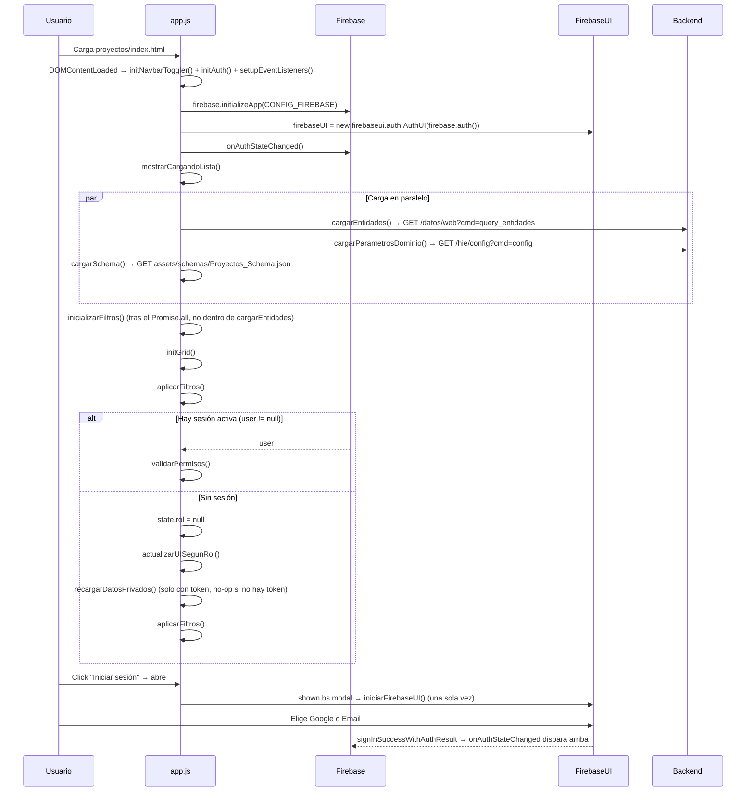
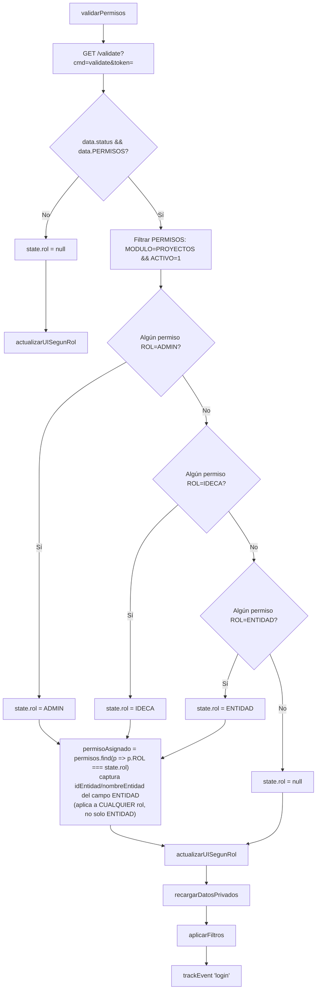
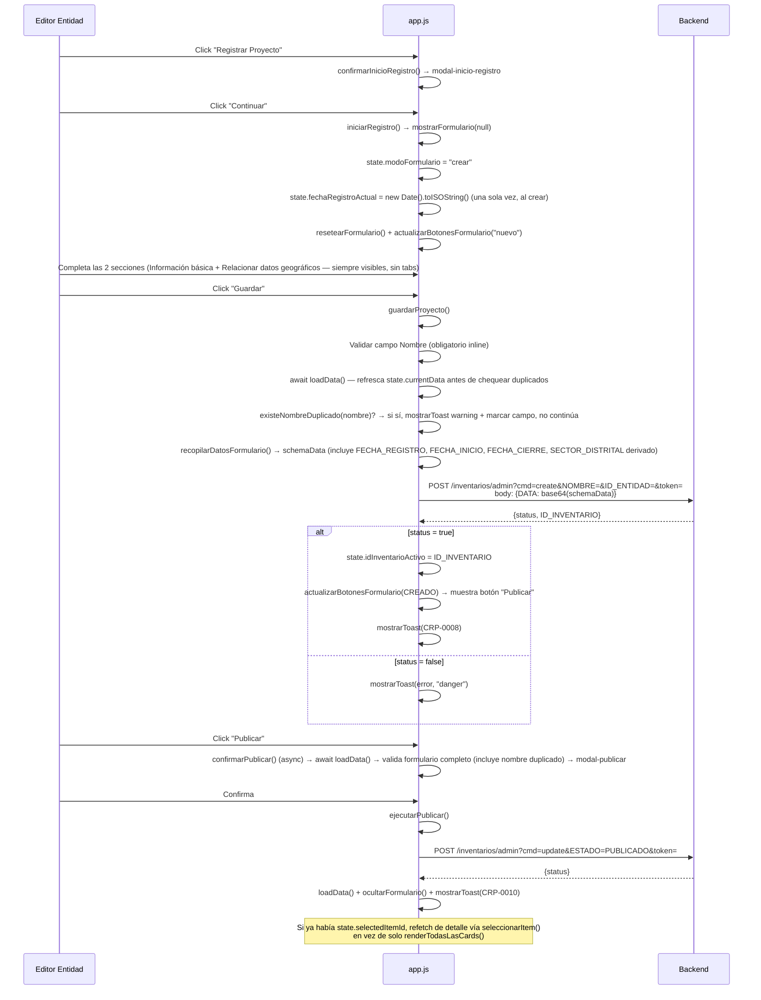
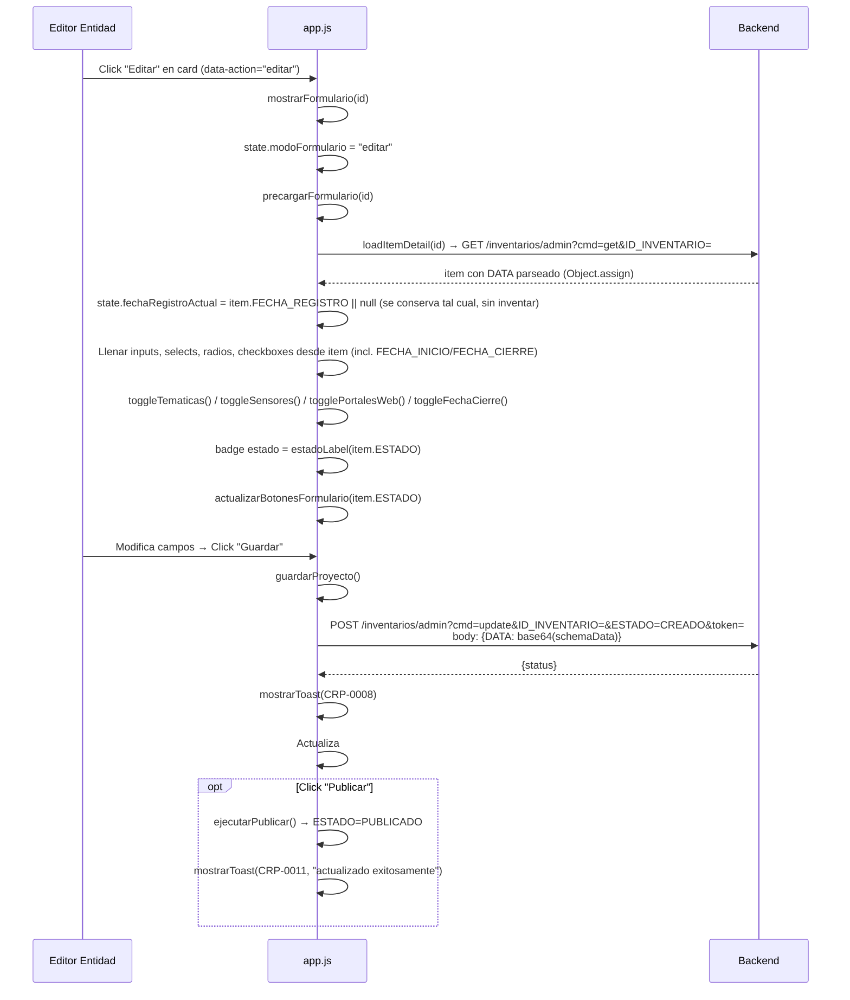
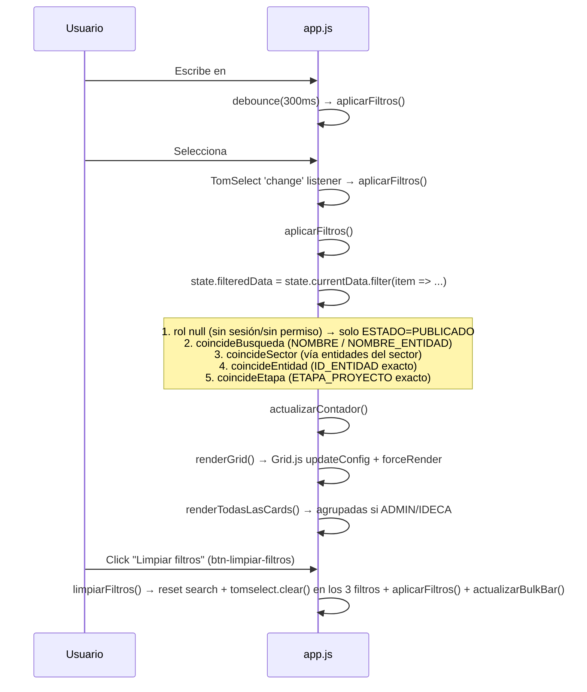
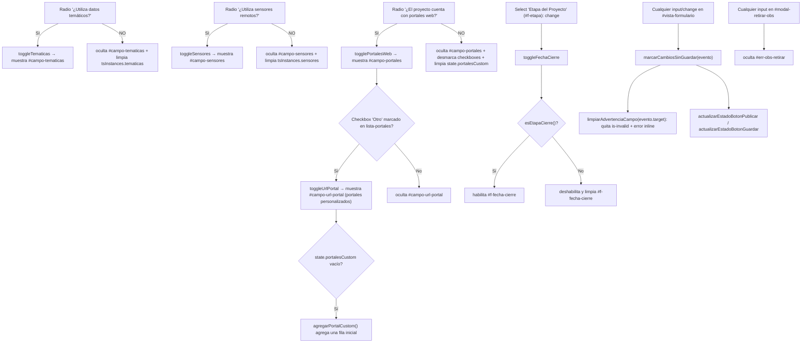

# Documentación Técnica: Módulo Proyectos (Gestión de Proyectos Geográficos)

## Propósito
Módulo de consulta pública y gestión privada del inventario de proyectos geográficos de las entidades del Distrito, dentro del Catálogo de Recursos IDECA. Permite registrar, editar, publicar, retirar, reactivar, eliminar y exportar (CSV/PDF) proyectos. Acceso de consulta libre para usuarios sin sesión o sin permiso (solo ítems `PUBLICADO`); acceso de gestión según permiso `MODULO=PROYECTOS` con roles `ENTIDAD`, `ADMIN` o `IDECA`.

---

## Arquitectura de Referencia

### Stack Tecnológico
| Tecnología | Versión | Propósito |
|------------|---------|-----------|
| Vanilla JS | ES6+ | Lógica de aplicación (módulo IIFE-less con objeto `state` global) |
| Bootstrap 5 | 5.3.0 | Layout, modales, tooltips, formularios (**ya no usa `bootstrap.Tab`** — el formulario dejó de tener pestañas) |
| Bootstrap Icons | 1.11.3 | Cargado vía CDN, **sin uso** (ver Código Muerto) |
| Font Awesome 6 Free | 6.5.0 | Iconografía (`fa-solid`) |
| Grid.js | (última `dist`, sin pin de versión) | Grid de la lista de resultados (columna Nombre con celda HTML custom) |
| TomSelect | 2.5.1 | Multi-dropdown con checkboxes (plugins `checkbox_options` + `remove_button`), usado para Temáticas, Sensores remotos, Entidades involucradas, los 3 selects de filtro y el select `f-etapa` del formulario |
| Firebase Auth (compat) | 12.15.0 | Identity provider |
| FirebaseUI Auth | 6.1.0 | Widget de login (Google + Email) montado dentro de `#modal-login` |
| Google Analytics 4 (gtag) | — | Tracking de eventos (`trackEvent`) |

### Archivos del módulo

| Archivo | Líneas | Rol |
|---------|--------|-----|
| `proyectos/index.html` | 660 | HTML: banner, filtros (ocultos mientras el formulario está abierto), vista-consulta (lista + detalle), vista-formulario en **vista única con 2 secciones apiladas** (`.form-container` > `.form-section` × 2, sin tabs) + barra sticky `.form-toolbar`, modales (login, inicio-registro, publicar, retirar, eliminar), vista-pdf |
| `proyectos/js/config.js` | 223 | `CONFIG_FIREBASE`, objeto `API` (builder de URLs), `FIELD_MAP`, `ROL`, `ESTADO`, `state` (estado global mutable) |
| `proyectos/js/utils.js` | 119 | Utilidades puras y transversales: `buildBody`, `fetchWithRetry`, `debounce`, `formatFecha`, `formatMesAnio`, `trackEvent`, `mostrarToast`, `ocultarToast` |
| `proyectos/js/app.js` | 3530 | Lógica de aplicación: auth (Firebase + FirebaseUI), filtros, render, formulario, validación (incluye nombre único por entidad), CRUD, paginación real del listado, exportación, offset sticky |
| `proyectos/css/fonts.css` | 18 | `@font-face` de Nunito Sans (compartido con el resto de módulos) |
| `proyectos/css/layout.css` | 146 | gov-bar, navbar, breadcrumb-hero y footer — layout compartido entre módulos |
| `proyectos/css/auth-modal.css` | 45 | Overrides de FirebaseUI del modal de login |
| `proyectos/css/estilos.css` | 339 | Estilos propios del módulo (filtros, lista, cards, formulario: `.form-toolbar`/`.form-container`/`.form-section-title`/`.info-value-texto`, PDF) |
| `proyectos/css/view-transitions.css` | 35 | Animación `@view-transition` entre módulos (Chrome/Edge 126+, Safari 18.2+) |
| `proyectos/assets/schemas/Proyectos_Schema.json` | 140 | JSON Schema del payload de proyecto (campos, validaciones, tooltips) |

**Nota:** `FIELD_MAP` (mapeo campo del schema → elemento HTML) vive ahora en `config.js` (L142-172), no en `app.js` como en una versión anterior — se agrupó junto a `API`, `ROL`, `ESTADO` y `state` porque es, en esencia, más configuración estática que lógica de aplicación.

### Dependencias CDN (orden en index.html)
```
Google Analytics 4 (G-NE8B8LP8Y6)
Bootstrap 5.3.0 CSS
Bootstrap Icons 1.11.3 CSS
Font Awesome 6.5.0 CSS
Grid.js theme "mermaid" CSS
TomSelect 2.5.1 CSS (tema bootstrap5)
FirebaseUI Auth 6.1.0 CSS
→ proyectos/css/fonts.css
→ proyectos/css/layout.css
→ proyectos/css/auth-modal.css
→ proyectos/css/estilos.css
→ proyectos/css/view-transitions.css

Bootstrap Bundle 5.3.0 JS
Grid.js UMD
TomSelect 2.5.1 JS (complete)
Firebase App Compat 12.15.0
Firebase Auth Compat 12.15.0
FirebaseUI Auth 6.1.0 JS (es_419)
→ js/config.js
→ js/utils.js
→ js/app.js
```

**Nota:** este módulo no carga GSAP. Tampoco carga jQuery ni DataTables — usa Grid.js en su lugar. Carga **TomSelect** para prácticamente todos los selects del módulo (temáticas, sensores, entidades involucradas, los 3 filtros y `f-etapa` del formulario) y **FirebaseUI** para el flujo de login, montado dentro de `#modal-login` la primera vez que se abre (`iniciarFirebaseUI()`, invocada perezosamente en el evento `shown.bs.modal`).

---

## Análisis Funcional

### Variables globales (config.js / app.js)

```javascript
// config.js L12-137: Objeto API — builder de URLs, ningún estado, solo funciones puras
const API = {
  BASE: "https://catalogopmb.catastrobogota.gov.co/PMBWeb/cr",
  TIPO: "PROYECTOS",
  listar, obtener, listarAdmin, obtenerAdmin,
  crear, actualizar, retirar, entidades, config, validate,
};

// app.js: state.portalesWeb se carga en runtime desde el backend
// (cargarParametrosDominio(), L469-498) a partir de enums.proy_portalesweb,
// y se renderiza dinámicamente vía renderPortalesCheckboxes() (L747-788).
state.portalesWeb = enums.proy_portalesweb || [];

// config.js L142-172: Mapeo campo del schema → elemento HTML del formulario.
// SECTOR_DISTRITAL ya NO está aquí (ver más abajo, se deriva automáticamente).
const FIELD_MAP = {
  NOMBRE: { id: "f-nombre", err: "err-nombre", type: "text" },
  DESCRIPCION: { id: "f-descripcion", err: "err-descripcion", type: "text" },
  DEPENDENCIAS_ENTIDAD: { id: "f-dependencias", err: "err-dependencias", type: "text" },
  ETAPA_PROYECTO: { id: "f-etapa", err: "err-etapa", type: "select" },
  FECHA_INICIO: { id: "f-fecha-inicio", err: "err-fecha-inicio", type: "text" },
  ENTIDADES_INVOLUCRADAS: { id: "f-entidades-involucradas", err: "err-entidades-involucradas", type: "multiselect" },
  DATOS_REFERENCIA: { id: "f-referencia", err: "err-referencia", type: "radio" },
  RESULTADOS_ESPERADOS: { id: "f-resultados", err: "err-resultados", type: "text" },
  OBSERVACIONES: { id: "f-observaciones", err: "err-observaciones", type: "text" },
};

// config.js L177-181: Roles soportados por el módulo (los 3 únicos roles de negocio asignables desde Admin)
const ROL = { ENTIDAD: "ENTIDAD", ADMIN: "ADMIN", IDECA: "IDECA" };

// config.js L183-188: Estados del ciclo de vida del proyecto
const ESTADO = { CREADO: "CREADO", BORRADOR: "BORRADOR", PUBLICADO: "PUBLICADO", RETIRADO: "RETIRADO" };

// config.js L193-218: Estado global mutable de toda la aplicación (un solo objeto, sin store externo)
const state = {
  currentData: [], filteredData: [],
  selectedItemId: null, selectedItem: null,

  usuario: null, rol: null, idEntidad: null, nombreEntidad: "",

  modoFormulario: null, idInventarioActivo: null,
  sinCambiosDesdeGuardado: false, fechaRegistroActual: null,

  etapasProyecto: [], sectores: [], entidades: [], tematicas: [], sensoresRemotos: [],

  grid: null, selectedIds: new Set(),
  portalesCustom: [],
};
// state.schema, state.portalesWeb, state.autoSeleccionPendiente y state.esBorradorActual
// se agregan dinámicamente en runtime (cargarSchema() / cargarParametrosDominio() /
// renderGrid() / actualizarBotonesFormulario()), igual que se documenta más abajo.

// app.js L492: registro de instancias TomSelect del formulario y de los filtros
// (tematicas, sensores, entidades). No vive dentro de `state` — es un objeto
// módulo-nivel independiente.
const tsInstances = {};

// app.js L354: registro de contadores de caracteres montados por campo (fieldId -> {el, contador, maxLength}).
// Tampoco vive dentro de `state`.
const CONTADORES_CARACTERES = {};

// app.js L2285-2296: grupos radio SI/NO de UI que exigen una opción marcada, con su
// contenedor de error inline (temáticos, sensores, portales web).
const RADIOS_UI = [ /* f-tematicos, f-sensores, f-portales-web */ ];

// app.js L2328-2361: grupos radio SI/NO que exigen al menos una selección en su control
// asociado (TomSelect de temáticas/sensores, o checkboxes de portales web).
const CAMPOS_CONDICIONALES = [ /* f-tematicos, f-sensores, f-portales-web */ ];
```

**Nota importante:** `state.schema` se asigna dinámicamente en `cargarSchema()` (L342-359) pero no está declarado en el literal inicial de `state` (config.js L193-218) — es una propiedad añadida en caliente. Es un patrón poco explícito: cualquier lectura de `state.schema` antes de que resuelva el `fetch` es `undefined` (mitigado porque `validarFormulario()` retorna `true` si `!state.schema`, ver Puntos de Mejora). El mismo patrón se repite con `state.autoSeleccionPendiente`, asignado en `renderGrid()` (L1064-1090) y consumido en `renderTodasLasCards()` (L1159-1198) para disparar la carga automática del detalle del ítem auto-seleccionado, y con `state.esBorradorActual`, asignado en `actualizarBotonesFormulario()` (L1859-1869) y consumido en `sincronizarBotonesFormulario()` (L1870-1880, renombrada — antes `sincronizarBotonesPorTab()`).

**Nota:** `state` ya no guarda `token` como propiedad cacheada (a diferencia de una versión anterior). El token se obtiene bajo demanda con `state.usuario.getIdToken()` en cada función que lo necesita (Firebase cachea/renueva internamente), en vez de guardarse una sola vez tras el login.

### Estructuras de datos clave

**`Proyectos_Schema.json`** (140 líneas) — define el contrato de datos del formulario. Se descarga en runtime (`cargarSchema()`, L342-359) y se usa para dos propósitos:
1. Generar tooltips de ayuda inline (`aplicarTooltipsDesdeSchema()`, L418-468) sobre los íconos `<i data-schema-field="CAMPO">`.
2. Alimentar la validación dinámica (`validarFormulario()`, L2491-2530) vía `FIELD_MAP` + `state.schema.required` + `state.schema.properties[campo].minLength/maxLength`.

Campos del schema (`properties`): `FECHA_REGISTRO` (estampada client-side, ver más abajo), `NOMBRE` (maxLength 200), `DESCRIPCION` (max 1000), `DEPENDENCIAS_ENTIDAD`, `ETAPA_PROYECTO`, `FECHA_INICIO` (formato `"month"`, obligatorio), `FECHA_CIERRE` (formato `"month"`, condicional a `ETAPA_PROYECTO === "Cierre"`), `SECTOR_DISTRITAL` (CSV, derivado automáticamente — no tiene campo propio en el formulario), `ENTIDADES_INVOLUCRADAS` (CSV de IDs), `URL_ACCESO` (opcional), `DATOS_REFERENCIA` (enum SI/NO), `DATOS_TEMATICOS` (enum SI/NO), `TEMATICAS` (CSV de IDs), `DATOS_SENSORES` (enum SI/NO), `SENSORES_REMOTOS` (CSV de IDs), `DATOS_PORTALES` (enum SI/NO), `PORTALES_WEB` (CSV de nombres, cada entrada puede venir en markdown `[Nombre](url)`), `RESULTADOS_ESPERADOS` (max 1000), `OBSERVACIONES` (max 1000), `OBSERVACIONES_RETIRO` (max 1000, no está en `required`, se agrega solo en `ejecutarRetirar()`).

`required`: `NOMBRE, DESCRIPCION, DEPENDENCIAS_ENTIDAD, ETAPA_PROYECTO, FECHA_INICIO, SECTOR_DISTRITAL, ENTIDADES_INVOLUCRADAS, DATOS_REFERENCIA, DATOS_TEMATICOS, DATOS_SENSORES, DATOS_PORTALES, RESULTADOS_ESPERADOS`.

**`DATOS_TEMATICOS` / `DATOS_SENSORES` / `DATOS_PORTALES`**: tres campos booleanos (enum SI/NO) agregados al schema replicando el patrón que ya existía en `aplicaciones` para distinguir "el usuario respondió No" de "nunca se contestó esta pregunta" — antes de esto, la respuesta se inferí­a por la longitud del array de `TEMATICAS`/`SENSORES_REMOTOS`/`PORTALES_WEB`, así que un "No" explícito no quedaba guardado ni se mostraba en el detalle. `construirCamposBaseCard()` (L1350-1381) y `renderPortalesWebCard()` (L1272-1309) muestran "No" en la card cuando el campo correspondiente vale `"NO"`.

**`buildBody(datos)`** (utils.js L9-16) — codifica el payload como `{ DATA: btoa(unescape(encodeURIComponent(JSON.stringify(filtrado)))) }`, filtrando `undefined/null/""`. Este es el formato de body que consume el backend en `create`, `update` y `delete` (retiro con observaciones).

**`extraerDatosSchema(item)`** (app.js L2716-2753) — extrae de un detalle completo (`loadItemDetail()`) los mismos campos que produce `recopilarDatosFormulario()`. El backend reemplaza el blob `DATA` completo en cada `update` (no hace merge), así que cualquier operación que cambie `ESTADO` sin pasar por el formulario (`ejecutarRetirar`, `ejecutarReactivar`) debe reenviar el `DATA` completo con esta función para no perder los datos ya guardados del proyecto.

### Inventario completo de funciones

| # | Función | Archivo | Líneas | Tipo |
|---|---------|---------|--------|------|
| 1 | `buildBody(datos)` | utils.js | 9-16 | Utilidad |
| 2 | `fetchWithRetry(url, retries)` | utils.js | 27-35 | API/Utilidad |
| 3 | `debounce(fn, delay)` | utils.js | 43-49 | Utilidad |
| 4 | `formatFecha(str)` | utils.js | 56-65 | Utilidad/Formato |
| 5 | `formatMesAnio(str)` | utils.js | 75-83 | Utilidad/Formato (nuevo). Formatea un valor "AAAA-MM" armando la fecha con año/mes explícitos (no `new Date(str)`) para evitar que el parseo UTC de fechas parciales ISO corra un mes hacia atrás en Colombia (UTC-5) |
| 6 | `trackEvent(nombre, params)` | utils.js | 90-93 | GA4 Analytics |
| 7 | `mostrarToast(mensaje, tipo)` | utils.js | 103-112 | UI |
| 8 | `ocultarToast()` | utils.js | 117-119 | UI |
| 9 | `estadoBadgeClass(estado)` | app.js | 11-24 | UI/Formato |
| 10 | `estadoLabel(estado)` | app.js | 25-43 | UI/Formato |
| 11 | `initAuth()` | app.js | 44-77 | Auth |
| 12 | `iniciarFirebaseUI()` | app.js | 78-101 | Auth (nuevo). Inicia FirebaseUI dentro de `#firebaseui-auth-container` la primera vez que se abre `#modal-login` (perezoso, guardado por `firebaseUIIniciado`) |
| 13 | `validarPermisos()` | app.js | 102-150 | Auth/Autorización → backend |
| 14 | `recargarDatosPrivados()` | app.js | 151-173 | Data loading. Pagina todo el listado vía `fetchTodosLosItems()` (ver fila 15-bis). Si ya había un ítem seleccionado, tras recargar el listado (datos mínimos) vuelve a pedir el detalle completo vía `seleccionarItem()` en vez de solo re-renderizar cards |
| 15 | `actualizarUISegunRol()` | app.js | 174-232 | UI. Ya no delega en `setBannerDosLineas` (eliminada): escribe directo sobre `#texto-nombre-usuario` y `#texto-rol-usuario`, más la foto de perfil (`#foto-usuario-header`) y los botones login/logout |
| 16 | `normalizarLista(valor)` | app.js | 233-242 | Utilidad — **nueva** (limpieza DRY). Normaliza un campo que puede llegar como array o como string CSV (según venga ya parseado o crudo) a un array de strings recortados; reemplaza 2 sitios que repetían el mismo patrón `Array.isArray(x) ? x : x.split(",")` para `item.PORTALES_WEB` (`renderPortalesWebCard()` y `verPDF()`) |
| 17 | `ordenarPorNombre(items)` | app.js | 243-259 | Utilidad — **nueva** (limpieza DRY). Ordena por `NOMBRE` (localeCompare es-CO); extraída porque `loadData()` y `recargarDatosPrivados()` repetían el mismo comparador inline |
| 18 | `fetchTodosLosItems(token)` | app.js | 260-288 | Data loading — **nueva**. El endpoint es tipo DataTables (`start`/`length`, tope de 1000 por página); pagina en loop hasta agotar `recordsTotal`, para no perder registros más allá del primer lote. Único punto de acceso a `API.listar`/`API.listarAdmin` |
| 19 | `loadData()` | app.js | 289-304 | API/Data loading — delega la paginación a `fetchTodosLosItems()` |
| 20 | `refrescarListadoSilencioso()` | app.js | 305-320 | Data loading — **nueva** (limpieza DRY). Envuelve `await loadData()` en `try/catch` best-effort; extraída porque `guardarProyecto()` y `confirmarPublicar()` repetían el mismo bloque antes de chequear nombre duplicado |
| 21 | `loadItemDetail(id)` | app.js | 321-341 | API/Data loading |
| 22 | `cargarSchema()` | app.js | 342-359 | API/Config |
| 23 | `inicializarContadoresCaracteres()` | app.js | 360-377 | Form/UI |
| 24 | `montarContadorCaracteres(fieldId, maxLength)` | app.js | 378-394 | Form/UI |
| 25 | `actualizarContadorCaracteres(fieldId)` | app.js | 395-410 | Form/UI |
| 26 | `actualizarTodosLosContadoresCaracteres()` | app.js | 411-417 | Form/UI |
| 27 | `aplicarTooltipsDesdeSchema()` | app.js | 418-468 | UI |
| 28 | `cargarParametrosDominio()` | app.js | 469-498 | API/Config |
| 29 | `inicializarTomSelectTematicas()` | app.js | 499-528 | Form/TomSelect |
| 30 | `setTematicasSeleccionadas(tematicas)` | app.js | 529-542 | Form/TomSelect |
| 31 | `separarEtiquetaDescripcion(texto)` | app.js | 543-555 | Utilidad/Formato |
| 32 | `parsePortalWeb(texto)` | app.js | 556-570 | Utilidad/Formato (nuevo). Extrae `{nombre, url}` de un portal en formato markdown `[Nombre](url)` |
| 33 | `formatPortalWeb(nombre, url)` | app.js | 571-579 | Utilidad/Formato (nuevo). Inverso de `parsePortalWeb`: arma el markdown a partir de nombre + url |
| 34 | `esUrlValida(texto)` | app.js | 580-594 | Validación (nuevo). `true` solo si es una URL `https` bien formada |
| 35 | `inicializarTomSelectSensores()` | app.js | 595-647 | Form/TomSelect |
| 36 | `setSensoresSeleccionados(sensores)` | app.js | 648-660 | Form/TomSelect. Ya no recibe un segundo argumento `otroSensor` (campo `OTRO_SENSOR` eliminado del todo) |
| 37 | `cargarEntidades()` | app.js | 661-680 | API/Config |
| 38 | `inicializarTomSelectEntidades()` | app.js | 681-722 | Form/TomSelect (nuevo, reemplaza a `inicializarEntidadesInvolucradas`). Incluye opción `"__todos__"` que selecciona todas las entidades reales |
| 39 | `toggleTodosTomSelect(ts)` | app.js | 723-732 | Form/TomSelect (nuevo, reemplaza a `toggleTodosSelect`). Si `"__todos__"` está seleccionado en un TomSelect, lo reemplaza por todos los valores reales |
| 40 | `setEntidadesSeleccionadas(entidades)` | app.js | 733-746 | Form/TomSelect |
| 41 | `renderPortalesCheckboxes()` | app.js | 747-788 | UI/Render. Cada checkbox institucional guarda el texto completo en `data-text` (no solo el `id` corto) y muestra un ícono de enlace (`fa-arrow-up-right-from-square`) cuando el portal trae URL |
| 42 | `agregarPortalCustom()` | app.js | 789-797 | Form (nuevo). Agrega una fila vacía a `state.portalesCustom` |
| 43 | `eliminarPortalCustom(index)` | app.js | 798-807 | Form (nuevo) |
| 44 | `renderPortalesCustom()` | app.js | 808-862 | UI/Render (nuevo). Renderiza las filas editables de portales personalizados ("Otro"): uno o más, cada uno con nombre + URL propios |
| 45 | `inicializarTomSelectFiltro(id, placeholder)` | app.js | 863-891 | Filtro/TomSelect (nuevo). Envuelve un `<select multiple>` de filtro en TomSelect con checkboxes + tags removibles |
| 46 | `poblarSelect(id, opciones, labelTodos)` | app.js | 892-907 | Filtro |
| 47 | `inicializarFiltros()` | app.js | 908-928 | Filtro |
| 48 | `aplicarFiltros()` | app.js | 929-975 | Filtro |
| 49 | `limpiarFiltros()` | app.js | 976-991 | Filtro |
| 50 | `initGrid()` | app.js | 992-1055 | UI/Render (Grid.js) |
| 51 | `actualizarVisibilidadFooter(container, total)` | app.js | 1056-1063 | UI (nuevo, extraída de `initGrid`/`renderGrid`) |
| 52 | `renderGrid()` | app.js | 1064-1090 | UI/Render |
| 53 | `actualizarContador()` | app.js | 1091-1106 | UI. Además de actualizar el texto `(N)`, deshabilita `#btn-exportar` cuando `state.filteredData.length === 0` |
| 54 | `seleccionarItem(id)` | app.js | 1107-1158 | UI/API |
| 55 | `renderTodasLasCards()` | app.js | 1159-1198 | UI/Render |
| 56 | `renderCardsAgrupadasPorEntidad(items)` | app.js | 1199-1221 | UI/Render |
| 57 | `calcularPermisosCard(item, estado)` | app.js | 1222-1244 | Autorización |
| 58 | `renderAccionesCard(item, permisos)` | app.js | 1245-1271 | UI/Render |
| 59 | `renderPortalesWebCard(item)` | app.js | 1272-1309 | UI/Render. Muestra "No" cuando `item.DATOS_PORTALES === "NO"` |
| 60 | `construirMetaEncabezadoCard(item)` | app.js | 1310-1349 | UI/Render (nuevo). Línea de chips (Entidad/Sector/Dependencias/Etapa) bajo el nombre de la card, replicando el patrón visual de `aplicaciones` con clases propias `item-card-meta*` |
| 61 | `construirCamposBaseCard(item)` | app.js | 1350-1381 | UI/Render. Incluye Fecha de inicio/cierre (`formatMesAnio`), muestra "No" en Temáticas/Sensores cuando corresponde, y cierra con Resultados esperados (texto largo, igual que en inventario) |
| 62 | `renderUrlAccesoCard(item, esExterno)` | app.js | 1382-1401 | UI/Render |
| 63 | `renderCard(item)` | app.js | 1402-1481 | UI/Render. Ya no incluye "Etapa del Proyecto" en el cuerpo (se movió al encabezado vía `construirMetaEncabezadoCard`); agrega "Fecha de registro" (si existe) antes de "Fecha de actualización" |
| 64 | `mostrarCargandoLista()` | app.js | 1482-1496 | UI |
| 65 | `mostrarErrorLista(msg)` | app.js | 1497-1515 | UI |
| 66 | `verPDF(id)` | app.js | 1516-1591 | UI/Exportación |
| 67 | `confirmarInicioRegistro()` | app.js | 1592-1601 | UI Modal |
| 68 | `iniciarRegistro()` | app.js | 1602-1612 | Form |
| 69 | `mostrarFormulario(idInventario)` | app.js | 1613-1648 | Form. **Ya no hay pestañas**: ambas secciones quedan siempre visibles. Oculta `.search-filters-section` mientras el formulario está abierto. Estampa `state.fechaRegistroActual` una sola vez en modo "crear" |
| 70 | `ocultarFormulario()` | app.js | 1649-1662 | Form. Restaura `.search-filters-section` |
| 71 | `descartarCambios()` | app.js | 1663-1673 | Form |
| 72 | `refrescarListado()` | app.js | 1674-1689 | Data loading |
| 73 | `precargarFormulario(id)` | app.js | 1690-1745 | Form/API. Precarga `FECHA_INICIO`/`FECHA_CIERRE`, toma `FECHA_REGISTRO` tal cual del registro |
| 74 | `precargarPortales(portales)` | app.js | 1746-1779 | Form. Matchea checkboxes contra `dataset.text` (antes contra `value`, por eso nunca coincidía con el markdown completo) |
| 75 | `resetearFormulario()` | app.js | 1780-1858 | Form. **Fix**: ahora también quita `is-invalid` del select `#f-etapa` y del multiselect `#f-entidades-involucradas` (y de sus wrappers TomSelect), y limpia `err-etapa`/`err-entidades-involucradas` — antes solo se llamaba `.tomselect.clear()` (limpia el valor, no el estado visual de error), así que el borde rojo quedaba "pegado" tras la primera validación fallida aunque se cerrara y reabriera el formulario |
| 76 | `actualizarBotonesFormulario(estado)` | app.js | 1859-1869 | Form/UI |
| 77 | `sincronizarBotonesFormulario()` | app.js | 1870-1880 | Form/UI. **Renombrada** (antes `sincronizarBotonesPorTab()`, ya no depende de pestañas). Solo decide si "Publicar" es visible, según `state.esBorradorActual` |
| 78 | `actualizarEstadoBotonPublicar()` | app.js | 1881-1889 | Form/UI |
| 79 | `actualizarEstadoBotonGuardar()` | app.js | 1890-1913 | Form/UI. **Ya no usa `disabled` real** (bloqueaba el hover del tooltip); aplica `.btn-restringido` + controla un `bootstrap.Tooltip` (`.enable()`/`.disable()`/`.hide()`) con el texto "Ingresa el nombre para poder guardar" |
| 80 | `marcarCambiosSinGuardar(evento)` | app.js | 1914-1925 | Form/UI |
| 81 | `limpiarAdvertenciaCampo(el)` | app.js | 1926-1964 | Form/UI |
| 82 | `setSelectValue(id, value)` | app.js | 1965-1980 | Form/Helper |
| 83 | `setRadio(name, value)` | app.js | 1981-1990 | Form/Helper |
| 84 | `popularSelectFormulario(id, opciones)` | app.js | 1991-2007 | Form/Helper |
| 85 | `inicializarTomSelectSelectFormulario(id)` | app.js | 2008-2027 | Form/TomSelect (nuevo). Envuelve un select de valor único del formulario (`f-etapa`) en TomSelect |
| 86 | `resolverEnumTexto(lista, valor)` | app.js | 2028-2042 | Utilidad |
| 87 | `resolverEnumLista(lista, valores)` | app.js | 2043-2052 | Utilidad |
| 88 | `toggleTematicas()` | app.js | 2053-2064 | Form/UI condicional |
| 89 | `toggleSensores()` | app.js | 2065-2076 | Form/UI condicional |
| 90 | `togglePortalesWeb()` | app.js | 2077-2099 | Form/UI condicional. Al pasar a "No" ahora limpia los checkboxes institucionales y `state.portalesCustom` (antes no limpiaba nada) |
| 91 | `esEtapaCierre()` | app.js | 2100-2109 | Utilidad/Form condicional (nuevo). Compara el texto visible de la opción seleccionada de `f-etapa` contra "cierre" |
| 92 | `toggleFechaCierre()` | app.js | 2110-2131 | Form/UI condicional (nuevo). Habilita `f-fecha-cierre` solo si la etapa es "Cierre"; si no, la deshabilita y limpia su valor |
| 93 | `validarFechaCierre(silent)` | app.js | 2132-2150 | Validación (nuevo). Obligatoria solo si la etapa es "Cierre"; vive fuera de `FIELD_MAP` porque depende de otro campo |
| 94 | `toggleUrlPortal()` | app.js | 2151-2171 | Form/UI condicional |
| 95 | `validarCampoTexto(map, prop, isRequired, silent)` | app.js | 2172-2204 | Validación |
| 96 | `validarCampoSelect(map, prop, isRequired, silent)` | app.js | 2205-2231 | Validación |
| 97 | `validarCampoMultiselect(map, prop, isRequired, silent)` | app.js | 2232-2262 | Validación |
| 98 | `validarCampoRadio(map, prop, isRequired, silent)` | app.js | 2263-2304 | Validación |
| 99 | `validarRadiosDeUI(silent)` | app.js | 2305-2368 | Validación. Valida el array módulo-nivel `RADIOS_UI` (L2285-2296, temáticos/sensores/portales) |
| 100 | `validarSeleccionCondicional(c, silent)` | app.js | 2369-2390 | Validación |
| 101 | `validarUrlPortalOtro(silent)` | app.js | 2391-2454 | Validación |
| 102 | `existeNombreDuplicado(nombre)` | app.js | 2455-2469 | Validación — **nueva**. Regla de negocio: dos proyectos no pueden compartir `NOMBRE` (normalizado) dentro de la misma entidad. Compara contra `state.currentData` filtrando por `ID_ENTIDAD === state.idEntidad`, excluyendo `state.idInventarioActivo`. *Best-effort* en cliente, no hay unicidad atómica en backend |
| 103 | `validarNombreDuplicado(silent)` | app.js | 2470-2490 | Validación — envuelve `existeNombreDuplicado()` marcando `is-invalid` + `err-nombre`; invocada desde `validarFormulario()` |
| 104 | `validarFormulario(silent)` | app.js | 2491-2530 | Validación. Incluye `validarUrlPortalOtro()`, `validarFechaCierre()` y **`validarNombreDuplicado(silent)`** |
| 105 | `guardarProyecto()` | app.js | 2531-2646 | API/CRUD. Antes de chequear duplicados hace `await loadData()` (best-effort) para refrescar `state.currentData` justo al guardar |
| 106 | `recopilarDatosFormulario()` | app.js | 2647-2715 | Form. Arma `PORTALES_WEB` combinando checkboxes institucionales (leídos vía `dataset.text`) + portales personalizados en markdown |
| 107 | `extraerDatosSchema(item)` | app.js | 2716-2753 | Form/API (nuevo, ver Estructuras de datos clave) |
| 108 | `confirmarPublicar()` | app.js | 2754-2772 | UI Modal. Ahora `async`: `await loadData()` (refresca listado) antes de `validarFormulario()` |
| 109 | `ejecutarPublicar()` | app.js | 2773-2833 | API/CRUD. Tras publicar y recargar con `loadData()`, si ya había un ítem seleccionado vuelve a pedir su detalle completo vía `seleccionarItem()` en vez de solo re-renderizar cards |
| 110 | `abrirModalEliminar()` | app.js | 2834-2849 | UI Modal |
| 111 | `ejecutarEliminar()` | app.js | 2850-2893 | API/CRUD. Si el/los ID(s) eliminados incluyen al `state.selectedItemId` actual, lo limpia a `null` antes de `renderGrid()` para no dejar una selección fantasma |
| 112 | `eliminarSeleccionados()` | app.js | 2894-2906 | UI |
| 113 | `idsObjetivo()` | app.js | 2907-2918 | Utilidad — **nueva** (limpieza DRY). Resuelve sobre qué IDs debe operar una acción masiva: la selección múltiple (`state.selectedIds`) si hay algo marcado, o `state.idInventarioActivo` como fallback (acción sobre una sola card). Reemplaza el mismo ternario que antes estaba copiado 3 veces en `ejecutarEliminar()`/`ejecutarRetirar()`/`ejecutarReactivar()` |
| 114 | `toggleSeleccion(id)` | app.js | 2919-2932 | UI/Bulk |
| 115 | `limpiarSeleccion()` | app.js | 2933-2941 | UI/Bulk |
| 116 | `actualizarCheckboxes()` | app.js | 2942-2950 | UI/Bulk |
| 117 | `actualizarBulkBar()` | app.js | 2951-2978 | UI/Bulk |
| 118 | `abrirModalRetirar()` | app.js | 2979-3004 | UI Modal |
| 119 | `cambiarEstadoBatch(ids, nuevoEstado, extraCampos, mensajes)` | app.js | 3005-3059 | API/CRUD — **nueva** (limpieza DRY + fix de bug). Reemplaza los cuerpos casi idénticos que antes tenían `ejecutarRetirar()` y `ejecutarReactivar()` por separado: por cada id, refetch (`loadItemDetail`) + `extraerDatosSchema()` + `fetch` en paralelo (`Promise.all`), y ahora **sí revisa `data.status` de cada respuesta individual** (`resultados.every(Boolean)`) antes de mostrar éxito — antes ninguna de las dos funciones lo hacía. `mensajes` trae los textos de éxito/error/error de conexión y el nombre del evento de tracking. Se llama "batch" y no "lote" para no chocar con el sentido catastral de "lote" (predio) en este dominio |
| 120 | `ejecutarRetirar()` | app.js | 3060-3085 | API/CRUD. Reenvía `extraerDatosSchema(detalle)` + `OBSERVACIONES_RETIRO` para no perder el resto del `DATA`; si hay `state.selectedItemId` refetch vía `seleccionarItem()` |
| 121 | `ejecutarReactivar()` | app.js | 3086-3103 | API/CRUD. Mismo patrón de refetch que `ejecutarRetirar()` |
| 122 | `retirarSeleccionados()` | app.js | 3104-3112 | UI/Bulk |
| 123 | `reactivarSeleccionados()` | app.js | 3113-3125 | UI/Bulk |
| 124 | `csvEscape(valor)` | app.js | 3126-3133 | Utilidad — **nueva** (limpieza DRY). Envuelve un valor en comillas dobles escapando comillas internas; reemplaza repeticiones inline del mismo `.replace` dentro de `exportarCSV()` |
| 125 | `exportarCSV()` | app.js | 3134-3210 | Exportación. Incluye columnas Fecha de Inicio/Cierre; la columna Portales WEB agrega la URL entre paréntesis junto al nombre |
| 126 | `setupBusquedaListeners()` | app.js | 3211-3237 | Event binding |
| 127 | `setupBotonesGlobalesListeners()` | app.js | 3238-3319 | Event binding. **Ya no incluye `#btn-siguiente` ni el listener `shown.bs.tab` sobre `#form-tabs`** (eliminados junto con las pestañas). Mantiene el listener `shown.bs.modal` sobre `#modal-login` que dispara `iniciarFirebaseUI()` |
| 128 | `setupListaListeners()` | app.js | 3320-3336 | Event binding |
| 129 | `setupDetalleListeners()` | app.js | 3337-3392 | Event binding |
| 130 | `setupTooltips()` | app.js | 3393-3401 | Event binding. Desde esta iteración también inicializa el tooltip estático de `#btn-guardar` ("Ingresa el nombre para poder guardar"), controlado dinámicamente por `actualizarEstadoBotonGuardar()` |
| 131 | `setupFormularioListeners()` | app.js | 3402-3452 | Event binding. Incluye listeners de `f-etapa` (→ `toggleFechaCierre`) y de los portales personalizados (agregar/eliminar/editar fila) |
| 132 | `setupEventListeners()` | app.js | 3453-3464 | Event binding (orquestador) |
| 133 | `initNavbarToggler()` | app.js | 3465-3484 | UI. Alterna el ícono `fa-bars`/`fa-times` del botón hamburguesa del navbar según el estado `shown.bs.collapse`/`hidden.bs.collapse` de `#navbarNav`; invocada al inicio de `DOMContentLoaded` junto con `initAuth()` y `setupEventListeners()` |
| 134 | `ajustarOffsetToolbarFormulario()` | app.js | 3485-3525 | UI — **nueva**. Mide `document.querySelector("nav.navbar").offsetHeight` y lo expone como variable CSS `--form-toolbar-top`, para que `.form-toolbar` (sticky) se ubique justo debajo del navbar (también sticky) sin taparlo ni dejar hueco. Invocada en `DOMContentLoaded` y en cada `resize` |

Adicionalmente el objeto literal `API` (`config.js` L12-137) contiene 10 métodos internos (`listar`, `obtener`, `listarAdmin`, `obtenerAdmin`, `crear`, `actualizar`, `retirar`, `entidades`, `config`, `validate`), no listados como funciones top-level pero documentados en la sección de URLs de API.

**Nota:** el módulo tiene **134 funciones top-level** (126 en `app.js` + 8 en `utils.js`). Iteración anterior (histórico): funciones nuevas `iniciarFirebaseUI`, `parsePortalWeb`, `formatPortalWeb`, `esUrlValida`, `inicializarTomSelectEntidades`, `toggleTodosTomSelect`, `agregarPortalCustom`, `eliminarPortalCustom`, `renderPortalesCustom`, `inicializarTomSelectFiltro`, `actualizarVisibilidadFooter`, `construirMetaEncabezadoCard`, `inicializarTomSelectSelectFormulario`, `esEtapaCierre`, `toggleFechaCierre`, `validarFechaCierre`, `extraerDatosSchema`, `actualizarEstadoBotonGuardar`, `initNavbarToggler` y `formatMesAnio` (en `utils.js`); funciones eliminadas: `setBannerDosLineas` (el banner ahora se escribe directo desde `actualizarUISegunRol`), `poblarSectorFormulario` y el select `f-sector` del formulario (`SECTOR_DISTRITAL` ahora se deriva automáticamente de `state.idEntidad`, ver Notas para el Mantenedor), `inicializarEntidadesInvolucradas` (reemplazada por `inicializarTomSelectEntidades`), `poblarFiltroAnio` y el filtro `#filter-anio` (**eliminados por completo**), `toggleTodosSelect` (reemplazada por `toggleTodosTomSelect`), `setMultipleSelect` y `toggleOtroSensorCheckbox` (el campo `OTRO_SENSOR` se eliminó del todo). Esta revisión (limpieza DRY) agregó `normalizarLista`, `ordenarPorNombre`, `refrescarListadoSilencioso`, `idsObjetivo`, `cambiarEstadoBatch` y `csvEscape` — puramente extractivas, sin comportamiento nuevo salvo el fix de `cambiarEstadoBatch()` (ver nota siguiente). `ejecutarRetirar()`/`ejecutarReactivar()` mantienen sus nombres y firma pero ahora son wrappers delgados sobre `cambiarEstadoBatch()`.

> **Bug corregido (esta revisión) en `setupDetalleListeners()`:** hacer clic en cualquier parte de una card de detalle ya seleccionada volvía a disparar `seleccionarItem()` — y por lo tanto un GET redundante a `loadItemDetail` — incluso si el ítem ya estaba abierto. `setupDetalleListeners()` ahora compara `card.dataset.cardId` contra `state.selectedItemId` antes de re-consultar, y solo llama a `seleccionarItem()` cuando son distintos. El mismo fix se aplicó en `aplicaciones/js/app.js` y `servicios/js/app.js`.

> **Bug corregido (esta revisión) en `ejecutarRetirar()`/`ejecutarReactivar()`:** ninguna de las dos revisaba el `data.status` de cada respuesta individual del `Promise.all()` (a diferencia de `ejecutarEliminar()`, que sí lo hacía con `resultados.every(Boolean)`). Si el backend rechazaba uno de varios IDs en una acción masiva, el usuario veía igual el toast de éxito genérico para todos. Al fusionar ambas funciones en el helper compartido `cambiarEstadoBatch()` (fila 119) se corrigió también este bug. El mismo fix se aplicó en `aplicaciones/js/app.js` y `servicios/js/app.js`.

> **Limpieza DRY (esta revisión):** se extrajeron 6 funciones para eliminar lógica duplicada dentro de `app.js`: `normalizarLista()`, `ordenarPorNombre()`, `refrescarListadoSilencioso()`, `idsObjetivo()`, `cambiarEstadoBatch()` y `csvEscape()`. Se eliminaron además 4 propiedades muertas de `state` en `config.js` (`tsFilterSector`/`tsFilterEntidad`/`tsFilterEtapa`/`tsEntidadesInvolucradas` — ver "Código Muerto"). Ninguno de estos cambios altera comportamiento visible salvo el fix de `cambiarEstadoBatch()` descrito arriba. El mismo refactor se replicó en `aplicaciones/js/app.js` y `servicios/js/app.js`.

### Funcionalidades

1. **Auth**: Firebase Auth + FirebaseUI (Google + Email) montado en `#modal-login`, validado contra backend vía `validarPermisos()`, que deriva rol (`ENTIDAD`/`ADMIN`/`IDECA`/`null`) y ajusta la UI del navbar (foto, nombre + entidad, rol, botones login/logout). La entidad (`state.idEntidad`/`state.nombreEntidad`, campo `ENTIDAD` de la fila de `PERMISOS`) se captura para **cualquier** rol asignado, no solo `ENTIDAD`.
2. **Consulta pública**: usuarios sin sesión solo ven proyectos `PUBLICADO` (filtro aplicado en `aplicarFiltros()`).
3. **Grid.js**: lista izquierda paginada (20/página), celda "Nombre" con HTML custom (badge de estado + checkbox bulk si `ADMIN`).
4. **Cards de detalle**: panel derecho con tarjetas completas por proyecto, agrupadas por entidad si el rol es `ADMIN`/`IDECA`. El encabezado de cada card muestra una línea de chips (Entidad/Sector/Dependencias/Etapa del Proyecto) vía `construirMetaEncabezadoCard()`. Al entrar al módulo se auto-selecciona el primer resultado y se dispara automáticamente la carga de su detalle completo (`state.autoSeleccionPendiente` → `seleccionarItem()`), sin requerir clic manual.
5. **Filtros**: búsqueda por texto (nombre/entidad), etapa, sector distrital (oculto para `ENTIDAD`), entidad involucrada — los 3 selects de filtro son TomSelect multi-selección. **No hay filtro de año** (`filter-anio` fue eliminado por completo).
6. **Formulario en vista única con secciones (ya no hay tabs)**: "Información básica" y "Relacionar datos geográficos" quedan siempre visibles, apiladas dentro de `.form-container`, con secciones condicionales internas (temáticas, sensores, portales). Se eliminó el botón **"Siguiente"** y la navegación por pestañas de Bootstrap; `sincronizarBotonesFormulario()` (renombrada, antes `sincronizarBotonesPorTab()`) ahora solo decide si "Publicar" es visible, según si el registro está en borrador. Los botones Descartar/Guardar/Publicar viven en `.form-toolbar`, una barra sticky compartida con "Volver" y el badge de estado. El botón **"Guardar"** ya no usa el atributo `disabled` real cuando falta `NOMBRE`: aplica la clase visual `.btn-restringido` y un `bootstrap.Tooltip` explicativo (controlados por `actualizarEstadoBotonGuardar()`), pero sigue siendo clicable — `guardarProyecto()` valida igual al intentar guardar.
7. **Temáticas, Sensores remotos y Entidades involucradas vía TomSelect**: los tres usan un multi-dropdown TomSelect con checkboxes (`tsInstances.tematicas` / `tsInstances.sensores` / `tsInstances.entidades`). Sensores permite además crear texto libre (`create:true`) para valores no catalogados.
8. **Fecha de inicio y Fecha de cierre**: `FECHA_INICIO` es obligatoria (`<input type="month">`). `FECHA_CIERRE` solo es editable/obligatoria cuando `ETAPA_PROYECTO` es "Cierre" (comparando el texto visible de la opción seleccionada, no su id) — `toggleFechaCierre()` deshabilita y limpia el campo en cualquier otra etapa, para que un cambio posterior de etapa no deje una fecha de cierre obsoleta guardada.
9. **Fecha de registro**: `FECHA_REGISTRO` se estampa 100% cliente (`new Date().toISOString()`) una sola vez al abrir el formulario en modo "crear" (`state.fechaRegistroActual`); en modo "editar" se toma tal cual del registro cargado, sin inventar una fecha si el registro no la tiene. Se muestra como la última fila del detalle de lectura, junto con "Fecha de actualización".
10. **Portales web — institucionales + personalizados**: los portales institucionales (`state.portalesWeb`, cargados de `enums.proy_portalesweb`) se muestran como checkboxes con un ícono de enlace cuando traen URL. La opción "Otro" despliega una lista editable de portales personalizados (`state.portalesCustom`, uno o más, cada uno con nombre + URL propios), reemplazando el antiguo campo único de texto libre.
11. **Contador de caracteres en vivo**: cada campo de texto con `maxLength` en el schema (incluyendo `OBSERVACIONES_RETIRO` en el modal de retiro) muestra un contador dinámico ("N caracteres restantes" / "N caracteres de más", en rojo si excede).
12. **Validación dinámica**: dirigida por el JSON Schema (`Proyectos_Schema.json`) vía `FIELD_MAP`, más las validaciones fuera de schema (`validarRadiosDeUI`, `validarSeleccionCondicional`, `validarUrlPortalOtro`, `validarFechaCierre`). Al editar un campo marcado inválido, `limpiarAdvertenciaCampo()` retira la advertencia visual de inmediato, sin esperar al siguiente intento de guardado.
13. **CRUD completo**: crear (`guardarProyecto`), editar, publicar/republicar (`ejecutarPublicar`), retirar con observaciones obligatorias (`ejecutarRetirar`), reactivar (`ejecutarReactivar`), eliminar (`ejecutarEliminar`). `guardarProyecto()` sincroniza `#form-badge-estado` (texto/clase/visibilidad) inmediatamente después de guardar con éxito.
14. **Bulk actions** (solo `ADMIN`): selección múltiple vía checkboxes → retirar/reactivar/eliminar en lote.
15. **Exportación**: CSV client-side (`exportarCSV`, incluye Fecha de Inicio/Cierre y URL de cada portal) y PDF vía `window.print()` (`verPDF`). El botón `#btn-exportar` se deshabilita automáticamente desde `actualizarContador()` cuando `state.filteredData` está vacío.
16. **Tooltips dinámicos**: íconos de ayuda que muestran la `description` del schema al hacer click.
17. **Refresco del detalle tras cualquier operación de escritura**: `recargarDatosPrivados()`, `ejecutarPublicar()`, `ejecutarRetirar()` y `ejecutarReactivar()` reemplazan `state.currentData` con datos mínimos del listado. Si ya había un ítem seleccionado (`state.selectedItemId`), las cuatro vuelven a llamar `seleccionarItem(state.selectedItemId)` para refetch del detalle completo — antes solo `recargarDatosPrivados()`/`ejecutarPublicar()` lo hacían, y retirar/reactivar dejaban el panel derecho desactualizado hasta el próximo clic manual.
18. **Contador de resultados sincronizado en toda operación de escritura**: `actualizarContador()` se llama también desde `loadData()` (antes solo desde `recargarDatosPrivados()`/`aplicarFiltros()`), así que el contador `(N)` y el estado deshabilitado de `#btn-exportar` quedan correctos tras publicar/retirar/reactivar/eliminar.
19. **Fila de filtros oculta durante crear/editar**: `.search-filters-section` se oculta al abrir el formulario (`mostrarFormulario()`) y se restaura al cerrarlo (`ocultarFormulario()`).
20. **Filtro de Entidad también oculto para Editor Entidad**: `#filter-sector-wrap` ya se ocultaba para este rol; se agregó el mismo tratamiento a `#filter-entidad-wrap` en `actualizarUISegunRol()`, ya que un Editor Entidad solo ve/gestiona los proyectos de su propia entidad.
21. **Validación de nombre único por entidad**: dos proyectos no pueden compartir `NOMBRE` (normalizado) dentro de la misma entidad — ver `existeNombreDuplicado()`/`validarNombreDuplicado()` en la tabla de funciones. Se invoca al hacer clic en "Guardar" y dentro de `validarFormulario()` (para que "Publicar" también la respete). `guardarProyecto()`/`confirmarPublicar()` refrescan `state.currentData` con `await loadData()` justo antes de comparar, para acotar la ventana de datos obsoletos — sigue siendo una verificación *best-effort* en cliente, sin unicidad atómica en el backend.
22. **Paginación real del listado**: el endpoint (`API.listar`/`API.listarAdmin`) es tipo DataTables, limitado a `length=1000` por respuesta. Antes se pedía una sola página y se perdían silenciosamente los registros excedentes; `fetchTodosLosItems(token)` pagina en loop hasta agotar `recordsTotal`.
23. **Detalle de texto largo con comportamiento de textarea**: en el detalle de la card, "Descripción" usa la clase `.info-value-texto` (además de `.info-value`): limita el alto a ~4 líneas con scroll interno y conserva saltos de línea. "URL de acceso" y "Portales WEB" (contienen `<a>`/`<div>` anidados) mantienen el `.info-value` simple — aplicarles `.info-value-texto` rompía el layout del link (indentación/saltos heredados del template HTML).
24. **Fix: bordes rojos "pegados" tras reset del formulario**: `resetearFormulario()` limpiaba el valor de `#f-etapa` (select) y `#f-entidades-involucradas` (multiselect) vía `tomselect.clear()`, pero no quitaba `is-invalid` de sus wrappers TomSelect ni los textos de error — quedaban marcados en rojo indefinidamente tras la primera validación fallida, sin importar cuántas veces se reabriera el formulario. Ver también el mismo fix aplicado a "Tipo" en `aplicaciones` y a "Tipo de servicio"/"Ubicación" en `servicios`.

---

## Diagramas de Flujo (Mermaid)

### Caso de uso 1: Autenticación e inicialización de la aplicación



### Caso de uso 2: validarPermisos → asignación de rol



### Caso de uso 3: Registro de nuevo proyecto



### Caso de uso 4: Edición de proyecto existente



### Caso de uso 5: Retiro (borrado lógico) y reactivación — vía `cambiarEstadoBatch()`

> `ejecutarRetirar()` y `ejecutarReactivar()` son wrappers delgados: arman `ids` (vía `idsObjetivo()`), estado destino, campos extra y textos de mensajes, y delegan toda la mecánica de red en `cambiarEstadoBatch()`. El diagrama muestra el flujo completo de **retiro**; **reactivar** es igual salvo `nuevoEstado = ESTADO.BORRADOR`, sin textarea de observaciones y sin `OBSERVACIONES_RETIRO` en el body.

```mermaid
flowchart TD
    A[Click 'Retirar' individual o bulk] --> B[abrirModalRetirar]
    B --> C[Usuario ingresa observaciones]
    C --> D{Observaciones vacías?}
    D -->|Sí| E[Muestra err-obs-retirar, no cierra modal]
    D -->|No| F[ejecutarRetirar]
    F --> F2["ids = idsObjetivo()"]
    F2 --> F3["cambiarEstadoBatch(ids, ESTADO.RETIRADO,<br/>{OBSERVACIONES_RETIRO: obs}, mensajes)"]
    F3 --> G[Para cada ID: loadItemDetail + extraerDatosSchema]
    G --> H["POST cmd=update ESTADO=RETIRADO<br/>body: DATA base64 con OBSERVACIONES_RETIRO"]
    H --> H2["cada fetch → res.json() → data.status"]
    H2 --> H3{"resultados.every(Boolean)?<br/>(fix: antes no se revisaba)"}
    H3 -->|Todos true| I[mostrarToast 'retirado(s) correctamente']
    H3 -->|Algún false| I2[mostrarToast error, igual limpia selección y refresca]
    I --> J[state.selectedIds.clear + loadData + renderGrid]
    I2 --> J
    J --> J2{state.selectedItemId?}
    J2 -->|Sí| J3[seleccionarItem: refetch de detalle]
    J2 -->|No| J4[renderTodasLasCards]

    K[Click 'Reactivar' individual o bulk] --> L[ejecutarReactivar]
    L --> L2["ids = idsObjetivo()"]
    L2 --> L3["cambiarEstadoBatch(ids, ESTADO.BORRADOR, {}, mensajes)"]
    L3 --> M[Para cada ID: loadItemDetail + extraerDatosSchema]
    M --> N["POST cmd=update ESTADO=BORRADOR<br/>body: DATA base64 con el resto del schema (sin perder datos)"]
    N --> N2["data.status por ítem → resultados.every(Boolean)"]
    N2 --> O[mostrarToast 'reactivado(s). Estado: En Borrador' (o error parcial)]
    O --> J
```

### Caso de uso 6: Búsqueda y filtros combinados



**Nota:** este diagrama ya no incluye `#filter-anio` / `coincideAnio` / `poblarFiltroAnio` — el filtro de año fue eliminado por completo del módulo (ver Puntos de Mejora resueltos e Inventario de funciones).

### Caso de uso 7: Lógica condicional del formulario (tabs y secciones dependientes)



---

## Código Muerto / No Referenciado

### Librerías cargadas sin uso
| Librería | Nota |
|----------|------|
| Bootstrap Icons 1.11.3 | CSS cargado (`index.html` L19), pero no existe ninguna clase `bi-*` en `index.html` ni en `app.js` (verificado con grep). Todo el iconografía usa Font Awesome (`fa-solid`). |

### CSS sin uso
`.checkbox-list` (`css/estilos.css` L183-189) ya no tiene ningún elemento correspondiente en `index.html` — el sistema de checkboxes genérico que estilizaba fue reemplazado por TomSelect (Temáticas/Sensores/Entidades) y por el markup específico de `renderPortalesCheckboxes()`/`renderPortalesCustom()` para portales.

### Assets
No hay assets sin usar: la única carpeta `proyectos/assets/` contiene únicamente `schemas/Proyectos_Schema.json`, que sí se consume (`cargarSchema()`, L342-359).

### Funciones sin uso
Ninguna. Las 134 funciones top-level del módulo (126 en `app.js` + 8 en `utils.js`) están todas invocadas (verificado cruzando cada nombre contra `app.js`, `utils.js` + `index.html`, incluyendo `onclick=`, `onchange=` y `addEventListener` con `data-action`). Las siguientes funciones de versiones anteriores del módulo ya no existen en el código, no son "código muerto" pendiente de limpieza: `setBannerDosLineas`, `poblarSectorFormulario`, `inicializarEntidadesInvolucradas`, `poblarFiltroAnio`, `toggleTodosSelect`, `setMultipleSelect`, `toggleOtroSensorCheckbox` (y, de una migración anterior, `generarCheckboxes`, `setCheckboxes`, `toggleTodosCheckbox`, `onCheckboxChange`).

### Campo `OTRO_SENSOR` eliminado
El campo `OTRO_SENSOR` (schema, formulario y `setSensoresSeleccionados`) se eliminó por completo: era un residuo de antes de habilitar `create:true` en el TomSelect de sensores remotos, que ya permite escribir un valor libre directamente como un tag más del propio TomSelect. Nunca se volvía a escribir tras esa migración, así que dejó de tener sentido mantenerlo.

---

## Puntos de Mejora

> **Nota de actualización:** esta iteración eliminó las pestañas del formulario, agregó validación de nombre único, paginación real del listado y otros cambios que desplazaron líneas en todo `app.js`. Se re-verificaron los números de línea de las funciones y referencias tocadas directamente por estos cambios; citas de línea en prosa muy alejadas de esos puntos pueden tener un pequeño desfase no re-auditado.

### 1. `state.schema` no inicializado en el literal de `state` (CLARIDAD / TYPE SAFETY)
```javascript
// config.js L193-218: no existe `schema: null,` en la declaración
const state = { currentData: [], ... };
// app.js L342-359: se asigna en runtime
async function cargarSchema() {
  const res = await fetch("assets/schemas/Proyectos_Schema.json");
  state.schema = await res.json();
  ...
}
```
Cualquier lector del código no puede saber, mirando solo la declaración de `state`, que existe una propiedad `schema`. Además, `validarFormulario()` (L2491) retorna `true` (formulario "válido") si `state.schema` aún no cargó — esto puede permitir que `guardarProyecto()` envíe datos sin validar si el usuario interactúa muy rápido antes de que resuelva el `fetch` del schema.

### 2. `Promise.all()` no distingue fallos de red parciales dentro de un lote (RESIDUAL)

Esta iteración corrigió la asimetría que tenía este punto antes: `ejecutarRetirar()`/`ejecutarReactivar()` ahora delegan en el helper compartido `cambiarEstadoBatch()` (tabla de funciones, fila 119), que sí revisa `data.status` de cada respuesta individual (`resultados.every(Boolean)`) igual que ya hacía `ejecutarEliminar()` — antes no lo hacían y un fallo parcial del backend (`status: false` en uno de varios IDs) se reportaba como éxito genérico. Lo que **sigue sin resolverse** en las tres funciones (`ejecutarEliminar`, `cambiarEstadoBatch` y por lo tanto `ejecutarRetirar`/`ejecutarReactivar`) es el caso de fallo a nivel de red: un solo `fetch` que *rechace* (conexión caída a mitad del lote, no una respuesta HTTP con `status: false`) sigue abortando todo el `Promise.all()`, sin distinguir cuáles de los N ítems ya se habían procesado con éxito antes del fallo. Resolverlo de verdad requeriría `Promise.allSettled()` para inspeccionar el resultado de cada ítem por separado, incluso cuando la promesa individual rechaza.

### 3. Uso de `alert()` nativo mezclado con el sistema de toasts
`guardarProyecto()` (L2533) usa `alert("Sesión expirada...")` y `exportarCSV()` (L3136) usa `alert("No hay datos para exportar.")`, mientras el resto del módulo usa consistentemente `mostrarToast()`. Rompe la consistencia de UX (el `alert()` bloquea el hilo y tiene estilo de navegador, no del sitio). El `alert()` de `exportarCSV()` es solo un fallback: el botón `#btn-exportar` se deshabilita preventivamente desde `actualizarContador()` cuando no hay resultados, así que en la práctica casi nunca se dispara.

### 4. `SECTOR_DISTRITAL` se deriva de `state.idEntidad`, no de la entidad del proyecto que se está editando
```javascript
// app.js L2681-2683, dentro de recopilarDatosFormulario()
SECTOR_DISTRITAL: state.entidades.find(
  (e) => String(e.id) === String(state.idEntidad),
)?.sector,
```
Este cálculo asume que `state.idEntidad` (la entidad del usuario logueado) siempre coincide con la entidad dueña del proyecto que se está guardando. Hoy eso es cierto porque `calcularPermisosCard()` (L1222-1244) solo permite `puedeEditar` cuando `state.rol === ROL.ENTIDAD` — y un `ENTIDAD` únicamente puede editar/crear proyectos de su propia entidad. Si en el futuro se habilitara que `ADMIN` también pueda crear o editar proyectos de otras entidades, este cálculo quedaría silenciosamente incorrecto (guardaría el sector del admin, no el del proyecto). No hay ninguna validación que lo detecte porque `SECTOR_DISTRITAL` está en `required` del schema pero no está en `FIELD_MAP`, así que `validarFormulario()` nunca lo revisa.

---

## Documentación Adicional

### URLs de API (todas via objeto `API`, base `https://catalogopmb.catastrobogota.gov.co/PMBWeb/cr`)

| Endpoint | Método | Parámetros | Retorno |
|----------|--------|------------|---------|
| `/inventarios/web?cmd=query&TIPO_INVENTARIO=PROYECTOS&...` | GET | `start, length, draw, order[0][column/dir], search[value], SECTOR, ID_ENTIDAD, ETAPA_PROYECTO` | `{status, items: [...]}` |
| `/inventarios/web?cmd=get&TIPO_INVENTARIO=PROYECTOS&ID_INVENTARIO=` | GET | `id` | `{status, item: {..., DATA}}` |
| `/inventarios/admin?cmd=query&TIPO_INVENTARIO=PROYECTOS&token=` | GET | `start, length, draw, order[0][*], token` | `{status, items: [...]}` |
| `/inventarios/admin?cmd=get&TIPO_INVENTARIO=PROYECTOS&ID_INVENTARIO=&token=` | GET | `id, token` | `{status, item: {..., DATA}}` |
| `/inventarios/admin?cmd=create&TIPO_INVENTARIO=PROYECTOS&NOMBRE=&ID_ENTIDAD=&token=` | POST | query: `NOMBRE, ID_ENTIDAD, token` · body: `{DATA: base64(schemaData)}` | `{status, ID_INVENTARIO}` |
| `/inventarios/admin?cmd=update&ID_INVENTARIO=&NOMBRE=&TIPO_INVENTARIO=PROYECTOS&ID_ENTIDAD=&ESTADO=&token=` | POST | query: `ID_INVENTARIO, NOMBRE, ID_ENTIDAD, ESTADO, token` · body: `{DATA: base64(schemaData)}` | `{status}` |
| `/inventarios/admin?cmd=delete&TIPO_INVENTARIO=PROYECTOS&ID_INVENTARIO=&token=` | POST | `id, token` | `{status}` |
| `/datos/web?cmd=query_entidades&query=` | GET | — | `{entidades: [{id, text, sector}]}` |
| `/hie/config?cmd=config` | GET | — | `{ENUMS: {proy_etapa_proyecto, ccTematica, proy_sensores_remotos, proy_portalesweb}}` |
| `/validate?cmd=validate&token=` | GET | `token` | `{status, PERMISOS: [{MODULO, ROL, ACTIVO, ID_ENTIDAD, NOMBRE_ENTIDAD}]}` |

**Nota:** el retiro lógico (`ESTADO=RETIRADO`) y la reactivación (`ESTADO=BORRADOR`) no usan `cmd=delete`; ambos son un `cmd=update` con cambio de `ESTADO`. El único uso real de `API.retirar()` (`cmd=delete`) es en `ejecutarEliminar()` — la eliminación física del registro.

### Estructura del formulario (index.html)

> **Fix (esta iteración): ya no hay pestañas Bootstrap.** Se eliminaron `#form-tabs`, `#tab-basica-btn`/`#tab-geo-btn`, las clases `tab-pane`/`nav`/`custom-tabs` y el botón `#btn-siguiente`. Ambas secciones quedan siempre visibles, apiladas dentro de un único `.form-container`, cada una con un encabezado `.form-section-title` no interactivo. Los botones del footer se movieron a la barra superior sticky `.form-toolbar` (junto con "Volver" y el badge de estado).

```
#vista-formulario (d-none inicialmente)
├── .form-toolbar (sticky, position: sticky; top: var(--form-toolbar-top))
│   ├── botón "Volver" (descartarCambios) + #form-nombre-entidad + #form-badge-estado
│   └── #btn-descartar, #btn-guardar (visualmente restringido + tooltip si falta NOMBRE, ya no `disabled` real), #btn-publicar (visible solo si es borrador)
├── .form-container
│   ├── Sección — #tab-basica ("Información básica")
│   │   ├── #f-nombre (text, maxlength 200)
│   │   ├── #f-etapa (select, TomSelect, opciones dinámicas de state.etapasProyecto)
│   │   ├── #f-fecha-inicio (input type="month", obligatorio)
│   │   ├── #f-fecha-cierre (input type="month", disabled por defecto, se habilita solo si Etapa = "Cierre")
│   │   ├── #f-descripcion (textarea)
│   │   ├── #f-dependencias (text)
│   │   ├── #f-entidades-involucradas (select multiple, TomSelect, opciones de state.entidades + "Todas")
│   │   └── #f-url (url, con #warn-url si no es https)
│   └── Sección — #tab-geo ("Relacionar datos geográficos")
│       ├── radios name="f-referencia" (SI/NO)
│       ├── radios name="f-tematicos" (SI/NO) → #campo-tematicas → #f-tematicas-select (TomSelect multi-dropdown, checkboxes + remove_button)
│       ├── radios name="f-sensores" (SI/NO) → #campo-sensores → #f-sensores-select (TomSelect multi-dropdown, con create:true)
│       ├── radios name="f-portales-web" (SI/NO) → #campo-portales → #lista-portales (checkboxes institucionales generados desde state.portalesWeb vía renderPortalesCheckboxes()) → #campo-url-portal → #portales-custom-container (filas dinámicas nombre + URL)
│       ├── #f-resultados (textarea, con contador de caracteres)
│       └── #f-observaciones (textarea, con contador de caracteres)
```

**Nota:** ya no existe un campo/select `f-sector` en el formulario — `SECTOR_DISTRITAL` se deriva automáticamente de la entidad del usuario (ver Puntos de Mejora #4). Cada campo de texto con `maxLength` en el schema (incluyendo `#modal-retirar-obs` en el modal de retiro) tiene montado un `<small class="contador-caracteres">` inmediatamente después, generado por `montarContadorCaracteres()`.

### Modales

| ID | Disparado por | Acción de confirmación |
|----|----------------|-------------------------|
| `#modal-login` | Botón `#btn-login` (`data-bs-toggle="modal"`) | Widget FirebaseUI montado en `#firebaseui-auth-container` (`iniciarFirebaseUI()`, disparada por `shown.bs.modal`); el propio flujo de Google/Email cierra el modal vía `onAuthStateChanged` |
| `#modal-inicio-registro` | `confirmarInicioRegistro()` (botón "Registrar Proyecto") | `iniciarRegistro()` → abre formulario en modo crear |
| `#modal-publicar` | `confirmarPublicar()` (botón "Publicar" o acción "republicar") | `ejecutarPublicar()` |
| `#modal-retirar` | `abrirModalRetirar()` (acción "retirar" o bulk) | `ejecutarRetirar()` (requiere `#modal-retirar-obs` no vacío) |
| `#modal-eliminar` | `abrirModalEliminar()` (acción "eliminar" o bulk) | `ejecutarEliminar()` vía listener sobre `#btn-confirmar-eliminar` |

### Configuración de columnas Grid.js (`initGrid`, L992-1055)

| Índice | name | hidden | Contenido |
|--------|------|--------|-----------|
| 0 | Nombre | No | HTML custom: checkbox bulk (solo ADMIN) + nombre + badge de estado, `data-action="seleccionar"` |
| 1 | ID | Sí | `ID_INVENTARIO` (usado internamente por el formatter) |
| 2 | Estado | Sí | `ESTADO` (usado internamente por el formatter) |

---

## Glosario

| Término | Definición |
|---------|------------|
| Inventario / Proyecto | Registro de un proyecto geográfico dentro del catálogo, identificado por `ID_INVENTARIO` |
| TIPO_INVENTARIO | Discriminador usado por el backend genérico de inventarios; en este módulo siempre `"PROYECTOS"` |
| Editor Entidad (`ROL.ENTIDAD`) | Rol que puede registrar, editar y retirar proyectos de su propia entidad |
| Administrador Consola (`ROL.ADMIN`) | Rol con visión global: retirar, republicar, eliminar cualquier proyecto, acciones bulk |
| Usuario IDECA (`ROL.IDECA`, valor real `"IDECA"`) | Rol de solo consulta con vista agrupada por entidad (sin acciones de escritura visibles en `calcularPermisosCard`) |
| Externo (`state.rol === null`) | Usuario sin sesión o sin permiso `PROYECTOS`; no es un rol de negocio, solo ve proyectos `PUBLICADO` |
| DATA | Campo del backend que contiene el JSON serializado + base64 con los campos del schema (`DESCRIPCION`, `ETAPA_PROYECTO`, etc.) |
| Borrador (`CREADO`/`BORRADOR`) | Estado inicial tras `guardarProyecto()`; no visible para externos |
| Publicado | Estado tras `ejecutarPublicar()`; visible para todos los roles |
| Retirado | Estado tras `ejecutarRetirar()`; borrado lógico con observaciones obligatorias |
| Republicar | Acción de `ADMIN` que reabre `confirmarPublicar()` sobre un proyecto ya publicado |
| Reactivar | Acción que devuelve un proyecto `RETIRADO` al estado `BORRADOR` (no a `PUBLICADO` directamente) |
| Bulk actions | Acciones sobre múltiples proyectos seleccionados vía checkbox (`state.selectedIds`), disponibles solo para `ADMIN` |
| Fecha de registro | `FECHA_REGISTRO`: estampada 100% cliente al crear un proyecto, se conserva sin cambios en cada actualización posterior; no existe confirmado en el backend fuera del blob `DATA` |
| Portal institucional | Entrada del enum `proy_portalesweb`, mostrada como checkbox fijo en `#lista-portales`; puede traer un link (`[Nombre](url)`) o solo el nombre |
| Portal personalizado | Entrada libre agregada por el usuario cuando marca "Otro" en portales web (`state.portalesCustom`), con nombre y URL propios, distinta de los portales institucionales |

---

## Notas para el Mantenedor

1. **El rol determina la fuente de datos, no solo la UI**: `state.rol === null` filtra por `ESTADO=PUBLICADO` en `aplicarFiltros()` (L941), pero los datos ya vienen completos en `state.currentData` desde `loadData()`/`recargarDatosPrivados()` — el filtrado de visibilidad es 100% client-side. Cualquier proyecto no publicado igual llega al navegador si el usuario intercepta la respuesta de `/inventarios/admin`.

2. **`recargarDatosPrivados()` vs `loadData()` — dos rutas de carga que hacen cosas distintas**: `recargarDatosPrivados()` (L151-173) se llama tras auth; `loadData()` (L289-304) decide la URL (`listarAdmin` vs `listar`) según si hay token y es la que usan las operaciones CRUD (`ejecutarPublicar`, `ejecutarEliminar`, `ejecutarRetirar`, `ejecutarReactivar`, `guardarProyecto`, `confirmarPublicar`). Son parcialmente redundantes: tras el login inicial se ejecuta `recargarDatosPrivados()`, pero cada operación de escritura recarga con `loadData()`. Si se agrega una nueva operación de escritura, hay que recordar cuál de las dos usar. Ambas delegan ahora la paginación real a `fetchTodosLosItems()` (L260-288) y el orden a `ordenarPorNombre()` — **fix de una iteración anterior**: antes cada una pedía una sola página (`length=1000` fijo) y descartaba silenciosamente cualquier registro más allá del primer lote; ahora se pagina en loop hasta agotar `recordsTotal`. Ambas rutas reemplazan `state.currentData` con datos mínimos del listado (sin `DATA` parseado); las cuatro operaciones de escritura y `recargarDatosPrivados()` detectan si ya había un `state.selectedItemId` y, de ser así, llaman a `seleccionarItem(state.selectedItemId)` para refetch del detalle completo.

3. **"Republicar" reutiliza el mismo modal que la primera publicación**: no existe un modal separado con el texto CRP-0005 ("¿Está seguro que desea volver a publicar el proyecto geográfico para su entidad?") mencionado en la spec funcional (`docs/fase2-modulo-proyectos.md` L177). En el código, la acción `data-action="republicar"` (`setupDetalleListeners`, L3351-3354) simplemente asigna `state.idInventarioActivo` y llama a `confirmarPublicar()`, que abre `#modal-publicar` con el texto genérico. **Discrepancia con la spec.**

4. **"Portales WEB" ya no está hardcodeado en el frontend**: los portales institucionales se cargan dinámicamente en `cargarParametrosDominio()` (`state.portalesWeb = enums.proy_portalesweb`, desde `/hie/config`) y se renderizan vía `renderPortalesCheckboxes()`. Cada checkbox institucional guarda el texto completo del enum en `data-text` (no solo un `id` corto) — esto es lo que le permite a `precargarPortales()` matchear correctamente contra el markdown `[Nombre](url)` que trae `proy_portalesweb`, y a `recopilarDatosFormulario()` reenviar ese mismo texto completo al guardar (antes se guardaba solo el `id` corto del enum, por lo que el link nunca se conservaba tras un guardado).

5. **Corregido — el código usaba `ROL.ESTRATEGICO` en vez de `ROL.IDECA`**: la spec (`docs/fase2-modulo-proyectos.md`, tabla sección 2) siempre definió el rol como "Usuario IDECA". Ya corregido: `ROL.IDECA` (valor `"IDECA"`) reemplaza a `ROL.ESTRATEGICO` en `config.js` y `app.js`.

6. **`ejecutarRetirar`/`ejecutarReactivar` sí verifican `data.status` por ítem** (bug corregido esta revisión): ambas delegan en el helper compartido `cambiarEstadoBatch()`, que revisa `resultados.every(Boolean)` igual que ya hacía `ejecutarEliminar()` — antes de este fix, un ID rechazado por el backend dentro de un lote se reportaba como éxito genérico. Lo que sigue sin resolver es el caso de fallo de **red** (no de respuesta HTTP) a mitad de un `Promise.all()` — ver Puntos de Mejora #2.

7. **`state.selectedItemId` se resetea automáticamente al primer resultado filtrado** (`renderGrid()`, L1064-1090): si el usuario tenía seleccionado un proyecto y aplica un filtro que lo excluye, la selección salta silenciosamente al primer ítem de la nueva lista filtrada, sin ningún aviso. Este mismo salto es el que dispara `state.autoSeleccionPendiente` y la carga automática de detalle en `renderTodasLasCards()` cuando no había selección previa (por ejemplo, al entrar al módulo). Lo mismo aplica ahora tras **eliminar** el ítem seleccionado (`ejecutarEliminar()`, L2850-2893): si el ID eliminado es el `selectedItemId` actual, se limpia explícitamente a `null` antes de `renderGrid()` para que el salto automático a "primer resultado" ocurra en vez de dejar el panel de detalle en blanco buscando un id que ya no existe.

8. **El botón "Publicar" se habilita/deshabilita en cada `input`/`change` del formulario completo** (`setupFormularioListeners`, L3440, vía `marcarCambiosSinGuardar` → `actualizarEstadoBotonPublicar`), ejecutando `validarFormulario(true)` (modo silencioso) en cada tecleo. Con formularios grandes esto ejecuta todas las validaciones de `FIELD_MAP` + las condicionales en cada evento de teclado; no hay debounce en este listener (a diferencia de la búsqueda, que sí usa `debounce(300ms)`). El mismo listener también dispara `limpiarAdvertenciaCampo()` y `actualizarEstadoBotonGuardar()` sobre el campo tocado.

9. **`toggleUrlPortal()` decide si mostrar los portales personalizados leyendo `dataset.text` del checkbox "Otro"** — si el catálogo institucional (`proy_portalesweb`) cambia el texto de esa opción a algo distinto de "otro" (case-insensitive), la comparación deja de funcionar silenciosamente; no hay un id fijo garantizado para esa opción, solo el texto. El mismo patrón de comparar texto en vez de id lo usa `esEtapaCierre()` con la opción "Cierre" del enum de etapas.

10. **`fetchWithRetry` no se usa en todas las peticiones**: las operaciones de escritura (`guardarProyecto`, `ejecutarPublicar`, `ejecutarEliminar`, `ejecutarRetirar`, `ejecutarReactivar`) usan `fetch()` directo sin reintentos, mientras las de lectura (`loadData`, `loadItemDetail`, `cargarParametrosDominio`, `cargarEntidades`) sí usan `fetchWithRetry`. Es una decisión razonable (no reintentar mutaciones automáticamente evita duplicados), pero no está documentada como tal en el código.

11. **`.info-row` es `flex-direction: column`** (`css/estilos.css` L132): label arriba, valor abajo dentro de una caja con borde (`.info-value` tiene `border`, `border-radius`, `padding` y fondo blanco, L135). Cualquier campo nuevo agregado a `construirCamposBaseCard()` hereda este layout automáticamente sin cambios adicionales. La línea de metadatos del encabezado (`construirMetaEncabezadoCard()`) usa en cambio las clases `.item-card-meta*` (L106-126), un layout horizontal de chips independiente de `.info-row`.

12. **`FECHA_CIERRE` depende de `ETAPA_PROYECTO`, no del schema simple**: `validarFechaCierre()` (L2132-2150) vive fuera de `FIELD_MAP`/`validarFormulario()` porque su obligatoriedad depende del valor de otro campo (comparando texto, no id — ver nota 9). Si en el futuro se necesita otro campo condicionado por un tercer campo, este es el patrón a replicar: función de detección (`esEtapaCierre`), función de toggle (`toggleFechaCierre`), función de validación aparte (`validarFechaCierre`), y su llamada explícita agregada al final de `validarFormulario()`.

13. **La captura de entidad en `validarPermisos()` es independiente del rol**: `permisoAsignado = permisos.find(p => p.ROL === state.rol)` se ejecuta después de determinar el rol y aplica igual para `ENTIDAD`, `ADMIN` o `IDECA`. Esto es lo que permite que `SECTOR_DISTRITAL` se derive de `state.idEntidad` en `recopilarDatosFormulario()` sin necesidad de un campo propio en el formulario (ver Puntos de Mejora #4) — pero solo es seguro porque hoy únicamente `ENTIDAD` puede crear/editar proyectos.

14. **El login ya no es un flujo custom, es 100% FirebaseUI**: `initAuth()` (L44-73) crea la instancia de `firebaseui.auth.AuthUI` una sola vez al cargar la página, pero el widget solo se monta en el DOM (`firebaseUI.start(...)`) la primera vez que se abre `#modal-login` (`iniciarFirebaseUI()`, guardada por el flag módulo-nivel `firebaseUIIniciado`). Si el usuario cierra sesión, `firebaseUI.reset()` se llama dentro de `onAuthStateChanged` (rama sin usuario) para permitir un nuevo login limpio la próxima vez que se abra el modal — hay que tener cuidado de no llamar `firebaseUI.start()` dos veces sobre el mismo contenedor sin pasar por `reset()`, porque FirebaseUI lanza error si ya hay una instancia activa.

15. **No usar la palabra "lote" para nombrar código nuevo que opere sobre varios ítems a la vez** — usar "batch" (ver `cambiarEstadoBatch()`). En este dominio (datos geográficos/catastrales), "lote" tiene un significado propio (predio/parcela) que puede confundirse con "conjunto de ítems seleccionados" si se usa como sinónimo genérico.
