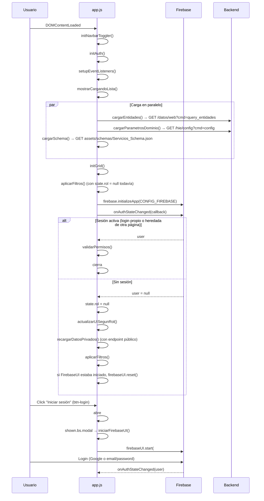
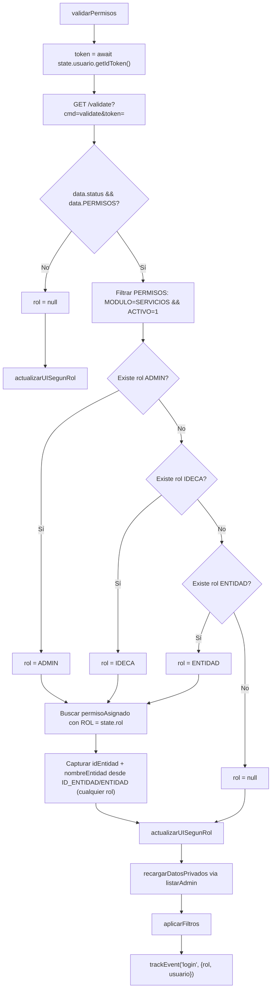
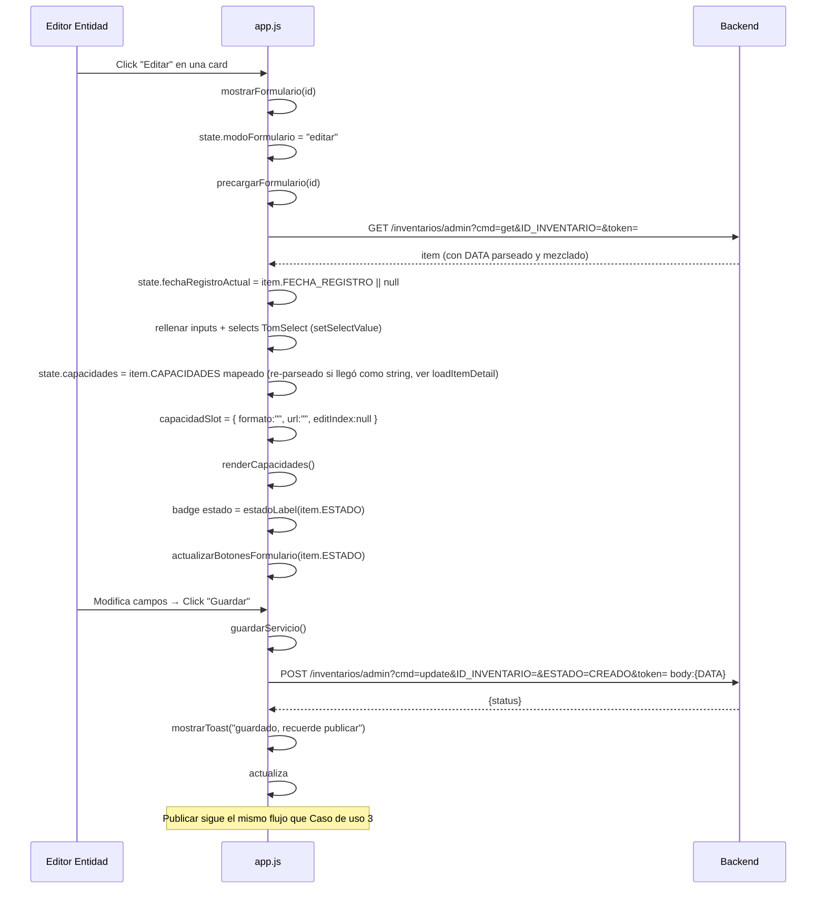
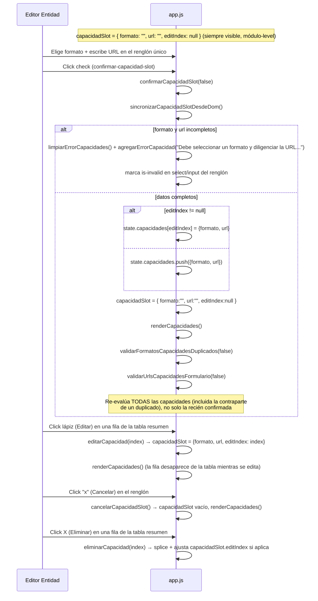
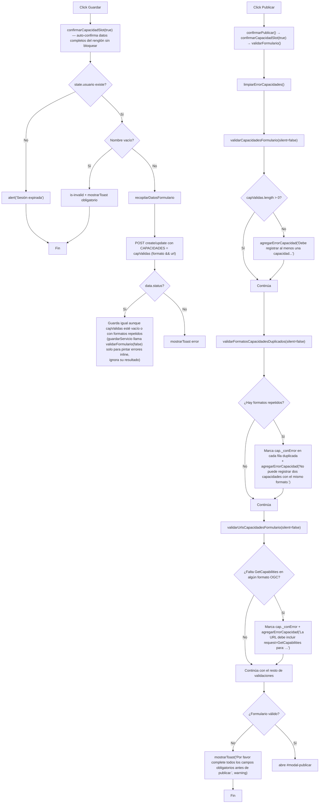

# Documentación Técnica: Módulo Servicios (Inventario de Servicios Web Geográficos)

## Propósito

Módulo de consulta pública y gestión privada del inventario de servicios web geográficos del Catálogo de Recursos. Permite a cualquier visitante externo consultar los servicios **publicados**, y a usuarios autenticados con permiso `MODULO=SERVICIOS` (roles `ENTIDAD`, `IDECA`, `ADMIN`) registrar, editar, publicar, retirar, reactivar y eliminar servicios, según su rol.

> **Corrección importante:** a diferencia de lo que documentaba una versión anterior de este archivo, `servicios/` **sí tiene** su propia pantalla de login (`#modal-login`, disparado desde `#btn-login` en el navbar), con FirebaseUI incrustada (`iniciarFirebaseUI()`, `servicios/js/app.js` líneas 92-110), igual que `admin/`. Ya no reutiliza únicamente la sesión heredada de otra página: el usuario puede loguearse directamente desde este módulo, además de conservar sesión si ya la inició en otra parte del sitio (persistencia estándar de `firebase.auth()`).

> **Nota — `MODULO` y `TIPO` son el mismo string, pero conceptos distintos:** `validarPermisos()` filtra permisos por `permiso.MODULO === "SERVICIOS"` (`servicios/js/app.js:128`) — el código de **módulo** que el backend usa para filtrar permisos (`admin/js/config.js`: `{ Name: "SERVICIOS WEB", Code: "SERVICIOS", ... }`). Por separado, `API.TIPO` en `servicios/js/config.js:14` también vale `"SERVICIOS"` — el valor de **tipo de inventario** que viaja como `TIPO_INVENTARIO` en las URLs de la API. Antes `API.TIPO` era `"SERVICIOS_WEB"` (un bug, no coincidía con ningún tipo real de inventario); se corrigió a `"SERVICIOS"`. Hoy ambos strings son literalmente idénticos — no hay nada que "no confundir" a nivel de texto — pero siguen siendo dos conceptos independientes (permiso de módulo vs. tipo de inventario) que solo coinciden en su valor actual por decisión de nombres del backend, no por diseño del frontend.

> **Cambio de esquema importante (esta revisión):** el formulario y el schema (`Servicios_Schema.json`) perdieron dos campos y cambiaron la obligatoriedad de otros dos:
> - **`TIPO_SERVICIO` eliminado por completo** — ya no existe select "Tipo de servicio", ni filtro "Tipo de Servicio" en el listado, ni agrupación de capacidades por tipo. Las capacidades (formato + URL) ahora son independientes de cualquier tipo de servicio.
> - **`URL_METADATO` eliminado por completo** — ya no existe el campo "URL ID Metadatos" en el formulario ni en el modal "Ver".
> - **`DIRECTORIO_SERVICIOS` dejó de ser obligatorio** — sigue existiendo en el formulario y el schema, pero ya no está en `required`.
> - **`CERTIFICACION_MINTIC` ahora es obligatorio** — se agregó a `required` en el schema y a `FIELD_MAP`.
> - **`ACOMPANAMIENTO_OBJETO` eliminado por completo** — el formulario tenía dos checkboxes que preguntaban esencialmente lo mismo ("¿Servicio registrado con acompañamiento de IDECA?" y "¿El servicio ha sido objeto de acompañamiento?"); se decidió quedarse solo con `ACOMPANAMIENTO_IDECA`.
> - El checkbox restante `f-acompanamiento-ideca` ahora usa el estilo **switch** de Bootstrap (`form-check form-switch`), para ser consistente con el mismo patrón usado en `datosadmin/index.html` (campo "Activo").
> - **Nueva regla de negocio**: no puede haber dos capacidades del servicio con el mismo formato (`validarFormatosCapacidadesDuplicados()`, ver "Funcionalidades principales").

> **Rediseño de "Capacidades del servicio" (esta revisión):** el modelo de filas siempre editables (`cap-formato-N`/`cap-url-N`, una por capacidad, con botón "Agregar capacidad") se reemplazó por un modelo de **cupo único** de captura/edición. Un único renglón (`#cap-formato-slot`/`#cap-url-slot`), siempre visible arriba de la tabla, se usa tanto para crear una capacidad nueva como para editar una ya guardada; la tabla de abajo (`renderTablaResumenCapacidades()`) solo lista capacidades ya confirmadas. El estado de ese renglón vive en una variable **módulo-level** `capacidadSlot = { formato, url, editIndex }` (`servicios/js/app.js:1542`) — deliberadamente fuera de `state`, ya que es un dato transitorio de UI, no del inventario. `agregarCapacidad()` y el botón "Agregar capacidad" **ya no existen**. Ver "Funcionalidades principales" y el Caso de uso 7 para el flujo completo.

> **Nueva regla de negocio — GetCapabilities para formatos OGC:** los formatos WMS, WMTS, WMS-C, WFS, WFS-T, WCS, CSW y WPS (`FORMATOS_OGC_CON_GETCAPABILITIES`, `servicios/js/app.js:1805`) exigen que la URL de la capacidad incluya el substring `getcapabilities` (sin distinguir mayúsculas). No aplica a formatos no-OGC como los de ArcGIS (MapServer, FeatureServer, VectorTileServer, etc.), que coexisten en el mismo enum `serv_formatocapacidad` pero no exponen esa operación. Ver `faltaGetCapabilities()`.

> **Bug corregido — `CAPACIDADES` quedaba como string al recargar el detalle:** `recopilarDatosFormulario()` serializa `CAPACIDADES` a JSON dentro del blob `DATA` (comportamiento intencional, ver `docs/contrato-campos-backend.md` sección 4.3). El bug estaba en `loadItemDetail()`: tras `Object.assign(item, JSON.parse(item.DATA))`, `item.CAPACIDADES` quedaba como *string*, no *array*, y todo el código que asumía `Array.isArray(item.CAPACIDADES)` fallaba silenciosamente a `[]`. Se corrigió agregando un re-parseo de `item.CAPACIDADES` dentro de `loadItemDetail()` (`servicios/js/app.js:344-354`) cuando llega como string — esto corrige de una sola vez la precarga del formulario, `extraerDatosSchema()` (retirar/reactivar) y la card de detalle.

> **Rediseño de la card de detalle:** el modal "Ver" (`#modal-ver`, `abrirModalVer()`) **se eliminó por completo** — sus campos (Descripción, Directorio de servicios, Certificación MINTIC, Acompañamiento IDECA, Fecha de publicación), antes visibles solo para IDECA/Admin a través del modal, ahora viven directamente en la card de detalle (`construirCamposBaseCard()`), visibles para cualquier rol — mismo patrón que `aplicaciones/`/`proyectos/`. El botón "Ver" también se eliminó de `renderAccionesCard()`/`calcularPermisosServicio()`.

---

## Arquitectura de Referencia

### Stack Tecnológico

| Tecnología | Versión | Propósito |
|------------|---------|-----------|
| Vanilla JS | ES6+ | Lógica de aplicación (sin jQuery) |
| Grid.js | latest (`dist/gridjs.umd.js`, sin pin de versión) | Lista de resultados paginada (reemplaza DataTables usado en `admin/`) |
| TomSelect | 2.5.1 (tema `bootstrap5`) | Multi-dropdown con checkboxes para los filtros (formato, sector, entidad, estado) y wrapper de valor único para los selects del formulario (ubicación, certificación, formato de capacidad) |
| Firebase Auth (compat) | 12.15.0 | Identity provider — login propio vía FirebaseUI + sesión persistida entre páginas |
| FirebaseUI | 6.1.0 (`es_419`) | Widget de login embebido en `#modal-login` (Google + email/password) |
| Bootstrap 5 | 5.3.0 | Layout, modales, tooltips, formularios (**ya no usa `bootstrap.Tab`** — el formulario dejó de tener pestañas) |
| Bootstrap Icons | 1.11.3 | Cargado vía CDN, **sin uso** en `index.html`/`app.js` (ver Código Muerto) |
| Font Awesome 6 Free | 6.5.0 | Iconografía |
| Google Analytics 4 (gtag) | — | Tracking de eventos (`G-NE8B8LP8Y6`) |

### Archivos del módulo

| Archivo | Líneas | Rol |
|---------|--------|-----|
| `servicios/index.html` | 534 | HTML: banner hero, filtros (formato/sector/entidad/estado — sin filtro por tipo de servicio), vista consulta (lista + panel detalle), vista formulario en **vista única con 2 secciones apiladas** (`.form-container` > `.form-section` × 2, sin tabs) + barra sticky `.form-toolbar`, modal de login (`#modal-login` + FirebaseUI), 3 modales de gestión (publicar, retirar, eliminar — el modal "Ver" se eliminó, ver nota de rediseño de card) |
| `servicios/js/config.js` | 202 | Configuración y estado: `CONFIG_FIREBASE`, objeto `API` (constructores de URL), `FIELD_MAP` (puente Schema↔DOM), constantes `ROL`/`ESTADO`, estado global `state` |
| `servicios/js/utils.js` | 101 | Utilidades puras y helpers de UI compartidos: `buildBody`, `fetchWithRetry`, `debounce`, `formatFecha`, `trackEvent`, `mostrarToast`, `ocultarToast` |
| `servicios/js/app.js` | 2883 | Lógica de aplicación: auth (login propio + heredado), carga de datos (paginación real), filtros vía TomSelect, render de lista/cards, formulario, capacidades (renglón único + validación GetCapabilities/duplicados), validación (nombre único por entidad + formato de capacidad único), CRUD, bulk actions, export CSV, event listeners, toggle del navbar colapsable, offset sticky |
| `servicios/css/fonts.css` | 81 | `@font-face` de Nunito Sans (compartido con el resto de módulos) |
| `servicios/css/layout.css` | 224 | gov-bar, navbar, breadcrumb-hero y footer — layout compartido entre módulos |
| `servicios/css/auth-modal.css` | 45 | Overrides de FirebaseUI del modal de login |
| `servicios/css/estilos.css` | 601 | Estilos propios del módulo (grid, cards, badges de estado/formato, TomSelect, formulario: `.form-toolbar`/`.form-container`/`.form-section-title`/`.info-value-texto`, `.item-card-meta`/`.item-card-meta-item`/`.item-card-meta-label`/`.item-card-meta-value` — chips de encabezado de card, mismo patrón que `proyectos/css/estilos.css`). `.info-row` (usado para "Observaciones"/"Motivo de retiro"/campos base/fechas en `renderCard()`) es `flex-direction: column` — etiqueta arriba, valor abajo en una caja con borde (`.info-value`; los textos largos suman `.info-value-texto`). La clase `.tabla-header` se eliminó por quedar sin uso (la tabla de capacidades de la card ahora usa `table-dark`, clase de Bootstrap) |
| `servicios/css/view-transitions.css` | 35 | Animaciones de transición entre páginas (View Transitions API nativa) |
| `servicios/assets/schemas/Servicios_Schema.json` | 74 | JSON Schema del formulario: títulos, descripciones (tooltips), `maxLength`, `required`. Ya no incluye `TIPO_SERVICIO` ni `URL_METADATO`; incluye `FECHA_REGISTRO` |

**Nota:** `servicios/index.html` no carga ningún `config.js`/`js/*` de la raíz ni de otro módulo — `CONFIG_FIREBASE` y el resto de la configuración viven íntegramente en `servicios/js/config.js`, local al módulo (independencia de módulos).

### Dependencias CDN (orden en index.html)

```
Google Analytics 4 (G-NE8B8LP8Y6)
Bootstrap 5.3.0 CSS
Bootstrap Icons 1.11.3 CSS
Font Awesome 6.5.0 CSS
gridjs/dist/theme/mermaid.min.css   ← tema base de Grid.js (nombre "mermaid" = paleta de color, no relación con diagramas)
tom-select@2.5.1 CSS (tema bootstrap5)
firebase-ui-auth.css (6.1.0)        ← estilos del widget de login embebido
→ servicios/css/fonts.css
→ servicios/css/layout.css
→ servicios/css/auth-modal.css
→ servicios/css/estilos.css
→ servicios/css/view-transitions.css

Bootstrap Bundle 5.3.0 JS
gridjs/dist/gridjs.umd.js            ← sin pin de versión (latest)
tom-select@2.5.1 JS (complete)
Firebase App Compat 12.15.0
Firebase Auth Compat 12.15.0
firebase-ui-auth__es_419.js (6.1.0)
→ servicios/js/config.js   (CONFIG_FIREBASE, API, FIELD_MAP, ROL, ESTADO, state)
→ servicios/js/utils.js
→ servicios/js/app.js
```

**Nota de resolución:** la versión de Firebase no difiere entre módulos — tanto `servicios/index.html` como `admin/index.html` cargan `12.15.0`.

---

## Análisis Funcional

### Objeto API (`servicios/js/config.js`, líneas 12-137)

Todas las URLs se construyen dinámicamente vía funciones puras dentro del objeto `API`:

```javascript
const API = {
  BASE: "https://catalogopmb.catastrobogota.gov.co/PMBWeb/cr",
  TIPO: "SERVICIOS",
  listar: (start, length, filtros) => ... ,       // público, sin token
  obtener: (id) => ... ,                            // público, detalle
  obtenerAdmin: (id, token) => ... ,                 // privado, detalle
  listarAdmin: (token, start, length) => ... ,       // privado, listado
  crear: (nombre, idEntidad, token) => ... ,
  actualizar: (id, nombre, idEntidad, estado, token) => ... ,
  eliminar: (id, token) => ... ,
  entidades: () => ... ,
  config: () => ... ,                                // parámetros de dominio
  validate: (token) => ... ,
};
```

> `listar()` acepta `filtros.search`/`filtros.sector`/`filtros.estado` para construir query params server-side (`search[value]`, `SECTOR`, `ESTADO`), pero en la práctica **nunca se invoca con esos filtros** — `fetchTodosLosItems()` (única llamadora) siempre pasa solo `start`/`length`. El filtrado real ocurre 100% en cliente vía `aplicarFiltros()`. El parámetro `filtros.tipo`/`TIPO_SERVICIO` que existía en versiones anteriores de esta función se eliminó junto con el campo `TIPO_SERVICIO` del schema.

### FIELD_MAP — puente Schema JSON ↔ DOM (`servicios/js/config.js`, líneas 141-151)

```javascript
const FIELD_MAP = {
  NOMBRE: { id: "f-nombre", err: "err-nombre", type: "text" },
  DESCRIPCION: { id: "f-descripcion", err: "err-descripcion", type: "text" },
  UBICACION: { id: "f-ubicacion", err: "err-ubicacion", type: "select" },
  DIRECTORIO_SERVICIOS: { id: "f-directorio", err: "err-directorio", type: "text" },
  CERTIFICACION_MINTIC: { id: "f-certificacion", err: "err-certificacion", type: "select" },
};
```

Es el único mapeo cliente-servidor: la validación (`validarFormulario`) itera este objeto cruzándolo con `state.schema.properties` (cargado de `Servicios_Schema.json`) para saber qué es `required`, `minLength`/`maxLength`, y qué `title` mostrar en el mensaje de error.

**Cambios de esta revisión:**
- `TIPO_SERVICIO` y `URL_METADATO` se eliminaron de `FIELD_MAP` (y de `Servicios_Schema.json`) — ya no son campos del formulario.
- `CERTIFICACION_MINTIC` se agregó a `FIELD_MAP` (antes existía el `<select>` en el HTML pero no estaba mapeado, por lo que nunca se validaba como obligatorio pese a estar disponible en el schema). Ahora también está en `required` del schema, así que `validarCampoSelect()` lo bloquea si queda vacío.
- `DIRECTORIO_SERVICIOS` sigue en `FIELD_MAP` pero salió de `required` en el schema — el campo existe y se valida su `maxLength`/formato si el schema lo definiera, pero no bloquea guardar/publicar si queda vacío.
- `FIELD_MAP` **ya no incluye `SECTOR_DISTRITAL`** — el formulario no tiene un campo `#f-sector`. `SECTOR_DISTRITAL` sigue siendo `required` en el schema, pero se calcula automáticamente en `recopilarDatosFormulario()` a partir del sector de `state.idEntidad` en `state.entidades`, sin intervención del usuario. Esto es consistente porque solo `ROL.ENTIDAD` puede crear/editar servicios (`btn-registrar` solo visible para ese rol), y su sector queda implícito por su propia entidad.

### Estado global (`state`, `servicios/js/config.js`, líneas 177-202)

```javascript
const state = {
  currentData: [], filteredData: [],
  selectedItemId: null, selectedItem: null,
  usuario: null, rol: null,
  idEntidad: null, nombreEntidad: "",
  modoFormulario: null, idInventarioActivo: null,
  sinCambiosDesdeGuardado: false,   // controla si "Publicar" puede habilitarse (ver actualizarEstadoBotonPublicar)
  fechaRegistroActual: null,        // FECHA_REGISTRO del formulario activo (ver "Funcionalidades principales")
  ubicaciones: [], certificaciones: [], sectores: [], entidades: [],
  capacidades: [],
  grid: null, selectedIds: new Set(),
};
```

> **`state.tiposServicio` eliminado** (esta revisión): junto con el campo `TIPO_SERVICIO` del schema desapareció el array de opciones que lo poblaba (`enums.serv_tiposdeservicio`), el select `#f-tipo-servicio` y el filtro `#filter-tipo`.

> **Nota — `state.token` no existe como propiedad:** a diferencia de `proyectos/` y `aplicaciones/`, `servicios/js/config.js` nunca declaró (ni asigna en runtime) un campo `token` en `state`. Cada función que necesita autenticar una petición llama `await state.usuario.getIdToken()` en el momento (`validarPermisos`, `recargarDatosPrivados`, `loadData`, `loadItemDetail`, `guardarServicio`, `ejecutarPublicar`, `ejecutarEliminar`, `ejecutarRetirar`, `ejecutarReactivar`), en vez de cachear un token una sola vez al login. El SDK de Firebase renueva el JWT automáticamente por debajo, así que este patrón evita usar un token expirado, a costa de una llamada async adicional por operación.

> Además de lo anterior, en tiempo de ejecución `app.js` agrega a `state` (no declarados en el literal inicial de `config.js`): `state.formatosCapacidad` (poblado en `cargarParametrosDominio()` desde `enums.serv_formatocapacidad`), `state.schema` (JSON Schema cargado en `cargarSchema()`), `state.autoSeleccionPendiente` (bandera de auto-selección de la primera card, ver `renderGrid()`/`renderTodasLasCards()`) y `state.esBorradorActual` (ver `actualizarBotonesFormulario()`/`sincronizarBotonesFormulario()`).

> **`capacidadSlot` NO vive en `state`:** es una variable módulo-level declarada aparte (`let capacidadSlot = { formato: "", url: "", editIndex: null }`, `servicios/js/app.js:1542`), que representa el único renglón de captura/edición de "Capacidades del servicio" (ver nota de rediseño más arriba). `editIndex` es el índice en `state.capacidades` que se está editando, o `null` si es una capacidad nueva aún no agregada. Se decidió mantenerla fuera de `state` porque es un dato puramente transitorio de la UI del formulario, no un dato del inventario que deba viajar al backend — `state.capacidades` (el array de capacidades ya confirmadas) sí sigue siendo parte de `state`.

### Constantes de dominio

```javascript
const ROL = { ENTIDAD: "ENTIDAD", ADMIN: "ADMIN", IDECA: "IDECA" };

const ESTADO = {
  CREADO: "CREADO", BORRADOR: "BORRADOR",
  PUBLICADO: "PUBLICADO", RETIRADO: "RETIRADO", ELIMINADO: "ELIMINADO",
};
```

> `FORMATOS_CAPACIDAD` no existe como array estático en `config.js` — se carga dinámicamente desde `/hie/config` (`enums.serv_formatocapacidad`) en `cargarParametrosDominio()` y se guarda en `state.formatosCapacidad`.

### Inventario completo de funciones

> Nota: líneas verificadas contra el código actual de `servicios/js/app.js` (2883 líneas) con `grep -n "^function \|^async function " servicios/js/app.js`. El módulo tiene **109 funciones top-level en `app.js` + 7 en `utils.js` = 116**. Iteración anterior (histórico): se eliminó `agregarCapacidad()` y `abrirModalVer()`, y se agregó `confirmarCapacidadSlot`, `cancelarCapacidadSlot`, `editarCapacidad`, `sincronizarCapacidadSlotDesdeDom`, `faltaGetCapabilities`, `limpiarErrorCapacidades`, `agregarErrorCapacidad`, `validarUrlsCapacidadesFormulario`, `construirMetaEncabezadoCard`, `construirCamposBaseCard`, `separarEtiquetaDescripcion` e `inicializarTomSelectFormatoCapacidad` (ver notas de rediseño al inicio del documento). Esta revisión (limpieza DRY) agregó `ordenarPorNombre`, `refrescarListadoSilencioso`, `idsObjetivo`, `cambiarEstadoBatch` y `csvEscape` — ver "Bug corregido"/"Limpieza DRY" más abajo.

| # | Función | Archivo | Línea | Tipo |
|---|---------|---------|-------|------|
| 1 | `buildBody(datos)` | `utils.js` | 9 | Utilidad — serializa a base64 (body `DATA`) |
| 2 | `fetchWithRetry(url, retries)` | `utils.js` | 27 | Utilidad — fetch con reintentos |
| 3 | `debounce(fn, delay)` | `utils.js` | 43 | Utilidad |
| 4 | `formatFecha(str)` | `utils.js` | 56 | Utilidad — formato es-CO |
| 5 | `trackEvent(nombre, params)` | `utils.js` | 72 | GA4 analytics |
| 6 | `mostrarToast(mensaje, tipo)` | `utils.js` | 85 | UI notificación |
| 7 | `ocultarToast()` | `utils.js` | 99 | UI notificación |
| 8 | `estadoBadgeClass(estado)` | `app.js` | 11-25 | Utilidad UI |
| 9 | `estadoLabel(estado)` | `app.js` | 26-41 | Utilidad UI |
| 10 | `formatoBadgeClass(formato)` | `app.js` | 42-57 | Utilidad UI |
| 11 | `initAuth()` | `app.js` | 58-91 | Auth — listener `onAuthStateChanged`, cierra `#modal-login` si estaba abierto y resetea FirebaseUI al hacer logout |
| 12 | `iniciarFirebaseUI()` | `app.js` | 92-115 | Auth — arranca el widget de FirebaseUI dentro de `#firebaseui-auth-container` una sola vez, disparado por `shown.bs.modal` de `#modal-login` |
| 13 | `validarPermisos()` | `app.js` | 116-164 | Auth → backend, asigna `state.rol` (filtra `permiso.MODULO === "SERVICIOS"`) |
| 14 | `recargarDatosPrivados()` | `app.js` | 165-187 | Data loading (admin) — pagina todo el listado vía `fetchTodosLosItems()` y ordena con `ordenarPorNombre()`; tras recargar, si ya había un ítem seleccionado, vuelve a pedir su detalle completo (`seleccionarItem`) en vez de dejarlo en campos mínimos |
| 15 | `actualizarUISegunRol()` | `app.js` | 188-251 | UI — visibilidad según rol + banner + foto/nombre de usuario en navbar |
| 16 | `ordenarPorNombre(items)` | `app.js` | 252-268 | Utilidad — **nueva** (limpieza DRY). Ordena por `NOMBRE` (localeCompare es-CO); extraída porque `loadData()` y `recargarDatosPrivados()` repetían el mismo comparador inline |
| 17 | `fetchTodosLosItems(token)` | `app.js` | 269-297 | Data loading — el endpoint es tipo DataTables (`start`/`length`, tope de 1000 por página); pagina en loop hasta agotar `recordsTotal`, para no perder registros más allá de la primera página. Único punto de acceso a `API.listar`/`API.listarAdmin` |
| 18 | `loadData()` | `app.js` | 298-313 | Data loading (público/privado) — delega la paginación a `fetchTodosLosItems()` y el orden a `ordenarPorNombre()` |
| 19 | `refrescarListadoSilencioso()` | `app.js` | 314-329 | Data loading — **nueva** (limpieza DRY). Envuelve `await loadData()` en `try/catch` best-effort; extraída porque `guardarServicio()` y `confirmarPublicar()` repetían el mismo bloque antes de chequear nombre duplicado |
| 20 | `loadItemDetail(id)` | `app.js` | 330-362 | Data loading — detalle + parse `DATA` + **re-parseo de `item.CAPACIDADES` si llega como string** (bug corregido esta revisión, ver nota al inicio del documento) |
| 21 | `cargarSchema()` | `app.js` | 363-380 | Config — carga JSON Schema |
| 22 | `inicializarContadoresCaracteres()` | `app.js` | 381-398 | Form — monta contadores de caracteres para todos los campos con `maxLength` |
| 23 | `montarContadorCaracteres(fieldId, maxLength)` | `app.js` | 399-415 | Form — crea el `<small>` de contador y lo sincroniza al evento `input` |
| 24 | `actualizarContadorCaracteres(fieldId)` | `app.js` | 416-431 | Form — recalcula texto/estilo del contador de un campo |
| 25 | `actualizarTodosLosContadoresCaracteres()` | `app.js` | 432-438 | Form — refresca todos los contadores tras poblar/resetear por código |
| 26 | `aplicarTooltipsDesdeSchema()` | `app.js` | 439-489 | UI — tooltips clic-a-clic |
| 27 | `cargarParametrosDominio()` | `app.js` | 490-517 | Config — ubicaciones/certificaciones/formatos de capacidad. **Ya no** carga tipos de servicio ni inicializa filtro de tipo (`TIPO_SERVICIO` eliminado del schema) |
| 28 | `cargarEntidades()` | `app.js` | 518-538 | Config — entidades + sectores |
| 29 | `inicializarTomSelectSelectFormulario(id)` | `app.js` | 539-558 | Form/TomSelect — envuelve un `<select>` de valor único del formulario en TomSelect, reutilizando `RENDER_FILTRO_TOMSELECT` para ocultar la opción vacía |
| 30 | `inicializarTomSelectFormatoCapacidad(id)` | `app.js` | 559-602 | Form/TomSelect — **nueva**. Envuelve el `<select>` de formato del renglón único de capacidad en TomSelect; muestra la descripción (tras "\|" en el `text` del enum) en gris bajo la etiqueta de cada opción del desplegable, vía `separarEtiquetaDescripcion()` |
| 31 | `popularSelect(id, opciones)` | `app.js` | 603-621 | Utilidad DOM (formulario, agrega sin limpiar) + envuelve en TomSelect vía `inicializarTomSelectSelectFormulario` |
| 32 | `separarEtiquetaDescripcion(texto)` | `app.js` | 622-634 | Utilidad — **nueva**. Separa un texto de enum `"Etiqueta\|Descripción"` en `{label, descripcion}` (misma convención que `proy_sensores_remotos` en `proyectos/js/app.js`), usada por `resolverEnumTexto()` e `inicializarTomSelectFormatoCapacidad()` |
| 33 | `resolverEnumTexto(lista, valor)` | `app.js` | 635-667 | Utilidad — resuelve el texto legible (solo etiqueta, descarta descripción tras "\|") de un valor de enum (`id`) buscando en una lista de opciones. **Simplificada esta revisión**: ya no hace fallback a `.value`/`.nombre`, los ENUMS del backend siempre traen `{id, text}` |
| 34 | `inicializarTomSelectFiltro(id, placeholder)` | `app.js` | 668-695 | Filtros/TomSelect — envuelve un `<select multiple>` de filtro en TomSelect con checkboxes + botón remover + botón limpiar, dispara `aplicarFiltros()` en cada cambio |
| 35 | `poblarSelect(id, opciones, labelTodos)` | `app.js` | 696-711 | Utilidad DOM (filtros, limpia y agrega opciones) + envuelve en TomSelect vía `inicializarTomSelectFiltro` |
| 36 | `inicializarFiltroFormato()` | `app.js` | 712-722 | Filtros. `inicializarFiltroTipo()` **se eliminó** junto con el filtro "Tipo de Servicio" |
| 37 | `inicializarFiltros()` | `app.js` | 723-741 | Filtros (sector/entidad/estado) |
| 38 | `limpiarFiltros()` | `app.js` | 742-759 | Filtros — limpia búsqueda + todos los TomSelect (`.tomselect.clear()`) |
| 39 | `aplicarFiltros()` | `app.js` | 760-818 | Filtros — motor de filtrado principal, lee valores vía `.tomselect.getValue()`. **Ya no** filtra por `TIPO_SERVICIO` (campo eliminado) |
| 40 | `initGrid()` | `app.js` | 819-882 | Render lista (Grid.js) |
| 41 | `actualizarVisibilidadFooter(container, total)` | `app.js` | 883-890 | UI — oculta el footer de paginación de Grid.js cuando hay 10 registros o menos |
| 42 | `renderGrid()` | `app.js` | 891-917 | Render lista — actualiza datos + marca `state.autoSeleccionPendiente` |
| 43 | `actualizarContador()` | `app.js` | 918-933 | UI — además deshabilita `#btn-exportar` si no hay resultados filtrados |
| 44 | `seleccionarItem(id)` | `app.js` | 934-985 | Selección + carga detalle |
| 45 | `renderTodasLasCards()` | `app.js` | 986-1025 | Render panel derecho + dispara auto-selección pendiente |
| 46 | `renderCardsAgrupadasPorEntidad(items)` | `app.js` | 1026-1047 | Render (IDECA/Admin) |
| 47 | `calcularPermisosServicio(estado)` | `app.js` | 1048-1069 | **Eliminada**: sus flags (`esBorrador`, `esRetirado`) no aplican a un módulo que solo muestra registros PUBLICADOS; se quitaron también las filas Observaciones (campo inexistente en el schema) y Motivo de retiro de `renderCard()` |
| 48 | `renderTablaCapacidadesPorTipo(capacidades)` | `app.js` | 1070-1103 | Render card (detalle) — tabla de **dos columnas** (Formato + URL con link), `<thead class="table-dark">`. Antes solo mostraba badges de formato sin URL |
| 49 | `renderAccionesCard(item, permisos)` | `app.js` | 1104-1131 | Render card (botones). **Ya no** incluye el botón "Ver" |
| 50 | `construirMetaEncabezadoCard(item)` | `app.js` | 1132-1161 | Render card — **nueva**. Chips de metadatos del encabezado (Entidad, Sector, Ubicación), clases `.item-card-meta*`, mismo patrón que `aplicaciones/`/`proyectos/` |
| 51 | `construirCamposBaseCard(item)` | `app.js` | 1162-1183 | Render card — **nueva**. Pares [etiqueta, valor] del cuerpo de la card (Descripción, Directorio de servicios, Certificación MINTIC, Acompañamiento IDECA, Fecha de Publicación); antes solo visibles en el modal "Ver" (eliminado) |
| 52 | `renderCard(item)` | `app.js` | 1184-1259 | Render card completa — usa `construirMetaEncabezadoCard()`/`construirCamposBaseCard()`; incluye "Fecha de registro" (solo si `item.FECHA_REGISTRO` existe) y "Fecha de actualización" como `.info-row` completos |
| 53 | `mostrarCargandoLista()` | `app.js` | 1260-1274 | UI loading |
| 54 | `mostrarErrorLista(msg)` | `app.js` | 1275-1292 | UI error |
| 55 | `mostrarFormulario(idInventario)` | `app.js` | 1293-1326 | Form — abrir. Ambas secciones ("Información básica" / "Capacidades del servicio") quedan siempre visibles + `sincronizarBotonesFormulario()`. Oculta `.search-filters-section` mientras el formulario está abierto; estampa `state.fechaRegistroActual` una sola vez si es modo "crear" |
| 56 | `ocultarFormulario()` | `app.js` | 1327-1340 | Form — cerrar, restaura `.search-filters-section` |
| 57 | `descartarCambios()` | `app.js` | 1341-1351 | Form — descartar + refetch del listado antes de volver a la consulta |
| 58 | `refrescarListado()` | `app.js` | 1352-1367 | UI — refresca manualmente el listado desde el servidor (botón `#btn-refrescar-lista`), respetando los filtros activos |
| 59 | `precargarFormulario(id)` | `app.js` | 1368-1408 | Form — precarga edición, toma `item.FECHA_REGISTRO` tal cual + refresca contadores. Inicializa `capacidadSlot = { formato: "", url: "", editIndex: null }` y llama `renderCapacidades()` |
| 60 | `resetearFormulario()` | `app.js` | 1409-1437 | Form — reset (incluye `.tomselect?.clear()` de ubicación/certificación) + refresca contadores; reinicia `capacidadSlot` |
| 61 | `actualizarBotonesFormulario(estado)` | `app.js` | 1438-1448 | Form — guarda `state.esBorradorActual` y delega a `sincronizarBotonesFormulario()` |
| 62 | `sincronizarBotonesFormulario()` | `app.js` | 1449-1459 | Form — decide si "Publicar" es visible según `state.esBorradorActual`; también invoca `actualizarEstadoBotonGuardar()` |
| 63 | `actualizarEstadoBotonPublicar()` | `app.js` | 1460-1468 | Form — habilita/deshabilita "Publicar" |
| 64 | `actualizarEstadoBotonGuardar()` | `app.js` | 1469-1492 | Form — no usa `disabled` real (bloquearía el hover del tooltip); aplica `.btn-restringido` + controla un `bootstrap.Tooltip` con el texto "Ingresa el nombre para poder guardar" |
| 65 | `marcarCambiosSinGuardar(evento)` | `app.js` | 1493-1504 | Form — marca cambios sin guardar + limpia advertencia del campo tocado + refresca el gate del botón "Guardar" |
| 66 | `limpiarAdvertenciaCampo(el)` | `app.js` | 1505-1519 | Form — quita `is-invalid` (input + wrapper de TomSelect) + mensaje de error de un campo |
| 67 | `setSelectValue(id, value)` | `app.js` | 1520-1546 | Utilidad DOM — usa `el.tomselect.setValue()` (modo `silent`) si el select está envuelto en TomSelect |
| 68 | `sincronizarCapacidadSlotDesdeDom()` | `app.js` | 1547-1563 | Capacidades — **nueva**. Lee del DOM (`#cap-formato-slot`/`#cap-url-slot`) los valores actuales y los vuelca sobre `capacidadSlot` |
| 69 | `confirmarCapacidadSlot(silentSiVacio)` | `app.js` | 1564-1601 | Capacidades — **nueva**. Agrega o actualiza (según `capacidadSlot.editIndex`) la capacidad del renglón en `state.capacidades` si formato+URL están completos; si `silentSiVacio` es true y el renglón está vacío/parcial, no bloquea (usado al Guardar/Publicar). Corre `validarFormatosCapacidadesDuplicados`/`validarUrlsCapacidadesFormulario` tras confirmar (salvo en modo silencioso) |
| 70 | `cancelarCapacidadSlot()` | `app.js` | 1602-1611 | Capacidades — **nueva**. Descarta los cambios del renglón y lo deja vacío |
| 71 | `editarCapacidad(index)` | `app.js` | 1612-1623 | Capacidades — **nueva**. Carga en el renglón los datos de una capacidad ya guardada para editarla |
| 72 | `eliminarCapacidad(index)` | `app.js` | 1624-1637 | Capacidades — elimina la capacidad en `state.capacidades`; ajusta `capacidadSlot.editIndex` si el índice eliminado lo afecta |
| 73 | `renderFilasCapacidadesFormulario(container)` | `app.js` | 1638-1687 | Capacidades — **rediseñada**. Renderiza el único renglón de captura/edición (`#cap-formato-slot`/`#cap-url-slot`), siempre visible, con botón check (agregar/guardar) y botón cancelar (solo en modo edición) |
| 74 | `renderTablaResumenCapacidades()` | `app.js` | 1688-1727 | Capacidades — tabla resumen de capacidades ya confirmadas, con Editar/Eliminar por fila; la capacidad abierta en el renglón (`capacidadSlot.editIndex`) no aparece aquí mientras se edita |
| 75 | `renderCapacidades()` | `app.js` | 1728-1748 | Capacidades — orquesta: `limpiarErrorCapacidades()` + renglón + tabla |
| 76 | `validarCampoTexto(map, prop, isRequired, silent)` | `app.js` | 1749-1781 | Validación |
| 77 | `validarCampoSelect(map, prop, isRequired, silent)` | `app.js` | 1782-1821 | Validación — también alterna `is-invalid` sobre el wrapper de TomSelect |
| 78 | `faltaGetCapabilities(cap)` | `app.js` | 1822-1835 | Validación — **nueva**. Para formatos OGC (`FORMATOS_OGC_CON_GETCAPABILITIES`), verifica que la URL incluya el substring `getcapabilities` (case-insensitive) |
| 79 | `limpiarErrorCapacidades()` | `app.js` | 1836-1848 | Validación — **nueva**. Limpia el mensaje acumulado de `#err-capacidades`, para iniciar una nueva pasada de validación |
| 80 | `agregarErrorCapacidad(mensaje)` | `app.js` | 1849-1855 | Validación — **nueva**. Agrega un mensaje a `#err-capacidades` sin pisar los anteriores — varios validadores pueden fallar a la vez y todos quedan visibles |
| 81 | `validarUrlsCapacidadesFormulario(silent)` | `app.js` | 1856-1884 | Validación — **nueva**. Recorre `state.capacidades` con `faltaGetCapabilities()`; agrega un único mensaje agrupando los formatos en falta |
| 82 | `validarCapacidadesFormulario(silent)` | `app.js` | 1885-1900 | Validación (regla CRS-0007: mínimo una capacidad completa formato+URL) |
| 83 | `validarFormatosCapacidadesDuplicados(silent)` | `app.js` | 1901-1928 | Validación — regla de negocio: no puede haber dos capacidades con el mismo formato. Compara `state.capacidades` filtrando solo formatos no vacíos; si hay repetidos, marca `cap._conError` para pintar la fila en rojo en la tabla resumen |
| 84 | `existeNombreDuplicado(nombre)` | `app.js` | 1929-1943 | Validación — regla de negocio: dos servicios no pueden compartir `NOMBRE` (normalizado) dentro de la misma entidad. Compara contra `state.currentData` filtrando por `ID_ENTIDAD === state.idEntidad`, excluyendo `state.idInventarioActivo`. *Best-effort* en cliente, sin unicidad atómica en backend |
| 85 | `validarNombreDuplicado(silent)` | `app.js` | 1944-1964 | Validación — envuelve `existeNombreDuplicado()` marcando `is-invalid` + `err-nombre`; invocada desde `validarFormulario()` |
| 86 | `validarFormulario(silent)` | `app.js` | 1965-1998 | Validación — orquesta todo: `FIELD_MAP` (texto/select) + `validarCapacidadesFormulario` + `validarFormatosCapacidadesDuplicados` + `validarUrlsCapacidadesFormulario` + `validarNombreDuplicado`. Llama `limpiarErrorCapacidades()` una sola vez al inicio (si no es `silent`) |
| 87 | `guardarServicio()` | `app.js` | 1999-2119 | API/CRUD — crear/actualizar (borrador). Llama `confirmarCapacidadSlot(true)` al inicio para no perder datos pendientes del renglón; antes de chequear duplicados hace `await loadData()` (best-effort) para refrescar `state.currentData` justo al guardar |
| 88 | `recopilarDatosFormulario()` | `app.js` | 2120-2153 | Form → payload API, incluye `FECHA_REGISTRO: state.fechaRegistroActual` y `SECTOR_DISTRITAL` derivado de `state.idEntidad` |
| 89 | `extraerDatosSchema(item)` | `app.js` | 2154-2180 | Utilidad — extrae del detalle completo de un inventario los campos del schema `DATA`, en el mismo formato que `recopilarDatosFormulario()`, para preservarlos al retirar/reactivar |
| 90 | `confirmarPublicar()` | `app.js` | 2181-2199 | Publicar — abre modal. `async`: llama `confirmarCapacidadSlot(true)` y `await loadData()` (refresca listado) antes de `validarFormulario()` |
| 91 | `ejecutarPublicar()` | `app.js` | 2200-2260 | API/CRUD — publicar, refresca detalle vía `seleccionarItem()` si hay ítem seleccionado |
| 92 | `abrirModalEliminar()` | `app.js` | 2261-2276 | Modal eliminar |
| 93 | `ejecutarEliminar()` | `app.js` | 2277-2325 | API/CRUD — eliminar (individual o bulk), limpia `state.selectedItemId` si el ítem eliminado era el seleccionado |
| 94 | `idsObjetivo()` | `app.js` | 2326-2337 | Utilidad — **nueva** (limpieza DRY). Resuelve sobre qué IDs debe operar una acción masiva: la selección múltiple (`state.selectedIds`) si hay algo marcado, o `state.idInventarioActivo` como fallback (acción sobre una sola card). Reemplaza el mismo ternario que antes estaba copiado 3 veces en `ejecutarEliminar()`/`ejecutarRetirar()`/`ejecutarReactivar()` |
| 95 | `toggleSeleccion(id)` | `app.js` | 2338-2351 | Bulk selection |
| 96 | `limpiarSeleccion()` | `app.js` | 2352-2360 | Bulk selection |
| 97 | `actualizarCheckboxes()` | `app.js` | 2361-2369 | Bulk selection — sincroniza UI |
| 98 | `actualizarBulkBar()` | `app.js` | 2370-2397 | Bulk selection — barra de acciones |
| 99 | `abrirModalRetirar()` | `app.js` | 2398-2423 | Modal retirar (incluye refresco de su contador de caracteres) |
| 100 | `cambiarEstadoBatch(ids, nuevoEstado, extraCampos, mensajes)` | `app.js` | 2424-2478 | API/CRUD — **nueva** (limpieza DRY + fix de bug). Reemplaza los cuerpos casi idénticos que antes tenían `ejecutarRetirar()` y `ejecutarReactivar()` por separado: por cada id, refetch (`loadItemDetail`) + `extraerDatosSchema()` + `fetch` en paralelo (`Promise.all`), y ahora **sí revisa `data.status` de cada respuesta individual** (`resultados.every(Boolean)`) antes de mostrar éxito — antes ninguna de las dos funciones lo hacía. `mensajes` trae los textos de éxito/error/error de conexión y el nombre del evento de tracking. Se llama "batch" y no "lote" para no chocar con el sentido catastral de "lote" (predio) en este dominio |
| 101 | `ejecutarRetirar()` | `app.js` | 2479-2504 | API/CRUD — retirar (individual o bulk); hace `loadItemDetail(id)` por cada ítem para reenviar `extraerDatosSchema(detalle)` + `OBSERVACIONES_RETIRO`, refresca detalle vía `seleccionarItem()` |
| 102 | `ejecutarReactivar()` | `app.js` | 2505-2522 | API/CRUD — reactivar (individual o bulk); mismo patrón de `loadItemDetail` + `extraerDatosSchema` que `ejecutarRetirar()` |
| 103 | `retirarSeleccionados()` | `app.js` | 2523-2531 | Bulk — wrapper |
| 104 | `reactivarSeleccionados()` | `app.js` | 2532-2539 | Bulk — wrapper |
| 105 | `eliminarSeleccionados()` | `app.js` | 2540-2552 | Bulk — wrapper |
| 106 | `csvEscape(valor)` | `app.js` | 2553-2560 | Utilidad — **nueva** (limpieza DRY). Envuelve un valor en comillas dobles escapando comillas internas; reemplaza repeticiones inline del mismo `.replace` dentro de `exportarCSV()` |
| 107 | `exportarCSV()` | `app.js` | 2561-2612 | Exportación — encabezados ya no incluyen "Tipo de Servicio" |
| 108 | `setupBusquedaListeners()` | `app.js` | 2613-2638 | Event binding |
| 109 | `setupBotonesGlobalesListeners()` | `app.js` | 2639-2699 | Event binding |
| 110 | `setupListaListeners()` | `app.js` | 2700-2716 | Event binding |
| 111 | `setupDetalleListeners()` | `app.js` | 2717-2764 | Event binding (delegación). **Bug corregido esta revisión**: el fallback de clic sobre `[data-card-id]` ahora compara `card.dataset.cardId` contra `state.selectedItemId` antes de llamar `seleccionarItem()`, para no re-consultar el detalle si la card ya estaba seleccionada y abierta |
| 112 | `setupTooltips()` | `app.js` | 2765-2773 | Event binding — tooltips de Bootstrap no controlados por el schema |
| 113 | `setupCapacidadesListeners()` | `app.js` | 2774-2804 | Event binding — delegación de clicks sobre `#capacidades-container` (confirmar/cancelar renglón) y `#tabla-capacidades-wrap` (editar/eliminar fila) |
| 114 | `setupEventListeners()` | `app.js` | 2805-2827 | Event binding — orquesta todo |
| 115 | `initNavbarToggler()` | `app.js` | 2828-2847 | UI — alterna el ícono `fa-bars`/`fa-times` del botón hamburguesa según se expanda/colapse `#navbarNav`; invocada directamente en `DOMContentLoaded`, antes de `initAuth()`, no forma parte de `setupEventListeners()` |
| 116 | `ajustarOffsetToolbarFormulario()` | `app.js` | 2848-2883 | UI — mide `document.querySelector("nav.navbar").offsetHeight` y lo expone como variable CSS `--form-toolbar-top`, para que `.form-toolbar` (sticky) se ubique justo debajo del navbar (también sticky) sin taparlo ni dejar hueco. Invocada en `DOMContentLoaded` y en cada `resize` |

**Nota de conteo:** la numeración de la tabla (1-116) coincide exactamente con el total de funciones `function`/`async function` a nivel de módulo: **109 en `app.js` + 7 en `utils.js` = 116** — verificable con `grep -c "^function \|^async function " servicios/js/app.js` (109) y el mismo comando sobre `utils.js` (7). Las 5 funciones nuevas de esta revisión (`ordenarPorNombre`, `refrescarListadoSilencioso`, `idsObjetivo`, `cambiarEstadoBatch`, `csvEscape`) son puramente extractivas — eliminan duplicación, no agregan comportamiento nuevo salvo el fix de `cambiarEstadoBatch()` (ver nota siguiente). `ejecutarRetirar()`/`ejecutarReactivar()` mantienen sus nombres y firma pero ahora son wrappers delgados sobre `cambiarEstadoBatch()`.

> **Bug corregido (esta revisión) en `ejecutarRetirar()`/`ejecutarReactivar()`:** el `Promise.all()` de ambas funciones nunca revisaba el `data.status` de cada respuesta individual (a diferencia de `ejecutarEliminar()`, que sí lo hacía con `resultados.every(Boolean)`). Si el backend rechazaba uno de varios IDs en una acción masiva, el usuario veía igual el toast de éxito genérico para todos. Al fusionar ambas funciones en el helper compartido `cambiarEstadoBatch()` (fila 100) se corrigió también este bug. El mismo fix se aplicó en `aplicaciones/js/app.js` y `proyectos/js/app.js`.

> **Limpieza DRY (esta revisión):** se extrajeron 5 funciones para eliminar lógica duplicada dentro de `app.js`: `ordenarPorNombre()`, `refrescarListadoSilencioso()`, `idsObjetivo()`, `cambiarEstadoBatch()` y `csvEscape()`. Se eliminaron además 3 propiedades muertas de `state` en `config.js` (`tsFilterTipo`/`tsFilterFormato`/`tsFilterSector` — ver "Código Muerto"). Ninguno de estos cambios altera comportamiento visible salvo el fix de `cambiarEstadoBatch()` descrito arriba. El mismo refactor se replicó en `aplicaciones/js/app.js` y `proyectos/js/app.js`.

### Funcionalidades principales

1. **Login propio + sesión heredada**: `initAuth()` escucha `onAuthStateChanged` y además el módulo tiene su propio `#modal-login` con FirebaseUI (`iniciarFirebaseUI()`), disparado al abrir el modal (`shown.bs.modal`). Si el usuario ya tenía sesión activa desde otra página del sitio, el rol se resuelve automáticamente sin necesidad de loguearse de nuevo.
2. **`FECHA_REGISTRO` — estampado 100% cliente**: no existe confirmado en el backend fuera del blob `DATA` (solo `FECHA_ACTUALIZACION`, manejado server-side). Se estampa (`new Date().toISOString()`) una sola vez al abrir el formulario en modo "crear" (`state.fechaRegistroActual`, seteado en `mostrarFormulario()`), y en modo "editar" se toma tal cual del registro cargado (`precargarFormulario()`) — si un registro viejo no la tiene, queda vacía, sin inventar nada. Viaja en `recopilarDatosFormulario()`/`extraerDatosSchema()` para sobrevivir a retirar/reactivar, y se muestra como `.info-row` en la card de detalle (`renderCard()`), justo antes de "Fecha de actualización".
3. **Consulta pública/privada dual**: `loadData()`/`recargarDatosPrivados()` alternan entre endpoint público (`API.listar`) y administrativo (`API.listarAdmin`) según exista `state.usuario`.
4. **Filtrado 100% cliente vía TomSelect**: `aplicarFiltros()` filtra `state.currentData` en memoria (búsqueda, formato, sector, entidad, estado — ya no hay filtro por tipo de servicio), leyendo los valores seleccionados con `.tomselect.getValue()`. El listado sí se pagina realmente contra el backend (`fetchTodosLosItems()`) — no se pierden registros más allá del primer lote de 1000. Todos los filtros son multi-selección con checkboxes.
5. **Lista con Grid.js**: `initGrid()`/`renderGrid()`, columna única con HTML custom (`gridjs.html`), 2 columnas ocultas (ID, Estado) usadas como metadata. El footer de paginación se oculta automáticamente (`actualizarVisibilidadFooter()`) cuando hay 10 resultados o menos.
6. **Panel de detalle basado en cards**: se renderizan **todas** las cards (`renderTodasLasCards()`) y se muestra/oculta la seleccionada con `d-none`/`item-card-selected`. Al aplicar filtros (o al cargar el módulo), la primera card se **auto-selecciona** y dispara automáticamente `seleccionarItem()` para cargar su detalle completo (`state.autoSeleccionPendiente`). La card ahora incluye los campos que antes solo veía IDECA/Admin en el modal "Ver" (`construirCamposBaseCard()`) y chips de metadatos en el encabezado (`construirMetaEncabezadoCard()`) — el modal "Ver" se eliminó, ver nota al inicio del documento. Un clic sobre una card ya seleccionada y abierta **no** vuelve a pedir su detalle (`setupDetalleListeners()` compara `card.dataset.cardId` contra `state.selectedItemId` antes de re-consultar; bug corregido esta revisión).
7. **Formulario en vista única con secciones (sin tabs), con selects envueltos en TomSelect**: "Información básica" (ubicación, certificación — cada uno un TomSelect de valor único vía `inicializarTomSelectSelectFormulario()`) y "Capacidades del servicio" (renglón único de captura/edición, ver punto 17) quedan siempre visibles, apiladas en `.form-container`. Validación dirigida por JSON Schema (`FIELD_MAP` + `Servicios_Schema.json`). El campo `SECTOR_DISTRITAL` no aparece en el formulario: se deriva automáticamente del sector de la entidad del usuario. Campos obligatorios actuales: Nombre, Descripción, Ubicación, Nivel de certificación MINTIC. **Directorio de servicios ya no es obligatorio.**
8. **Guardado en 2 fases**: "Guardar" deja el registro en `CREADO`/borrador; "Publicar" (modal de confirmación) lo pasa a `PUBLICADO`. El botón "Guardar" no usa el atributo `disabled` real cuando falta `NOMBRE` — aplica la clase visual `.btn-restringido` y un `bootstrap.Tooltip` explicativo (`actualizarEstadoBotonGuardar()`), pero sigue siendo clicable: `guardarServicio()` valida igual al intentar guardar.
9. **Selección múltiple (bulk) — solo Admin**: checkboxes en la lista (`data-action="toggle-seleccion"`), barra `#bulk-bar` con retirar/reactivar/eliminar en lote.
10. **Exportación CSV** de los resultados filtrados actuales (ya no incluye columna "Tipo de Servicio").
11. **Tooltips dinámicos por schema**: íconos `data-schema-field` muestran/ocultan un `<div class="field-hint">` con el texto de `Servicios_Schema.json` al hacer clic.
12. **Contador de caracteres en vivo**: para cada campo de texto del formulario (y para `#modal-retirar-obs`) que tenga `maxLength` definido en `Servicios_Schema.json`.
13. **Limpieza de advertencia al editar un campo**: `marcarCambiosSinGuardar(evento)` llama a `limpiarAdvertenciaCampo(evento.target)`, que quita `is-invalid` (tanto del input como del wrapper de TomSelect si aplica) y el mensaje de error inline del campo tocado.
14. **Retirar/reactivar preservan el `DATA` completo**: `ejecutarRetirar()` y `ejecutarReactivar()` hacen `loadItemDetail(id)` por cada ítem antes de enviar el `update`, y envían `extraerDatosSchema(detalle)` en el body en vez de un objeto vacío `{}`. Como el backend **reemplaza** el blob `DATA` completo en cada `update` (no hace merge), enviar `{}` habría borrado todos los campos del schema del servicio al retirarlo o reactivarlo — este patrón evita esa pérdida de datos.
15. **Fila de filtros oculta durante crear/editar**: `.search-filters-section` se oculta al abrir el formulario (`mostrarFormulario()`) y se restaura al cerrarlo (`ocultarFormulario()`).
16. **Validación de nombre único por entidad**: dos servicios no pueden compartir `NOMBRE` (normalizado) dentro de la misma entidad — ver `existeNombreDuplicado()`/`validarNombreDuplicado()`. Se invoca al hacer clic en "Guardar" y dentro de `validarFormulario()` (para que "Publicar" también la respete). `guardarServicio()`/`confirmarPublicar()` refrescan `state.currentData` con `await loadData()` justo antes de comparar, para acotar la ventana de datos obsoletos — sigue siendo *best-effort* en cliente, sin unicidad atómica en el backend.
17. **Capacidades del servicio — renglón único de captura/edición (rediseño esta revisión)**: en vez de filas siempre editables, un único renglón (`#cap-formato-slot`/`#cap-url-slot`) sirve tanto para crear una capacidad nueva como para editar una ya guardada. Su estado vive en `capacidadSlot = { formato, url, editIndex }`, variable módulo-level fuera de `state`. `confirmarCapacidadSlot(silentSiVacio)` agrega o actualiza la capacidad en `state.capacidades` (push si `editIndex` es `null`, update si no) cuando el renglón tiene formato+URL completos; `cancelarCapacidadSlot()` lo descarta; `editarCapacidad(index)` carga una capacidad existente en el renglón. `guardarServicio()`/`confirmarPublicar()` llaman `confirmarCapacidadSlot(true)` para auto-confirmar cualquier dato pendiente sin bloquear si el renglón quedó vacío o parcial. La tabla resumen (`renderTablaResumenCapacidades()`) solo muestra capacidades ya confirmadas; la que está abierta en el renglón para editar no aparece ahí hasta que se confirma o cancela.
18. **Validación de formato de capacidad único**: dos capacidades del mismo servicio no pueden tener el mismo `FORMATO` (p. ej. dos filas "WMS"). `validarFormatosCapacidadesDuplicados(silent)` compara los formatos no vacíos de `state.capacidades`; si hay repetidos, marca `cap._conError` para pintar en rojo la fila correspondiente en la tabla resumen y agrega un mensaje a `#err-capacidades` vía `agregarErrorCapacidad()`. Se invoca desde `validarFormulario()` **y** desde `confirmarCapacidadSlot()` al hacer clic en el check del renglón — no solo al Guardar/Publicar.
19. **Validación GetCapabilities para formatos OGC (nueva)**: para los formatos WMS, WMTS, WMS-C, WFS, WFS-T, WCS, CSW y WPS (`FORMATOS_OGC_CON_GETCAPABILITIES`), la URL de la capacidad debe incluir el substring `getcapabilities` (case-insensitive) — `faltaGetCapabilities(cap)`/`validarUrlsCapacidadesFormulario(silent)`. No aplica a formatos no-OGC (ArcGIS MapServer/FeatureServer/VectorTileServer, etc.), que coexisten en el mismo enum pero no exponen esa operación. Se invoca desde `validarFormulario()` y desde `confirmarCapacidadSlot()`.
20. **Mensajes de error de capacidades acumulados, no sobrescritos (nueva)**: antes, cada validador de capacidades pisaba `#err-capacidades` con `textContent =`, así que solo se veía el último error que corrió. Ahora `limpiarErrorCapacidades()` limpia el bloque una sola vez al inicio de una pasada de validación (`validarFormulario()`/`confirmarCapacidadSlot()`), y cada validador **agrega** su mensaje vía `agregarErrorCapacidad()` sin pisar los anteriores — así se ven todos los errores vigentes a la vez (mínimo una capacidad, formato duplicado, falta GetCapabilities), no solo el último que corrió.
21. **Paginación real del listado**: el endpoint (`API.listar`/`API.listarAdmin`) es tipo DataTables, limitado a `length=1000` por respuesta. `fetchTodosLosItems(token)` pagina en loop hasta agotar `recordsTotal`.
22. **Detalle de texto largo con comportamiento de textarea**: en el detalle de la card, "Observaciones" y "Motivo de retiro" usan la clase `.info-value-texto` (además de `.info-value`): limita el alto a ~4 líneas con scroll interno y conserva saltos de línea.

---

## Diagramas de Flujo (Mermaid)

### Caso de uso 1: Carga inicial + autenticación (propia y heredada)



### Caso de uso 2: validarPermisos → resolución de rol



### Caso de uso 3: Registro de nuevo servicio (completo)

```mermaid
sequenceDiagram
    participant U as Editor Entidad
    participant P as app.js
    participant B as Backend

    U->>P: Click "Registrar Servicio Web"
    P->>P: mostrarFormulario(null)
    P->>P: state.modoFormulario = "crear"
    P->>P: state.fechaRegistroActual = new Date().toISOString()
    P->>P: resetearFormulario() + actualizarBotonesFormulario("nuevo")

    U->>P: Completa "Información básica" (Nombre, Ubicación, Descripción, Certificación MINTIC — todos obligatorios; Directorio de servicios opcional)
    P->>P: input en #f-nombre → actualizarEstadoBotonGuardar() habilita "Guardar"

    U->>P: Elige formato + escribe URL en el renglón único (sección "Capacidades del servicio")
    U->>P: Click check → confirmarCapacidadSlot(false)
    P->>P: state.capacidades.push({formato, url}) + renderCapacidades()
    P->>P: validarFormatosCapacidadesDuplicados(false) + validarUrlsCapacidadesFormulario(false)

    U->>P: Click "Guardar"
    P->>P: guardarServicio()
    P->>P: confirmarCapacidadSlot(true) — auto-confirma datos completos pendientes del renglón
    alt Nombre vacío
        P->>P: marcar is-invalid + mostrarToast(warning)
    else Nombre OK
        P->>P: recopilarDatosFormulario() → schemaData (FECHA_REGISTRO + SECTOR_DISTRITAL derivado)
        P->>B: POST /inventarios/admin?cmd=create&NOMBRE=&ID_ENTIDAD=&token=  body:{DATA: base64(schemaData)}
        B-->>P: {status, ID_INVENTARIO}
        P->>P: state.idInventarioActivo = ID_INVENTARIO
        P->>P: actualizarBotonesFormulario(CREADO) → muestra "Publicar"
        P->>P: mostrarToast(guardado, recuerda publicar)
    end

    U->>P: Click "Publicar"
    P->>P: confirmarPublicar() → validarFormulario()
    alt Formulario inválido (obligatorios, capacidades vacías, formatos duplicados o nombre duplicado)
        P->>P: mostrarToast(warning, "complete campos obligatorios")
    else Válido
        P->>P: abre #modal-publicar
        U->>P: Confirma
        P->>P: ejecutarPublicar()
        P->>B: POST /inventarios/admin?cmd=update&ESTADO=PUBLICADO&token=  body:{DATA: base64(schemaData)}
        B-->>P: {status}
        P->>P: mostrarToast(con nombre)
        P->>P: loadData() + ocultarFormulario() + renderGrid()
        P->>P: seleccionarItem(id) si hay selección activa, si no renderTodasLasCards()
    end
```

### Caso de uso 4: Edición de servicio existente



### Caso de uso 5: Retiro y reactivación (individual + bulk) — vía `cambiarEstadoBatch()`

> `ejecutarRetirar()` y `ejecutarReactivar()` son wrappers delgados: arman `ids` (vía `idsObjetivo()`), estado destino, campos extra y textos de mensajes, y delegan toda la mecánica de red en `cambiarEstadoBatch()`. El diagrama muestra el flujo completo de **retiro**; **reactivar** es igual salvo `nuevoEstado = ESTADO.BORRADOR`, sin textarea de observaciones y sin `OBSERVACIONES_RETIRO` en el body.

```mermaid
flowchart TD
    A["Click Retirar (card individual)"] --> B["state.idInventarioActivo = id"]
    B --> C[abrirModalRetirar]
    D["Click Retirar (bulk, Admin)"] --> E{selectedIds.size > 0?}
    E -->|Sí| C
    E -->|No| Z1[No hace nada]

    C --> F[Limpiar textarea observaciones]
    F --> G["Usuario escribe observaciones → Click Retirar"]
    G --> H{obs vacío?}
    H -->|Sí| I[Mostrar error inline, no continúa]
    H -->|No| J["ejecutarRetirar()"]
    J --> K["ids = idsObjetivo()<br/>(selectedIds o [idInventarioActivo])"]
    K --> L["cambiarEstadoBatch(ids, ESTADO.RETIRADO,<br/>{OBSERVACIONES_RETIRO: obs}, mensajes)"]
    L --> L1["Por cada id (Promise.all): loadItemDetail(id) → detalle completo"]
    L1 --> L2["POST cmd=update ESTADO=RETIRADO body: extraerDatosSchema(detalle) + OBSERVACIONES_RETIRO"]
    L2 --> L3["cada fetch → res.json() → data.status"]
    L3 --> L4{"resultados.every(Boolean)?<br/>(fix: antes no se revisaba)"}
    L4 -->|Todos true| M["mostrarToast éxito + limpiarSeleccion + loadData + renderGrid"]
    L4 -->|Algún false| M1["mostrarToast error ('Algunos servicios no se pudieron retirar')<br/>igual limpia selección y refresca"]
    M --> M2["seleccionarItem(selectedItemId) si hay selección, si no renderTodasLasCards()"]
    M1 --> M2

    N["Click Reactivar (card o bulk)"] --> O["ejecutarReactivar()"]
    O --> P["ids = idsObjetivo()"]
    P --> Q["cambiarEstadoBatch(ids, ESTADO.BORRADOR, {}, mensajes)"]
    Q --> Q1["Por cada id (Promise.all): loadItemDetail(id) → detalle completo"]
    Q1 --> Q2["POST cmd=update ESTADO=BORRADOR body: extraerDatosSchema(detalle)"]
    Q2 --> Q3["data.status por ítem → resultados.every(Boolean)"]
    Q3 --> R[mostrarToast 'Estado: En Borrador' (o error parcial) + recarga + refresco de detalle]
```

> Nota clave: `cambiarEstadoBatch()` (invocado por `ejecutarRetirar()`/`ejecutarReactivar()`) hace un `loadItemDetail(id)` extra por cada ítem del lote para reconstruir el `DATA` completo antes de reenviarlo — enviar un body vacío (`{}`) habría borrado los campos del schema (`DESCRIPCION`, `CAPACIDADES`, etc.) del servicio al retirarlo o reactivarlo, dado que el backend reemplaza el `DATA` completo en cada `update`.

### Caso de uso 6: Búsqueda y filtros combinados (TomSelect multi-selección)

```mermaid
flowchart TD
    A["Usuario escribe en #search-main"] --> B[debounce 300ms]
    B --> C{length >= 2 || length == 0?}
    C -->|Sí| D[aplicarFiltros]
    C -->|No| Z[No filtra aún]

    E["Cambia cualquier TomSelect de filtro (checkbox_options): formato/sector/entidad/estado"] --> D
    F["Enter en búsqueda"] --> D

    D --> G["Leer vía .tomselect.getValue(): formatos, sectores, entidades, estados (arrays)"]
    G --> H{"rol == null?"}
    H -->|Sí| I["Excluir todo item con ESTADO != PUBLICADO"]
    H -->|No| J[Sin exclusión por estado]
    I --> K[Aplicar coincideBusqueda: NOMBRE/NOMBRE_ENTIDAD]
    J --> K
    K --> M["Aplicar coincideFormato (busca en item.CAPACIDADES[].FORMATO)"]
    M --> N["Aplicar coincideSector (resuelve entidades del sector → compara ID_ENTIDAD)"]
    N --> O["Aplicar coincideEntidad (entidades.includes)"]
    O --> P["Aplicar coincideEstado (estados.includes)"]
    P --> Q[state.filteredData = resultado]
    Q --> R[actualizarContador + renderGrid + renderTodasLasCards]
```

> Nota: esta revisión eliminó `coincideTipo` (filtrado por `TIPO_SERVICIO`) del pipeline — el campo ya no existe en el schema ni en el listado de filtros.

### Caso de uso 7: Renglón único de captura/edición de capacidades (con validación al confirmar)



> Nota: antes de esta revisión existía un modelo de filas siempre editables (`cap-formato-N`/`cap-url-N`) con botón "Agregar capacidad" (`agregarCapacidad()`, eliminada). El modelo actual usa un único renglón de captura/edición, siempre visible, sin botón para mostrarlo/ocultarlo.

### Caso de uso 8: Validaciones de capacidades al Guardar/Publicar (CRS-0007 + formato único + GetCapabilities)



> Nota clave sobre este flujo: `guardarServicio()` **no** bloquea por validación de capacidades — solo pinta errores inline llamando `validarFormulario(false)` pero ignora su valor de retorno y guarda de todas formas (ver "Puntos de Mejora"). Tanto la regla CRS-0007 (mínimo una capacidad) como la de formato único y la de GetCapabilities solo bloquean al **publicar**, no al guardar en borrador. Sí hay una diferencia con revisiones anteriores: `confirmarCapacidadSlot(false)` (clic en el check del renglón) también corre `validarFormatosCapacidadesDuplicados`/`validarUrlsCapacidadesFormulario` de inmediato, así que el usuario ve esos dos errores en cuanto confirma una fila, no solo al intentar publicar.

---

## Código Muerto / No Referenciado

### Parámetros sin uso real

`API.listar(start, length, filtros)` sigue aceptando `filtros.search`/`filtros.sector`/`filtros.estado`, pero la única llamadora (`fetchTodosLosItems()`) nunca pasa un tercer argumento — el filtrado real es 100% cliente (`aplicarFiltros()`). Esto ya era así antes de esta revisión y queda fuera de su alcance.

### Librerías cargadas sin uso

| Librería | Nota |
|----------|------|
| Bootstrap Icons 1.11.3 | CSS cargado (`index.html`), pero no existe ninguna clase `bi-*` en `index.html` ni en `app.js` (verificado con grep). Todo el iconografía usa Font Awesome (`fa-solid`). Mismo patrón detectado en `proyectos/`. |

### Otras observaciones

- `servicios/assets/` solo contiene `schemas/Servicios_Schema.json` — no hay imágenes ni íconos propios sin usar.
- El bloque histórico de ~265 líneas de panel de detalle huérfano (`renderDetalle`, `mostrarCargandoDetalle`, etc.) y la carga de GSAP, documentados como código muerto en revisiones anteriores de este archivo, siguen sin existir en el código actual.

---

## Puntos de Mejora

### 1. `guardarServicio()` no reutiliza `validarFormulario()` (DRY / consistencia)
```javascript
// servicios/js/app.js, ~líneas 1720-1750 — valida NOMBRE (vacío + duplicado) manualmente
const nombre = document.getElementById("f-nombre")?.value.trim();
if (!nombre) { /* ... */ }
if (existeNombreDuplicado(nombre)) { /* ... */ }
```
El resto de campos obligatorios del schema (`DESCRIPCION`, `UBICACION`, `CERTIFICACION_MINTIC`, `ACOMPANAMIENTO_IDECA`) no bloquean el "Guardar" (solo pintan errores inline vía `validarFormulario(false)`, que se llama pero cuyo resultado se ignora). Con el rediseño de capacidades (renglón único), la historia es un poco distinta: `confirmarCapacidadSlot()` **sí** valida (GetCapabilities + formato duplicado) al confirmar el renglón, pero eso corre al hacer clic en el check de esa fila, no al hacer clic en "Guardar" del formulario completo — `guardarServicio()` sigue sin invocar `validarCapacidadesFormulario()` ni `validarFormatosCapacidadesDuplicados()` directamente, así que sigue siendo posible guardar (no publicar) un borrador con capacidades vacías, incompletas o con formatos repetidos si el usuario nunca confirmó el renglón. Esto es intencional para permitir borradores parciales, pero la falta de un único punto de entrada de validación (con un parámetro de "nivel" borrador/publicación) hace frágil cualquier cambio futuro a las reglas de negocio.

### 2. Filtrado 100% en cliente con `length=1000` fijo (RENDIMIENTO/ESCALABILIDAD)
`API.listar()` y `API.listarAdmin()` siempre piden hasta 1000 registros (`servicios/js/config.js`) y el filtrado ocurre enteramente en `aplicarFiltros()` sobre el array en memoria. Si el inventario supera 1000 servicios, la paginación server-side existente (`start`, `length`, `draw`) queda inutilizada y los resultados se truncan silenciosamente sin aviso al usuario.

### 3. `filter-estado` no incluye la opción "Retirado" (CONSISTENCIA/UX)
```html
<!-- servicios/index.html -->
<select id="filter-estado" multiple class="form-select">
  <option value="PUBLICADO">Publicado</option>
  <option value="BORRADOR">En Borrador</option>
  <option value="ELIMINADO">Eliminado</option>
</select>
```
El filtro de estado (visible solo para Admin) no ofrece `RETIRADO` como opción, aunque `ESTADO.RETIRADO` existe, `estadoBadgeClass()`/`estadoLabel()` lo soportan, y las cards muestran acciones de "Reactivar" para ítems retirados. Un Admin no puede filtrar la lista para ver únicamente los servicios retirados desde este selector — tiene que buscarlos manualmente entre todos los resultados.

### 4. `Grid.js` cargado sin pin de versión (ESTABILIDAD)
```html
<script src="https://cdn.jsdelivr.net/npm/gridjs/dist/gridjs.umd.js"></script>
```
A diferencia de Bootstrap, Font Awesome, TomSelect y Firebase (todos pineados a una versión exacta), Grid.js apunta a `latest`. Un breaking change upstream (cambio de API de `gridjs.Grid`, de `gridjs.html`, o del formato de `columns`) rompería el módulo en producción sin aviso ni control de versión.

---

## Documentación Adicional

### `ejecutarRetirar()`/`ejecutarReactivar()` — preservación del blob DATA (implementado)
Ambas funciones hacen `loadItemDetail(id)` por cada ítem del lote **antes** de construir el body del `update`, y usan `extraerDatosSchema(detalle)` para reconstruir todos los campos del schema (`DESCRIPCION`, `CAPACIDADES`, etc.) en vez de enviar un body vacío. Esto es necesario porque el endpoint `cmd=update` reemplaza el `DATA` completo del inventario, no hace un merge parcial. El mismo helper `extraerDatosSchema()` mantiene el formato de payload alineado con `recopilarDatosFormulario()` (mismas claves), reduciendo el riesgo de que ambas funciones diverjan con el tiempo.

### Bulk actions vía `Promise.all()`
`ejecutarEliminar()`, `ejecutarRetirar()` y `ejecutarReactivar()` (`servicios/js/app.js`) paralelizan las N peticiones HTTP de una operación en lote con `Promise.all(ids.map(...))`, y construyen un `Map` (`mapaItems`) indexado por `ID_INVENTARIO` antes del loop en vez de repetir `state.currentData.find(...)` por cada ID. `ejecutarRetirar()`/`ejecutarReactivar()` delegan esta mecánica en el helper compartido `cambiarEstadoBatch()` (ver tabla de funciones, fila 100), que además revisa `data.status` de cada respuesta individual antes de reportar éxito — bug corregido en esta revisión (antes solo `ejecutarEliminar()` lo hacía).

### Eliminación de `TIPO_SERVICIO`, `URL_METADATO` y `ACOMPANAMIENTO_OBJETO` (esta revisión)
Se retiraron tres campos del schema y del formulario, por decisión de producto:
- **`TIPO_SERVICIO`**: junto con él se eliminó la relación de las capacidades con el tipo de servicio (antes `renderTablaCapacidadesPorTipo()` agrupaba los formatos por tipo; ahora los lista sin agrupar), el select `#f-tipo-servicio`, el filtro `#filter-tipo`, y toda la lógica de bloqueo que impedía agregar capacidades sin tipo seleccionado (`onTipoServicioChange()`, el aviso `#aviso-tipo-servicio`).
- **`URL_METADATO`**: se eliminó el campo "URL ID Metadatos" del formulario y de la fila correspondiente en el (entonces existente) modal "Ver".
- **`ACOMPANAMIENTO_OBJETO`**: el formulario tenía dos checkboxes con redacciones muy similares ("¿Servicio registrado con acompañamiento de IDECA?" y "¿El servicio ha sido objeto de acompañamiento?"). Se conservó solo `ACOMPANAMIENTO_IDECA`, que además ahora usa el estilo switch (`form-check form-switch`) en vez de checkbox cuadrado, para consistencia con `datosadmin/`.

En paralelo, `DIRECTORIO_SERVICIOS` dejó de ser obligatorio y `CERTIFICACION_MINTIC` pasó a serlo (se agregó a `FIELD_MAP` y a `required` del schema; antes el `<select>` existía en el HTML pero no estaba mapeado ni validado).

### Rediseño de "Capacidades del servicio" y de la card de detalle (esta revisión)
Cambio más grande de esta revisión, resumido aquí porque toca varias partes del módulo a la vez:
- **Capacidades**: el modelo de filas siempre editables (`cap-formato-N`/`cap-url-N`, botón "Agregar capacidad") se reemplazó por un **renglón único** de captura/edición (`capacidadSlot`, variable módulo-level fuera de `state`). Ver Caso de uso 7 y el punto 17 de "Funcionalidades principales". `agregarCapacidad()` se eliminó.
- **GetCapabilities**: nueva regla de negocio — los formatos OGC (WMS, WMTS, WMS-C, WFS, WFS-T, WCS, CSW, WPS) exigen que la URL incluya `getcapabilities` (`faltaGetCapabilities()`, `FORMATOS_OGC_CON_GETCAPABILITIES`). No aplica a formatos no-OGC (ArcGIS, etc.).
- **Errores acumulados**: `#err-capacidades` ya no se sobrescribe por cada validador — `limpiarErrorCapacidades()`/`agregarErrorCapacidad()` permiten que mínimo-una-capacidad, formato-duplicado y falta-GetCapabilities se muestren todos a la vez si fallan simultáneamente.
- **Bug de `CAPACIDADES` como string**: `loadItemDetail()` ahora re-parsea `item.CAPACIDADES` si llega como string tras el merge de `DATA` (afectaba precarga de formulario, `extraerDatosSchema()` y la card de detalle).
- **Card de detalle**: el modal "Ver" se eliminó por completo; sus campos (`construirCamposBaseCard()`) y nuevos chips de encabezado (`construirMetaEncabezadoCard()`) viven ahora directamente en la card, visibles para cualquier rol. `renderTablaCapacidadesPorTipo()` ahora muestra Formato + URL (antes solo badges de formato).
- **Bug de clic redundante**: `setupDetalleListeners()` ahora compara `card.dataset.cardId` contra `state.selectedItemId` antes de volver a llamar `seleccionarItem()`, evitando un GET redundante al hacer clic dentro de una card ya abierta. Mismo fix aplicado en `aplicaciones/js/app.js` y `proyectos/js/app.js` (ver sus respectivos docs).
- **Enums simplificados**: se confirmó que los ENUMS del backend (`/hie/config`) siempre traen `{id, text}` — se simplificaron `resolverEnumTexto()`, `popularSelect()`, `inicializarFiltroFormato()` e `inicializarTomSelectFormatoCapacidad()` para leer `opt.id`/`opt.text` directamente, sin fallback a `.value`/`.nombre`. Se agregó `separarEtiquetaDescripcion()` para el patrón `"Etiqueta|Descripción"` en el texto de los formatos de capacidad (misma convención que `proy_sensores_remotos` en `proyectos/js/app.js`).

---

## Glosario

| Término | Definición |
|---------|------------|
| Inventario / Servicio | Registro de un servicio web geográfico (`ID_INVENTARIO`, `NOMBRE`, `ESTADO`, `CAPACIDADES`, etc.) |
| Capacidad | Combinación Formato (WMS, WFS, ...) + URL que expone el servicio. Independiente de cualquier tipo de servicio (campo eliminado). Se captura/edita vía el renglón único `capacidadSlot`; formatos OGC exigen URL con GetCapabilities |
| DATA (body) | Payload base64 de los campos definidos en `Servicios_Schema.json`, enviado en el body del POST. El backend lo reemplaza completo en cada `update`, no hace merge |
| ENUMS | Parámetros de dominio (`ubicacion`, `certificacion_mintic`, `formatocapacidad`) devueltos por `/hie/config`. Ya no incluye `tiposdeservicio` en uso (campo eliminado del schema) |
| Borrador | Estado `CREADO`/`BORRADOR` — registro guardado pero no publicado, editable, incompleto |
| FECHA_REGISTRO | Fecha de creación original del registro, estampada 100% en cliente al crear (no existe confirmada en el backend fuera de `DATA`) y preservada en cada actualización posterior |
| Bulk actions | Operaciones sobre múltiples ítems seleccionados a la vez (retirar/reactivar/eliminar), exclusivo Admin |
| Grid.js | Librería de tabla ligera usada para la lista de resultados |
| TomSelect | Librería de multi-dropdown con checkboxes usada en todos los filtros y en los selects de valor único del formulario |
| Externo (`state.rol === null`) | Usuario sin sesión o sin permiso `MODULO=SERVICIOS` activo; no es un rol de negocio — solo ve ítems `PUBLICADO` |

---

## Notas para el Mantenedor

1. **`servicios/` tiene pantalla de login propia**: `#modal-login` con FirebaseUI embebida (`iniciarFirebaseUI()`, `servicios/js/app.js` líneas 92-110). Además de eso, el módulo también funciona con sesión heredada de otra página del sitio (persistencia de Firebase Auth entre pestañas/dominios), igual que en `admin/`.

2. **El botón "Publicar" solo aparece si el registro está en borrador** (no depende de ninguna pestaña — ambas secciones son siempre visibles): `actualizarBotonesFormulario(estado)` guarda `state.esBorradorActual` (borrador si `estado` está en `{nuevo, CREADO, BORRADOR}`) y delega en `sincronizarBotonesFormulario()`, que solo decide la visibilidad de "Publicar" según ese flag. Un servicio ya `PUBLICADO` que se edita usa "Guardar", que lo devuelve a `BORRADOR` — es decir, **editar un servicio publicado lo despublica** hasta que se vuelva a pulsar "Publicar".

3. **`guardarServicio()` calcula el estado destino a partir del estado real del ítem**: usa `estadoExistente` desde `state.currentData` (o `ESTADO.BORRADOR` si es un registro nuevo) y solo lo reescribe a `ESTADO.BORRADOR` cuando el estado previo era `PUBLICADO`; en cualquier otro caso preserva `estadoExistente` tal cual. Regla de negocio explícita en el código: *"Editar y guardar un inventario Publicado lo devuelve a Borrador: no se puede republicar directamente, primero hay que pasar por Borrador"*.

4. **El checkbox de selección bulk solo se pinta para `rol === ADMIN`** (`initGrid`, `servicios/js/app.js`). Entidad/IDECA nunca ven `#bulk-bar` ni pueden multi-seleccionar, aunque el CSS y las funciones (`toggleSeleccion`, etc.) son genéricas y funcionarían igual para otros roles si se cambiara esa condición.

5. **Las validaciones de capacidades son asimétricas entre "Guardar" y "Publicar"**: CRS-0007 (mínimo una capacidad), formato único y GetCapabilities bloquean "Publicar" (dentro de `validarFormulario()`, invocada desde `confirmarPublicar()`) pero no "Guardar" (ver punto 1 de "Puntos de Mejora"). Matiz introducido con el renglón único: formato-duplicado y GetCapabilities **sí** corren también al confirmar el renglón individual (`confirmarCapacidadSlot(false)`), así que el usuario ve esos dos errores apenas confirma una capacidad — pero eso no bloquea "Guardar" del formulario completo si el usuario nunca llegó a confirmar el renglón. Si se decide más adelante exigir todo esto también en el guardado de borrador, hay que modificar `guardarServicio()` para invocar los validadores de capacidades explícitamente.

6. **`FORMATOS_CAPACIDAD` no es un array estático en el frontend**: se carga dinámicamente desde `/hie/config` (`enums.serv_formatocapacidad`) en `cargarParametrosDominio()` y se guarda en `state.formatosCapacidad`. Cualquier formato nuevo que agregue el backend se refleja automáticamente en los selects de capacidad y en el filtro "Formato de Capacidad", sin tocar `config.js`. Si el backend agrega un formato OGC nuevo que también deba exigir GetCapabilities, hay que añadirlo manualmente a `FORMATOS_OGC_CON_GETCAPABILITIES` (`servicios/js/app.js:1805`) — esa lista sí es estática, a diferencia del enum de formatos.

7. **`validarPermisos()` filtra por `MODULO === "SERVICIOS"`, y `API.TIPO` también vale `"SERVICIOS"` — mismo string, dos conceptos distintos**: el primero es el código de módulo de permisos (confirmado en `admin/js/config.js`: `{ Name: "SERVICIOS WEB", Code: "SERVICIOS", ... }`); el segundo es el tipo de inventario que viaja como `TIPO_INVENTARIO` en las URLs de la API (`servicios/js/config.js:14`). Antes `API.TIPO` era `"SERVICIOS_WEB"` (bug, no coincidía con ningún tipo real), corregido a `"SERVICIOS"`. Hoy ambos strings son idénticos por coincidencia de nombres del backend, no porque sean la misma cosa — no asumir que cambiar uno es seguro para el otro.

8. **`ROL.IDECA` = `"IDECA"`**: `servicios/js/config.js` define `IDECA: "IDECA"` para coincidir con lo que Admin asigna desde `admin/`, igual que en `aplicaciones/` y `proyectos/`.

9. **Captura de entidad para cualquier rol**: `validarPermisos()` busca `permisoAsignado = permisos.find((permiso) => permiso.ROL === state.rol)` y captura `ID_ENTIDAD`/`ENTIDAD` de esa fila sin importar el rol resuelto. El campo real que trae el backend es `ENTIDAD`, no `NOMBRE_ENTIDAD`.

10. **`SECTOR_DISTRITAL` no es un campo del formulario**: `FIELD_MAP` no lo incluye, y no existe ningún `#f-sector` en `index.html`. Se sigue enviando en `recopilarDatosFormulario()`/`extraerDatosSchema()` porque el schema lo exige como `required`, pero su valor se deriva automáticamente del sector de `state.idEntidad` dentro de `state.entidades` — el usuario nunca lo elige directamente. Si algún día `ADMIN` necesita crear/editar un servicio en nombre de otra entidad, este cálculo automático dejaría de ser válido (hoy solo `ROL.ENTIDAD` puede registrar/editar, así que siempre coincide con su propia entidad).

11. **`state.token` no existe**: a diferencia de `proyectos/`/`aplicaciones/`, este módulo nunca cachea el JWT en `state`. Cada operación que requiere autenticación llama `await state.usuario.getIdToken()` en el momento. Si se porta código de otro módulo que asuma `state.token`, hay que adaptarlo a este patrón.

12. **Dos pares de nombres parecidos para poblar selects, con comportamiento distinto — fácil de confundir**: `popularSelect(id, opciones)` (formulario, agrega sin limpiar, envuelve en TomSelect de **valor único** vía `inicializarTomSelectSelectFormulario`) vs. `poblarSelect(id, opciones, labelTodos)` (filtros, limpia y agrega, envuelve en TomSelect **multi-selección** vía `inicializarTomSelectFiltro`). Al tocar cualquiera de las dos, verificar cuál se está editando — la diferencia de una sola letra (`popular` vs `poblar`) no es evidente a simple vista.

13. **Si se necesita reintroducir un campo dependiente de otro (como era `TIPO_SERVICIO` → capacidades), evitar acoplar la UI de capacidades a un select del formulario básico**: el patrón anterior (`onTipoServicioChange()`, `#aviso-tipo-servicio`, bloqueo en `agregarCapacidad()`) generaba una dependencia cruzada entre dos secciones del formulario que complicaba tanto la UX (el usuario debía saber en qué orden llenar el formulario) como el código (lógica de "gate" repartida entre el listener de cambio del select y la función de agregar fila). El diseño actual, con capacidades totalmente independientes, es más simple de mantener.

14. **`capacidadSlot` es intencionalmente una variable módulo-level, no parte de `state`**: representa el renglón único de captura/edición de capacidades (`{ formato, url, editIndex }`). Se decidió no meterlo en `state` porque es un dato transitorio de la UI del formulario (qué se está tecleando ahora mismo), no un dato del inventario — `state.capacidades` (el array ya confirmado) sigue siendo la fuente de verdad que viaja al backend. Al portar este patrón a otro módulo, mantener esa misma separación: estado de UI efímero fuera de `state`, datos de negocio dentro.

15. **No usar la palabra "lote" para nombrar código nuevo que opere sobre varios ítems a la vez** — usar "batch" (ver `cambiarEstadoBatch()`). En este dominio (datos geográficos/catastrales), "lote" tiene un significado propio (predio/parcela) que puede confundirse con "conjunto de ítems seleccionados" si se usa como sinónimo genérico.
