# Diagramas de Flujo — Proyecto HIEE

Herramienta de Información de Estándares y Entidades (HIEE) — Documentación completa actualizada.

**Última actualización:** 2026-03-13
**Versión del código:** v2.06.06
**Total de funciones:** ~274
**Funciones utilizadas:** 260
**Funciones sin uso:** 14

---

## Notas de Refactorización v2.06.06

### Correcciones de errores `const` → `let`

Se corrigieron 18 variables declaradas con `const` que eran reasignadas posteriormente:

**formularios.js (15 correcciones):**
| Variable | Función | Línea ~ |
|----------|---------|---------|
| `index` | `leerCitacionesDelPicker` | 609 |
| `nombreVal` | `leerCitacionesDelPicker` | 614 |
| `estadoTexto` | `updateFormTabStateColors` | 5166 |
| `_citacionLoading` | Módulo (global) | 2592 |
| `matchingItem` | `populateDropdowns` | 2272 |
| `formaPresentacion` | `mostrarModalCitacion` | 2636 |
| `colIzq` | `mostrarModalCitacion` | 2645 |
| `colDer` | `mostrarModalCitacion` | 2653 |
| `importados` | `importarValoresDominioDesdeCSV` | 3670 |
| `campo` | `importarValoresDominioDesdeCSV` | 3676 |
| `enComillas` | `importarValoresDominioDesdeCSV` | 3677 |
| `tbody` | `eliminarValoresDominioSeleccionados` | 3750 |
| `addedCount` | `preargarValoresDominioDesdeConfiguracion` | 3895 |
| `html` | `renderValidaciones` | 4773 |
| `validationResult` | `handleGuardarFormulario` | 4855 |

**chat.js (3 correcciones):**
| Variable | Función | Línea ~ |
|----------|---------|---------|
| `msgs` | `loadChatMessages` | 351 |
| `anyVisible` | `isAnyChatHieeSectionVisible` | 683 |
| `mensajes` | `processChatPotentialUpdateFor` | 864 |

### Correcciones de event listeners

**formularios.js:**
- `btn-agregar-medio`: Se corrigió el listener para usar `distIndex` del closure en lugar de `this.closest('[data-index]')`
- `btn-agregar-servicio`: Se corrigió el listener para usar `medioIndex` y `distIndex` del closure, guardando los valores en `data-attributes`
- `btn-eliminar-medio`: Se corrigió para pasar `this.closest('.accordion-item')` en lugar de `this.closest('[data-medio-index]')`

**chat.js:**
- `ensureChatChildStructure`: Se agregó validación `if (!child) return;` para evitar error cuando `child` es null

---

## Tabla de Contenidos

1. [Arquitectura General](#1-arquitectura-general)
2. [Flujo de Inicialización de la Aplicación](#2-flujo-de-inicialización-de-la-aplicación)
3. [Flujo de Carga de Sección HIEE](#3-flujo-de-carga-de-sección-hiee)
4. [Flujo de Inicialización de Formularios](#4-flujo-de-inicialización-de-formularios)
5. [Flujo de Población de Campos](#5-flujo-de-población-de-campos)
6. [Flujo de Modo Vista Previa / Edición](#6-flujo-de-modo-vista-previa--edición)
7. [Flujo de Guardado de Formulario](#7-flujo-de-guardado-de-formulario)
8. [Flujo de Validación](#8-flujo-de-validación)
9. [Flujo del Chat — Buzón de Acompañamiento](#9-flujo-del-chat--buzón-de-acompañamiento)
10. [Flujo de Polling del Chat](#10-flujo-de-polling-del-chat)
11. [Flujo de Citaciones](#11-flujo-de-citaciones)
12. [Flujo de Filtro SRIG](#12-flujo-de-filtro-srig)
13. [Flujo de Navegación por Pestañas](#13-flujo-de-navegación-por-pestañas)
14. [Flujo de Creación de Registro HIEE](#14-flujo-de-creación-de-registro-hiee)
15. [Flujo de Animaciones GSAP](#15-flujo-de-animaciones-gsap)
16. [Flujo de Botones Laterales Pestañas](#16-flujo-de-botones-laterales-pestañas)
17. [Flujo de Generación de PDF](#17-flujo-de-generación-de-pdf)
18. [Flujo de Botones de Acción en Formularios](#18-flujo-de-botones-de-acción-en-formularios)
19. [Flujo de Autenticación Firebase](#19-flujo-de-autenticación-firebase)
20. [Flujo de Sistema de Filtros SRIG](#20-flujo-de-sistema-de-filtros-srig)
21. [Listado Completo de Funciones por Archivo](#21-listado-completo-de-funciones-por-archivo)
22. [Funciones Sin Uso](#22-funciones-sin-uso)

---

## 1. Arquitectura General

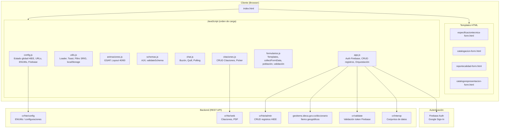

---

## 2. Flujo de Inicialización de la Aplicación

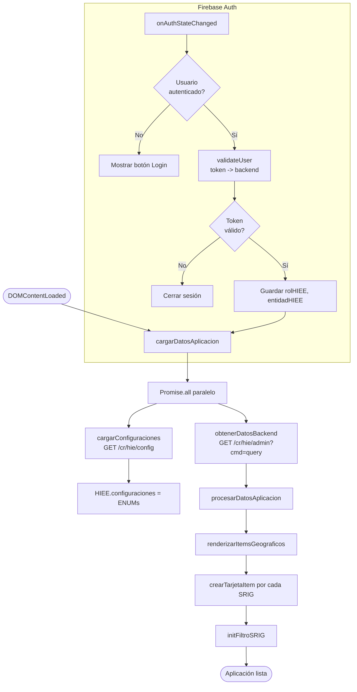

**Funciones involucradas:**
- `cargarDatosAplicacion()` - app.js
- `cargarConfiguraciones()` - api.js
- `obtenerDatosBackend()` - api.js
- `procesarDatosAplicacion(data, esRecarga)` - app.js
- `renderizarItemsGeograficos(items)` - app.js
- `crearTarjetaItem(item)` - app.js
- `initFiltroSRIG()` - app.js
- `validateUser()` - api.js

---

## 3. Flujo de Carga de Sección HIEE

El usuario hace clic en "Consultar Estándares" o "Editar Estándares" en una tarjeta SRIG.

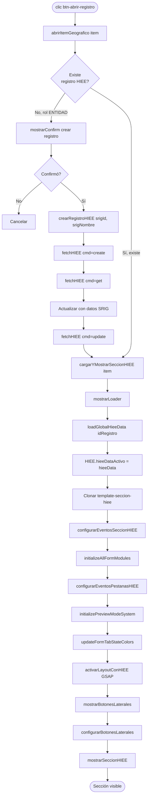

**Funciones involucradas:**
- `abrirItemGeografico(item)` - app.js
- `crearRegistroHIEE(srigId, srigNombre)` - app.js
- `cargarYMostrarSeccionHIEE(item)` - app.js
- `loadGlobalHieeData(idRegistro)` - api.js
- `configurarEventosSeccionHIEE(seccion, srigId)` - app.js
- `initializeAllFormModules(srigId, idRegistro, hieeData)` - formularios.js
- `initializeFormModule(...)` - formularios.js
- `configurarEventosPestanasHIEE(seccion, idRegistro)` - app.js
- `initializePreviewModeSystem(idRegistro)` - formularios.js
- `updateFormTabStateColors(idRegistro, hieeData)` - formularios.js
- `activarLayoutConHIEE()` - animaciones.js
- `mostrarBotonesLaterales()` - app.js
- `configurarBotonesLaterales()` - app.js
- `mostrarSeccionHIEE(seccion)` - app.js

---

## 4. Flujo de Inicialización de Formularios

`initializeAllFormModules` itera los 4 formularios (ET, CO, RC, CR).

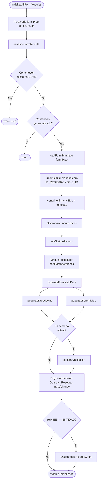

**Funciones involucradas:**
- `initializeAllFormModules(srigId, idRegistro, hieeData)` - formularios.js
- `initializeFormModule(...)` - formularios.js
- `loadFormTemplate(formType)` - formularios.js
- `populateFormWithData(idRegistro, prefix, hieeData)` - formularios.js
- `populateDropdowns(idRegistro, prefix)` - formularios.js
- `populateFormFields(idRegistro, prefix, formData)` - formularios.js
- `populateSelectFromConfig(select, configKey, useIdAsValue)` - formularios.js
- `populateDominiosSelect(select)` - formularios.js
- `initTomSelectEnSelect(select)` - formularios.js
- `initCitationPickers(container)` - formularios.js
- `ejecutarValidacion(formType, prefix, idRegistro)` - formularios.js
- `handleGuardarFormulario(formType, prefix, idRegistro)` - formularios.js
- `handleResetearFormulario(formType, prefix, idRegistro)` - formularios.js

---

## 5. Flujo de Población de Campos

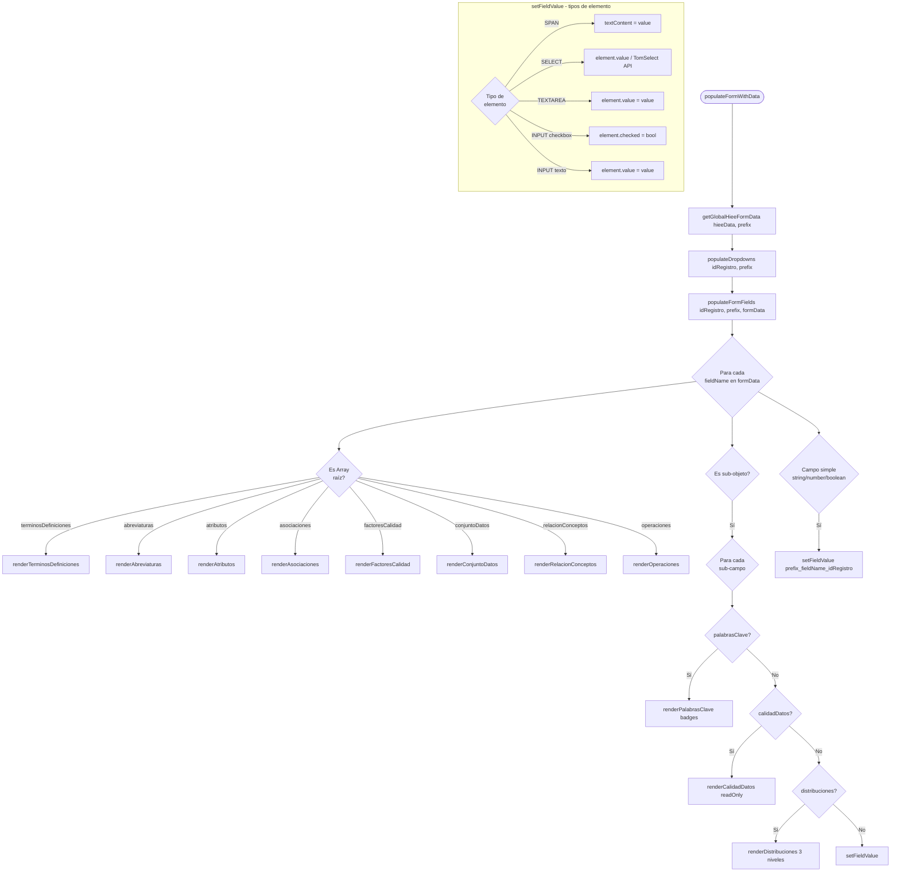

**Funciones involucradas:**
- `getGlobalHieeFormData(hieeData, formType)` - formularios.js
- `populateFormFields(idRegistro, prefix, formData)` - formularios.js
- `setFieldValue(prefix, fieldName, idRegistro, value)` - formularios.js
- `resolverTextoNivelAlcance(value)` - formularios.js
- `renderPalabrasClave(prefix, fieldPath, idRegistro, palabras)` - formularios.js
- `renderTerminosDefiniciones(prefix, idRegistro, terminos)` - formularios.js
- `renderAbreviaturas(prefix, idRegistro, abreviaturas)` - formularios.js
- `renderAtributos(prefix, idRegistro, atributos)` - formularios.js
- `renderAsociaciones(prefix, idRegistro, asociaciones)` - formularios.js
- `renderConjuntoDatos(prefix, idRegistro, conjuntos)` - formularios.js
- `renderRelacionConceptos(prefix, idRegistro, ...)` - formularios.js
- `renderOperaciones(prefix, idRegistro, operaciones)` - formularios.js
- `renderCalidadDatos(prefix, parentField, idRegistro, factores)` - formularios.js
- `renderDistribuciones(prefix, idRegistro, distribuciones)` - formularios.js
- `renderValoresDominio(clone, prefix, idRegistro, attrIndex, valores)` - formularios.js
- `renderHerencias(prefix, idRegistro, herencias)` - formularios.js
- `renderFuncionesCR(prefix, idRegistro, funciones)` - formularios.js
- `renderCitacionesEnFormulario(idRegistro, parentField, citaciones, prefix)` - formularios.js
- `renderCitacionesEnClone(clone, dataField, citaciones, ...)` - formularios.js

---

## 6. Flujo de Modo Vista Previa / Edición

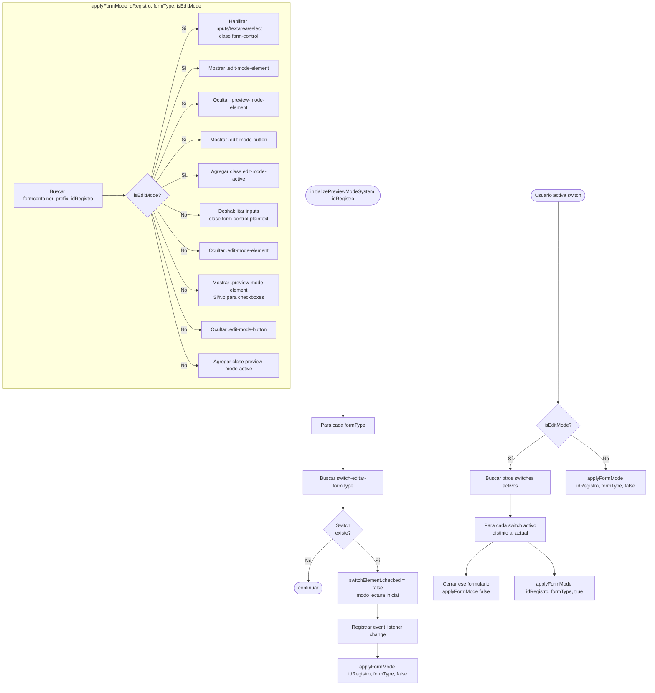

**Funciones involucradas:**
- `initializePreviewModeSystem(idRegistro)` - formularios.js
- `applyFormMode(idRegistro, formType, isEditMode)` - formularios.js
- `toggleSeccionesVacias(container, isEditMode)` - formularios.js
- `seccionEstaVacia(body)` - formularios.js
- `isFormInEditMode(idRegistro, formType)` - formularios.js

---

## 7. Flujo de Guardado de Formulario

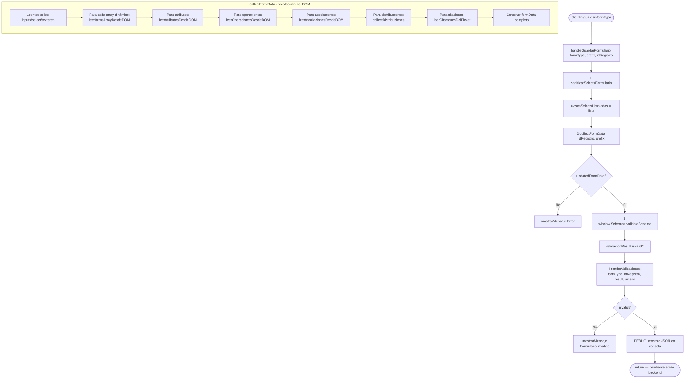

**Funciones involucradas:**
- `handleGuardarFormulario(formType, prefix, idRegistro)` - formularios.js
- `sanitizarSelectsFormulario(idRegistro, prefix)` - formularios.js
- `collectFormData(idRegistro, prefix)` - formularios.js
- `getFieldValue(prefix, fieldName, idRegistro)` - formularios.js
- `leerItemsArrayDesdeDOM(...)` - formularios.js
- `leerAtributosDesdeDOM(prefix, idRegistro, originalArray, formContainer)` - formularios.js
- `leerOperacionesDesdeDOM(prefix, idRegistro, ...)` - formularios.js
- `leerAsociacionesDesdeDOM(prefix, idRegistro, ...)` - formularios.js
- `leerRelacionConceptosDesdeDOM(prefix, idRegistro, ...)` - formularios.js
- `leerConjuntosDatosDesdeDOM(prefix, idRegistro, formContainer)` - formularios.js
- `leerCitacionesDelPicker(picker)` - formularios.js
- `leerCitacionesArrayDesdeDOM(originalArray, fieldName, formContainer)` - formularios.js
- `collectDistribuciones(prefix, idRegistro)` - formularios.js
- `ejecutarValidacion(formType, prefix, idRegistro)` - formularios.js
- `renderValidaciones(formType, idRegistro, validationResult, avisos)` - formularios.js
- `updateFormTabStateColors(idRegistro, hieeData)` - formularios.js

---

## 8. Flujo de Validación

La validación se ejecuta en tres momentos: al cargar la pestaña activa, al cambiar de pestaña, y en tiempo real al editar (debounce 800ms).

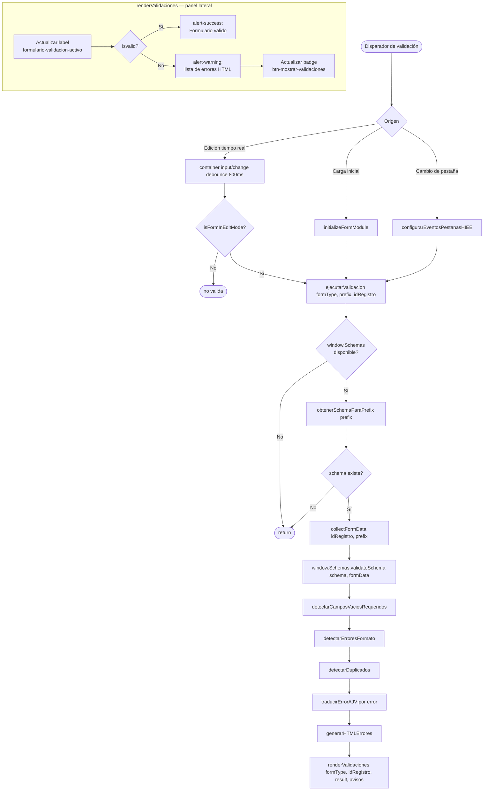

**Funciones involucradas:**
- `ejecutarValidacion(formType, prefix, idRegistro)` - formularios.js
- `obtenerSchemaParaPrefix(prefix)` - formularios.js
- `renderValidaciones(formType, idRegistro, validationResult, avisos)` - formularios.js
- `dispararValidacionSiModoEdicion(idRegistro)` - formularios.js
- `validateSchema(schema, data)` - schemas.js
- `detectarCamposVaciosRequeridos(schemaNode, dataNode, rootSchema, pathPrefix)` - schemas.js
- `detectarErroresFormato(schemaNode, dataNode, rootSchema, pathPrefix)` - schemas.js
- `detectarDuplicados(schemaNode, dataNode, rootSchema, pathPrefix)` - schemas.js
- `traducirErrorAJV(err, schema)` - schemas.js
- `rutaATexto(path, schema)` - schemas.js
- `generarHTMLErrores(erroresTraducidos)` - schemas.js

---

## 9. Flujo del Chat — Buzón de Acompañamiento

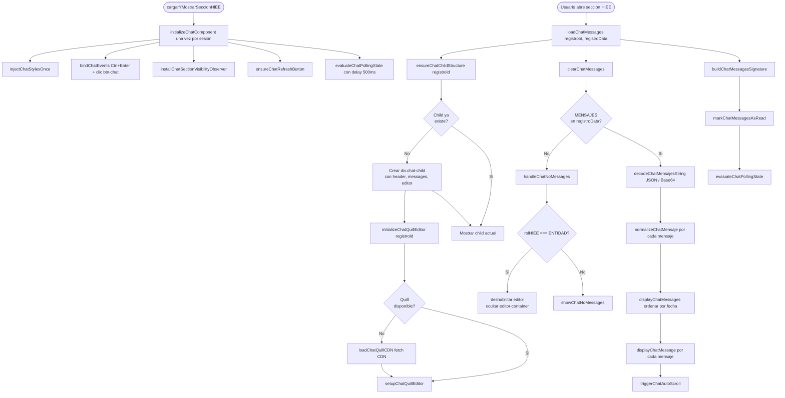

**Funciones involucradas:**
- `initializeChatComponent()` - chat.js
- `injectChatStylesOnce()` - chat.js
- `bindChatEvents()` - chat.js
- `installChatSectionVisibilityObserver()` - chat.js
- `ensureChatRefreshButton()` - chat.js
- `evaluateChatPollingState()` - chat.js
- `loadChatMessages(registroId, registroData)` - chat.js
- `ensureChatChildStructure(registroId)` - chat.js
- `initializeChatQuillEditor(registroId)` - chat.js
- `loadChatQuillCDN()` - chat.js
- `setupChatQuillEditor(registroId)` - chat.js
- `clearChatMessages()` - chat.js
- `displayChatMessages(mensajes)` - chat.js
- `displayChatMessage(mensaje)` - chat.js
- `triggerChatAutoScroll()` - chat.js
- `scrollChatToBottom()` - chat.js
- `decodeChatMensajesString(rawStr)` - chat.js
- `normalizeChatMensaje(mensaje)` - chat.js
- `handleChatNoMessages()` - chat.js
- `showChatNoMessages(textAviso)` - chat.js
- `hideChatNoMessages()` - chat.js
- `buildChatMessagesSignature(mensajes)` - chat.js
- `markChatMessagesAsRead(idRegistro, messages)` - chat.js
- `updateChatUnreadBadge()` - chat.js

---

## 10. Flujo de Polling del Chat

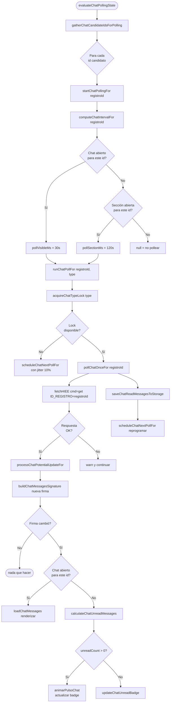

**Funciones involucradas:**
- `evaluateChatPollingState()` - chat.js
- `gatherChatCandidateIdsForPolling()` - chat.js
- `startChatPollingFor(registroId)` - chat.js
- `stopChatPollingFor(registroId)` - chat.js
- `computeChatIntervalFor(registroId)` - chat.js
- `acquireChatTypeLock(type)` - chat.js
- `runChatPollFor(registroId, type, noReschedule)` - chat.js
- `scheduleChatNextPollFor(registroId)` - chat.js
- `pollChatOnceFor(registroId, force, noReschedule)` - chat.js
- `processChatPotentialUpdateFor(registroId, rawData, forceRenderVisible)` - chat.js
- `buildChatMessagesSignature(mensajes)` - chat.js
- `calculateChatUnreadMessages(idRegistro, messages)` - chat.js
- `getChatReadMessagesFromStorage(idRegistro)` - chat.js
- `saveChatReadMessagesToStorage(idRegistro, messageIds)` - chat.js
- `isChatOpen()` - chat.js
- `isChatOpenFor(registroId)` - chat.js
- `isChatSectionOpenedFor(registroId)` - chat.js
- `isAnyChatHieeSectionVisible()` - chat.js

---

## 11. Flujo de Citaciones

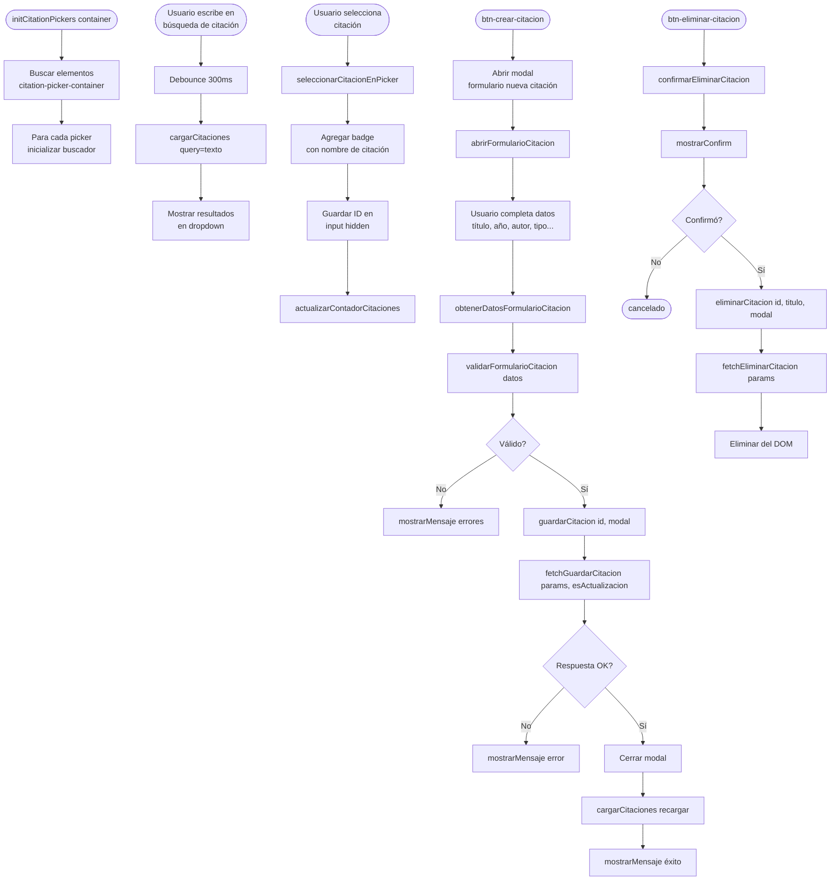

**Funciones involucradas:**
- `initCitationPickers(container)` - formularios.js
- `cargarCitaciones(filtro, silencioso)` - citaciones.js
- `renderizarCitaciones(lista)` - citaciones.js
- `filtrarCitaciones(textoBusqueda)` - citaciones.js
- `puedeEditarCitaciones()` - citaciones.js
- `crearTarjetaCitacion(item)` - citaciones.js
- `generarOpcionesSelect(configKey, selectedValue)` - citaciones.js
- `generarFormularioCitacion(citacion)` - citaciones.js
- `abrirFormularioCitacion(id, citacion)` - citaciones.js
- `obtenerDatosFormularioCitacion()` - citaciones.js
- `validarFormularioCitacion(datos)` - citaciones.js
- `guardarCitacion(id, modal)` - citaciones.js
- `confirmarEliminarCitacion(id, titulo)` - citaciones.js
- `eliminarCitacion(id, titulo, modal)` - citaciones.js
- `initCitaciones()` - citaciones.js
- `precargarCitaciones()` - citaciones.js
- `seleccionarCitacionEnPicker(picker, cit)` - formularios.js
- `actualizarContadorCitaciones(picker)` - formularios.js
- `crearBadgeCitacion(cit)` - formularios.js
- `abrirDetalleCitacion(citacionId)` - formularios.js
- `mostrarModalCitacion(citacionData)` - formularios.js

---

## 12. Flujo de Filtro SRIG

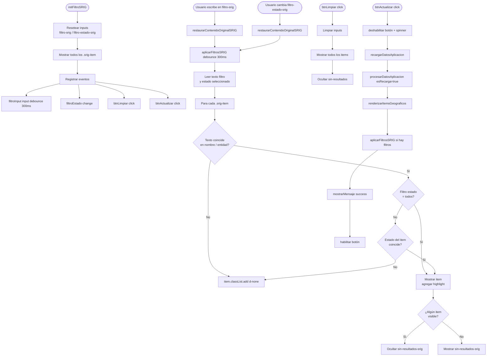

**Funciones involucradas:**
- `initFiltroSRIG()` - app.js
- `aplicarFiltrosSRIG()` - app.js
- `restaurarContenidoOriginalSRIG()` - app.js
- `recargarDatosAplicacion()` - app.js
- `normalizarTexto(texto)` - app.js
- `buildHighlightRegex(textoBusqueda)` - app.js

---

## 13. Flujo de Navegación por Pestañas

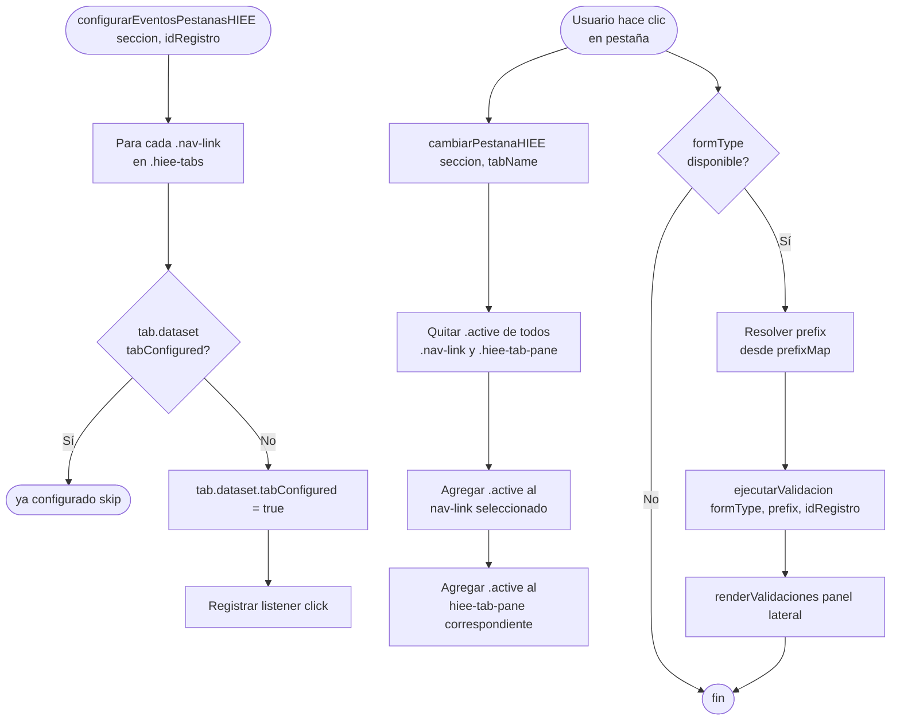

**Funciones involucradas:**
- `configurarEventosPestanasHIEE(seccion, idRegistro)` - app.js
- `cambiarPestanaHIEE(seccion, tabName)` - app.js
- `ejecutarValidacion(formType, prefix, idRegistro)` - formularios.js
- `renderValidaciones(formType, idRegistro, validationResult, avisos)` - formularios.js

---

## 14. Flujo de Creación de Registro HIEE

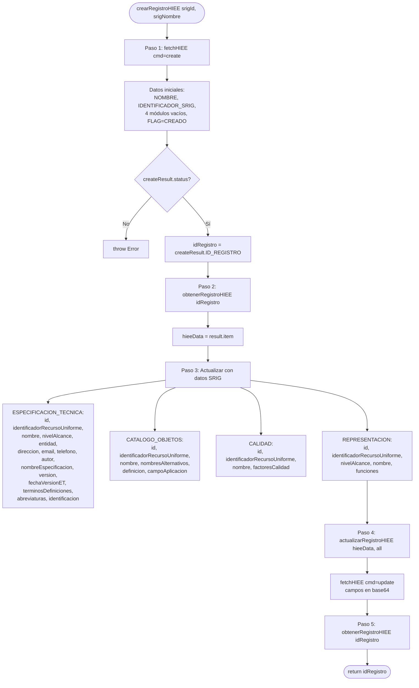

**Funciones involucradas:**
- `crearRegistroHIEE(srigId, srigNombre)` - app.js
- `obtenerRegistroHIEE(idRegistro)` - api.js
- `actualizarRegistroHIEE(hieeData, modulo)` - api.js
- `fetchHIEE(params)` - api.js
- `utf8ToBase64(value)` - utils.js

---

## 15. Flujo de Animaciones GSAP

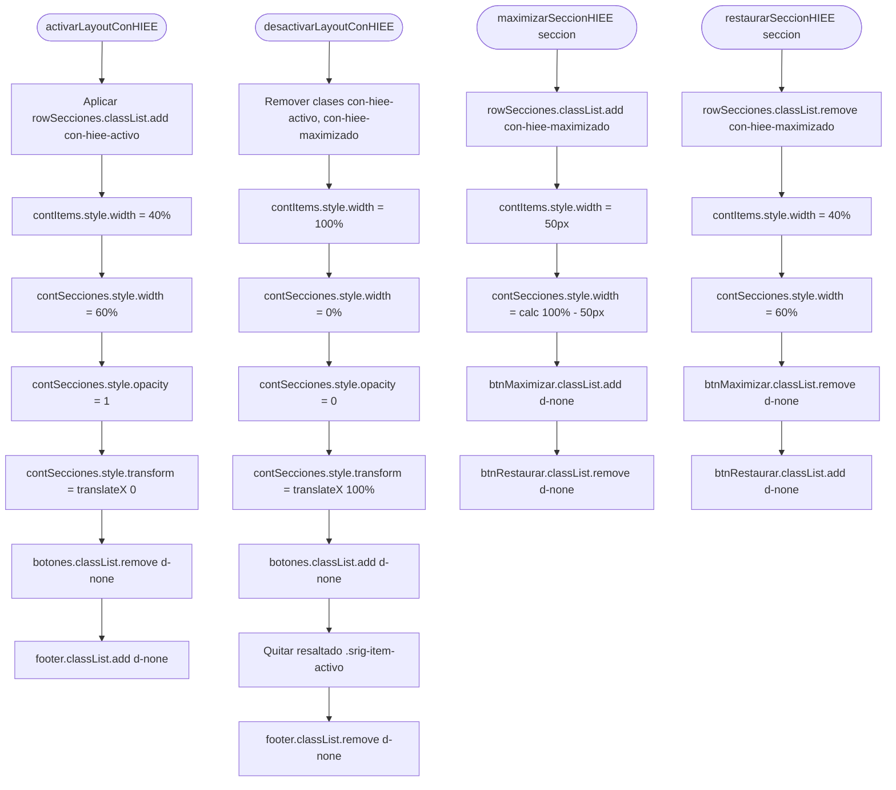

**Funciones involucradas:**
- `activarLayoutConHIEE()` - animaciones.js
- `desactivarLayoutConHIEE()` - animaciones.js
- `maximizarSeccionHIEE(seccion)` - animaciones.js
- `restaurarSeccionHIEE(seccion)` - animaciones.js
- `animarAperturaLayoutHIEE()` - animaciones.js
- `animarCierreLayoutHIEE()` - animaciones.js
- `animarEntradaSeccionHIEE(seccion, callback)` - animaciones.js
- `animarSalidaSeccionHIEE(seccion, callback)` - animaciones.js
- `animarCambioPestana(panelSaliente, panelEntrante)` - animaciones.js

---

## 16. Flujo de Botones Laterales (Pestañas)

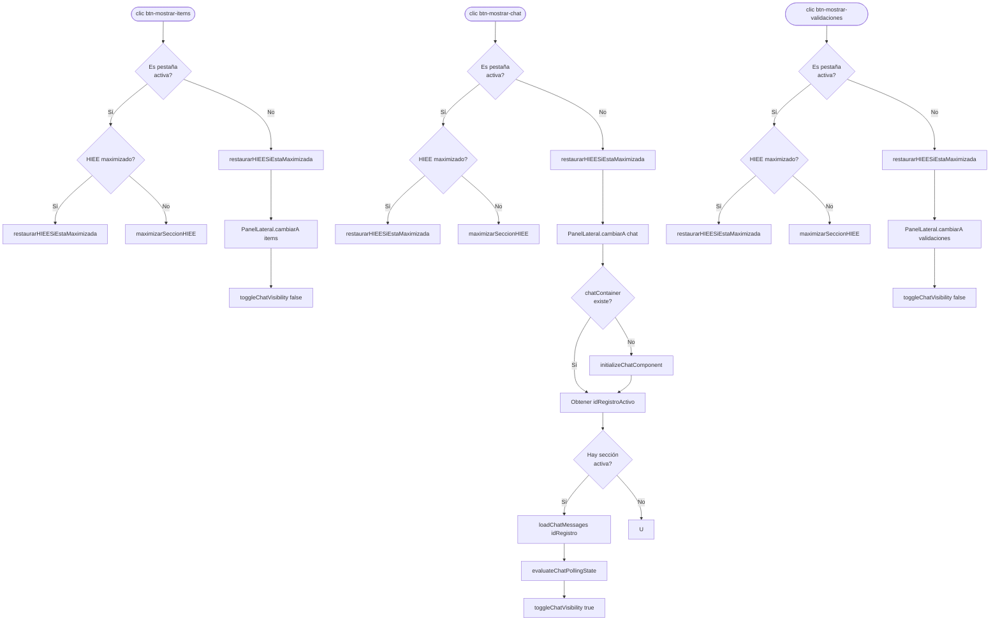

**Funciones involucradas:**
- `configurarBotonesLaterales()` - app.js
- `manejarClickPestania(nombrePestania, accionAlActivar)` - app.js (interna)
- `PanelLateral.cambiarA(pestania)` - app.js
- `PanelLateral.pestaniaActiva()` - app.js
- `estaHIEEMaximizado()` - app.js
- `restaurarHIEESiEstaMaximizada()` - app.js
- `maximizarSeccionHIEE(seccion)` - animaciones.js
- `toggleChatVisibility(show)` - chat.js
- `initializeChatComponent()` - chat.js
- `loadChatMessages(registroId, registroData)` - chat.js
- `evaluateChatPollingState()` - chat.js

---

## 17. Flujo de Generación de PDF

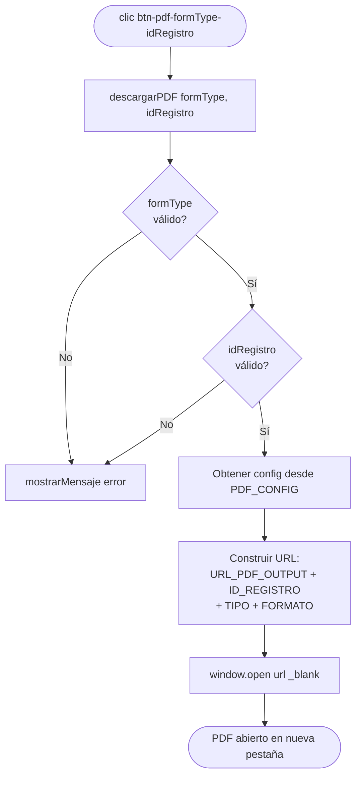

**Funciones involucradas:**
- `descargarPDF(formType, idRegistro)` - app.js
- `configurarBotonesPDF()` - app.js (event delegation)

---

## 18. Flujo de Botones de Acción en Formularios

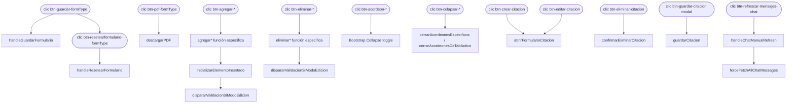

**Funciones involucradas:**
- `handleGuardarFormulario(formType, prefix, idRegistro)` - formularios.js
- `handleResetearFormulario(formType, prefix, idRegistro)` - formularios.js
- `descargarPDF(formType, idRegistro)` - app.js
- `agregarPalabraClave/TerminoDefinicion/Abreviatura/Atributo/...()` - formularios.js
- `eliminarPalabraClave/ItemCO/ValorDominio/...()` - formularios.js
- `inicializarElementoInsertado(elemento)` - formularios.js
- `dispararValidacionSiModoEdicion(idRegistro)` - formularios.js
- `abrirFormularioCitacion(id, citacion)` - citaciones.js
- `guardarCitacion(id, modal)` - citaciones.js
- `confirmarEliminarCitacion(id, titulo)` - citaciones.js
- `eliminarCitacion(id, titulo, modal)` - citaciones.js
- `handleChatManualRefresh(buttonEl)` - chat.js
- `forceFetchAllChatMessages()` - chat.js

---

## 19. Flujo de Autenticación Firebase

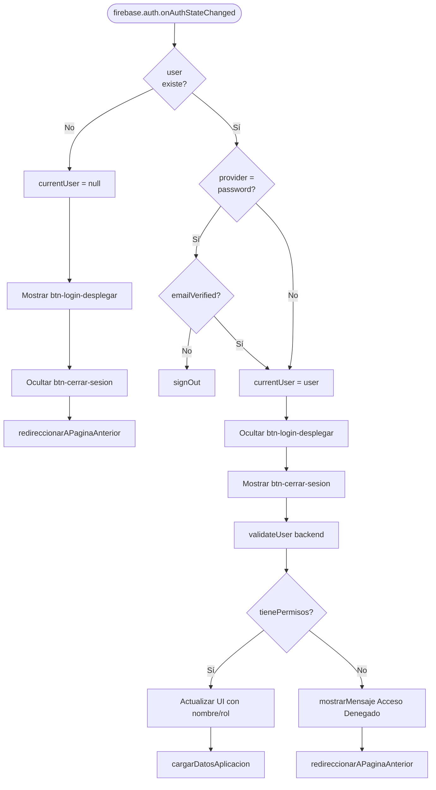

**Funciones involucradas:**
- `firebase.auth().onAuthStateChanged()` - Firebase
- `validateUser()` - api.js
- `signOut()` - app.js
- `cargarDatosAplicacion()` - app.js
- `redireccionarAPaginaAnterior()` - utils.js

---

## 20. Flujo de Sistema de Filtros SRIG

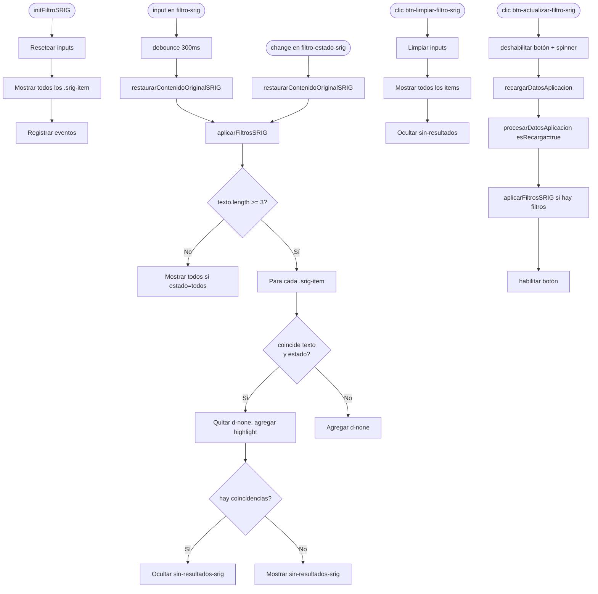

**Funciones involucradas:**
- `initFiltroSRIG()` - app.js
- `aplicarFiltrosSRIG()` - app.js
- `restaurarContenidoOriginalSRIG()` - app.js
- `normalizarTexto(texto)` - app.js
- `buildHighlightRegex(textoBusqueda)` - app.js
- `recargarDatosAplicacion()` - app.js
- `procesarDatosAplicacion(data, esRecarga)` - app.js

---

## 21. Listado Completo de Funciones por Archivo

### 21.1 config.js (1 función)

| Función | Propósito | Llamada desde |
|---------|-----------|---------------|
| `getConfiguracion(nombre)` | Obtiene configuración por nombre desde HIEE.configuraciones | formularios.js (populateSelectFromConfig, populateDropdowns, populateDominiosSelect, renderFactoresCalidad) |

### 21.2 utils.js (28 funciones)

| Función | Propósito | Llamada desde |
|---------|-----------|---------------|
| `mostrarMensaje(mensaje, titulo, tipo)` | Muestra toast notification | api.js, app.js, citaciones.js, formularios.js |
| `mostrarConfirm(mensaje, titulo, ...)` | Muestra diálogo de confirmación modal | app.js, citaciones.js, formularios.js |
| `mostrarLoader(mensaje)` | Muestra loader de carga | api.js, app.js, citaciones.js |
| `ocultarLoader()` | Oculta loader de carga | api.js, app.js, citaciones.js |
| `getUrlParams()` | Obtiene parámetros de la URL | config.js |
| `setDebug(isDebug)` | Configura window.debug como proxy de console | config.js |
| `redireccionarAPaginaAnterior(fallbackUrl)` | Redirige a página anterior | api.js, app.js, citaciones.js |
| `escapeHtml(str)` | Escapa caracteres HTML | citaciones.js, formularios.js |
| `utf8ToBase64(value)` | Codifica a Base64 con UTF-8 | api.js, app.js, citaciones.js, chat.js |
| `base64ToUtf8(str)` | Decodifica Base64 a UTF-8 | **SIN USO** |
| `isElementVisible(element)` | Verifica si elemento es visible | **SIN USO** |
| `removeElement(selectorOrElement)` | Elimina elemento del DOM | **SIN USO** |
| `toggleClass(element, className, force)` | Toggle de clase CSS | **SIN USO** |
| `getFormFieldValue(id, trim)` | Obtiene valor de campo formulario | **SIN USO** |
| `setFormFieldValue(id, value)` | Establece valor de campo formulario | **SIN USO** |
| `disableFormFields(container, exclude)` | Deshabilita campos en contenedor | **SIN USO** |
| `enableFormFields(container, exclude)` | Habilita campos en contenedor | **SIN USO** |
| `isValidISBN13(isbn)` | Valida ISBN-13 | schemas.js |
| `isValidISSN(issn)` | Valida ISSN | schemas.js |
| `isValidUrl(url)` | Valida URL | citaciones.js |
| `isValidEmail(email)` | Valida email | **SIN USO** |
| `debounce(fn, delay)` | Crea función con debounce | **SIN USO** |
| `deepClone(obj)` | Copia profunda de objeto | **SIN USO** |
| `isEmpty(value)` | Verifica si valor está vacío | **SIN USO** |
| `getNestedValue(obj, path, default)` | Obtiene valor anidado con notación de punto | **SIN USO** |
| `getStorageSubKey(storageKey, subKey, fallback)` | Lee sub-clave de localStorage | chat.js |
| `setStorageSubKey(storageKey, subKey, value)` | Guarda sub-clave en localStorage | chat.js |
| `formatDate(date, format)` | Formatea fecha | **SIN USO** |

### 21.3 api.js (15 funciones)

| Función | Propósito | Llamada desde |
|---------|-----------|---------------|
| `apiFetch(url)` | Base HTTP GET con validación | fetchHIEE, validateUser, cargarConfiguraciones, obtenerDatosBackend, etc. |
| `fetchHIEE(params)` | Base autenticada para URL_HIE | app.js, chat.js, citaciones.js, formularios.js |
| `validateUser()` | Valida usuario contra backend | app.js (validarRolParaAccion) |
| `cargarConfiguraciones()` | Carga configuraciones dinámicas | app.js (cargarDatosAplicacion) |
| `cargarCitacionSchema()` | Carga schema de citaciones | citaciones.js (initCitaciones) |
| `obtenerDatosBackend()` | Obtiene listado de ítems geográficos | app.js (cargarDatosAplicacion, recargarDatosAplicacion) |
| `loadGlobalHieeData(idRegistro)` | Carga datos completos de registro HIEE | app.js (cargarYMostrarSeccionHIEE) |
| `obtenerRegistroHIEE(idRegistro)` | Obtiene registro HIEE por ID | app.js (crearRegistroHIEE) |
| `actualizarRegistroHIEE(hieeData, modulo)` | Actualiza registro HIEE | app.js (crearRegistroHIEE), formularios.js (handleGuardarFormulario) |
| `obtenerConjuntosDatos()` | Obtiene conjuntos de datos | (uso interno) |
| `obtenerDetalleConjuntoDatos(idSrig)` | Obtiene detalle de ítem SRIG | formularios.js (agregarConjuntoDatosSeleccionado) |
| `fetchCitaciones(filtro)` | Obtiene citaciones del backend | citaciones.js (cargarCitaciones) |
| `fetchGuardarCitacion(params, esActualizacion)` | Guarda citación | citaciones.js (guardarCitacion) |
| `fetchEliminarCitacion(params)` | Elimina citación | citaciones.js (eliminarCitacion) |
| `fetchCitacionItem(citacionId)` | Obtiene detalle de citación | formularios.js (abrirDetalleCitacion) |

### 21.4 schemas.js (11 funciones - IIFE)

| Función | Propósito | Llamada desde |
|---------|-----------|---------------|
| `schemaPromise(url)` | Carga schema JSON desde URL | (interno - inicialización IIFE) |
| `rutaATexto(path, schema)` | Convierte ruta AJV a texto legible | traducirErrorAJV, detectarCamposVaciosRequeridos, detectarErroresFormato, detectarDuplicados |
| `buscarTituloEn(schemaNode, clave)` | Busca título en schema | rutaATexto (interno) |
| `traducirErrorAJV(err, schema)` | Traduce error AJV a objeto legible | validateSchema |
| `generarHTMLErrores(erroresTraducidos)` | Genera HTML de panel de validaciones | validateSchema |
| `detectarCamposVaciosRequeridos(schemaNode, dataNode, rootSchema, pathPrefix)` | Detecta campos requeridos vacíos | validateSchema |
| `detectarErroresFormato(schemaNode, dataNode, rootSchema, pathPrefix)` | Detecta errores de formato recursivamente | validateSchema |
| `detectarDuplicados(schemaNode, dataNode, rootSchema, pathPrefix)` | Detecta valores duplicados en arrays | validateSchema |
| `validateSchema(schema, data)` | Valida datos contra schema | formularios.js (ejecutarValidacion, handleGuardarFormulario) |
| `traducirConOneOf(err)` | Traduce errores oneOf/anyOf | validateSchema (interno) |

### 21.5 formularios.js (~100 funciones)

**Funciones Core de Formularios:**

| Función | Propósito | Llamada desde |
|---------|-----------|---------------|
| `getGlobalHieeFormData(hieeData, formType)` | Obtiene datos de formulario desde HIEE | populateFormWithData, initAttributeSelect |
| `loadFormTemplate(formType)` | Carga template HTML de formulario | initializeFormModule |
| `initializeAllFormModules(srigId, idRegistro, hieeData)` | Inicializa todos los formularios | app.js (cargarYMostrarSeccionHIEE) |
| `initializeFormModule(...)` | Inicializa módulo de formulario específico | initializeAllFormModules |
| `populateFormWithData(idRegistro, prefix, hieeData)` | Pobla formulario con datos | initializeFormModule |
| `populateFormFields(idRegistro, prefix, formData)` | Pobla campos del formulario | populateFormWithData |
| `resolverTextoNivelAlcance(value)` | Resuelve texto de nivelAlcance | populateFormFields |
| `setFieldValue(prefix, fieldName, idRegistro, value)` | Asigna valor a elemento | populateFormFields |
| `getFieldValue(prefix, fieldName, idRegistro)` | Lee valor de campo del DOM | collectFormData |
| `normalizarIdsCitaciones(citaciones)` | Normaliza IDs de citaciones a integer | leerCitacionesDelPicker |
| `leerCitacionesDelPicker(picker)` | Lee citaciones de citation-picker | leerCitacionesArrayDesdeDOM, collectFormData |
| `leerItemsArrayDesdeDOM(...)` | Lee ítems de array dinámico desde DOM | collectFormData |
| `leerCitacionesArrayDesdeDOM(originalArray, fieldName, formContainer)` | Actualiza citaciones desde DOM | collectFormData |
| `leerAtributosDesdeDOM(prefix, idRegistro, originalArray, formContainer)` | Lee atributos desde DOM CO | collectFormData |
| `leerOperacionesDesdeDOM(prefix, idRegistro, ...)` | Lee operaciones desde DOM | collectFormData |
| `leerAsociacionesDesdeDOM(prefix, idRegistro, ...)` | Lee asociaciones desde DOM | collectFormData |
| `leerRelacionConceptosDesdeDOM(prefix, idRegistro, ...)` | Lee relaciones conceptuales desde DOM | collectFormData |
| `leerConjuntosDatosDesdeDOM(prefix, idRegistro, formContainer)` | Lee conjuntos de datos desde DOM | collectFormData |
| `collectFormData(idRegistro, prefix)` | Recolecta datos editables del formulario | ejecutarValidacion, handleGuardarFormulario |

**Funciones de Renderizado:**

| Función | Propósito | Llamada desde |
|---------|-----------|---------------|
| `renderPalabrasClave(prefix, fieldPath, idRegistro, palabras)` | Renderiza palabras clave como badges | agregarPalabraClave, eliminarPalabraClave |
| `renderTerminosDefiniciones(prefix, idRegistro, terminos)` | Renderiza términos y definiciones | populateFormFields |
| `renderAbreviaturas(prefix, idRegistro, abreviaturas)` | Renderiza abreviaturas | populateFormFields |
| `renderAtributos(prefix, idRegistro, atributos)` | Renderiza atributos (CO) | populateFormFields |
| `renderAsociaciones(prefix, idRegistro, asociaciones)` | Renderiza asociaciones (CO) | populateFormFields |
| `renderConjuntoDatos(prefix, idRegistro, conjuntos)` | Renderiza conjuntos de datos (CO) | populateFormFields |
| `renderRelacionConceptos(prefix, idRegistro, ...)` | Renderiza relaciones conceptuales (CO) | populateFormFields |
| `renderOperaciones(prefix, idRegistro, operaciones)` | Renderiza operaciones (CO) | populateFormFields |
| `renderCalidadDatos(prefix, parentField, idRegistro, factores)` | Renderiza factores de calidad | populateFormFields |
| `renderDistribuciones(prefix, idRegistro, distribuciones)` | Renderiza distribuciones (ET) | populateFormFields |
| `renderValoresDominio(clone, prefix, idRegistro, attrIndex, valores)` | Renderiza valores de dominio | renderAtributos |
| `renderHerencias(prefix, idRegistro, herencias)` | Renderiza herencias (CR) | populateFormFields |
| `renderFuncionesCR(prefix, idRegistro, funciones)` | Renderiza funciones (CR) | populateFormFields |
| `renderCitacionesEnFormulario(idRegistro, parentField, citaciones, prefix)` | Renderiza citaciones en formulario | populateFormFields |
| `renderCitacionesEnClone(clone, dataField, citaciones, ...)` | Renderiza citaciones en clone | renderTerminosDefiniciones, renderAbreviaturas, etc. |

**Gestión de Ítems Dinámicos:**

| Función | Propósito | Llamada desde |
|---------|-----------|---------------|
| `agregarPalabraClave(idRegistro)` | Agrega palabra clave | onclick (template) |
| `eliminarPalabraClave(idRegistro, prefix, fieldPath, index)` | Elimina palabra clave | onclick (renderPalabrasClave) |
| `obtenerPalabrasClaveActuales(idRegistro)` | Obtiene palabras clave actuales | collectFormData, agregarPalabraClave |
| `agregarItemGenerico(templateId, containerId, collapsePrefix, badgeId)` | Agrega ítem genérico | agregarTerminoDefinicion, agregarAbreviatura, etc. |
| `agregarTerminoDefinicion(idRegistro)` | Agrega término/definición | onclick (template) |
| `agregarAbreviatura(idRegistro)` | Agrega abreviatura | onclick (template) |
| `agregarAtributo(idRegistro)` | Agrega atributo (CO) | onclick (template) |
| `agregarAsociacion(idRegistro)` | Agrega asociación (CO) | onclick (template) |
| `agregarHerencia(idRegistro)` | Agrega herencia (CR) | onclick (template) |
| `agregarRelacionConcepto(idRegistro)` | Agrega relación conceptual (CO) | onclick (template) |
| `agregarOperacion(idRegistro)` | Agrega operación (CO) | onclick (template) |
| `agregarConjuntoDatosSeleccionado(idRegistro)` | Agrega conjunto de datos seleccionado | onclick (template) |
| `agregarValorDominio(btn, idRegistro)` | Agrega valor de dominio | onclick (template), autoAgregarValoresDominio |
| `eliminarItemCO(itemId, tipoLista)` | Elimina ítem CO | onclick (template) |
| `eliminarValorDominio(btn, idRegistro)` | Elimina valor de dominio | onclick (template) |
| `eliminarValoresDominioSeleccionados(btn, idRegistro)` | Elimina valores seleccionados | onclick (template) |
| `autoAgregarValoresDominio(btn, idRegistro)` | Auto-agrega valores desde dominio | onclick (template) |
| `agregarDistribucion(idRegistro)` | Agrega distribución (ET) | onclick (template) |
| `eliminarDistribucion(itemId)` | Elimina distribución | onclick (template) |
| `agregarMedioDistribucion(distIndex, idRegistro)` | Agrega medio de distribución | onclick (template) |
| `eliminarMedioDistribucion(medioItem)` | Elimina medio de distribución | onclick (template) |
| `agregarServicioDistribucion(medioIndex, distIndex, idRegistro)` | Agrega servicio de distribución | onclick (template) |
| `eliminarServicioDistribucion(servicioItem)` | Elimina servicio | onclick (template) |
| `agregarFactorCalidad(idRegistro)` | Agrega factor de calidad (RC) | onclick (template) |
| `eliminarFactorCalidad(itemId)` | Elimina factor de calidad | onclick (template) |
| `agregarFuncionCR(idRegistro)` | Agrega función (CR) | onclick (template) |
| `eliminarFuncionCR(idRegistro, funcIndex)` | Elimina función (CR) | onclick (template) |
| `agregarEspecificacionCR(idRegistro, funcIndex)` | Agrega especificación (CR) | onclick (template) |
| `eliminarEspecificacionCR(idRegistro, funcIndex, specIndex)` | Elimina especificación (CR) | onclick (template) |

**Funciones Helper:**

| Función | Propósito | Llamada desde |
|---------|-----------|---------------|
| `setupAccordionIds(clone, config)` | Configura IDs de accordion | renderTerminosDefiniciones, renderAtributos, etc. |
| `populateClonedFields(clone, idPrefix, suffix, data, fields)` | Pobla campos en clone | render functions |
| `populateCheckboxWithPreview(clone, idPrefix, idRegistro, suffix, value)` | Pobla checkbox con preview | render functions |
| `populateSelectFromConfig(select, configKey, useIdAsValue)` | Pobla select desde configuraciones | populateDropdowns, renderAtributos, etc. |
| `populateDropdowns(idRegistro, prefix)` | Pobla dropdowns de formulario | populateFormWithData |
| `populateDominiosSelect(select)` | Pobla select de dominios | renderAtributos, agregarAtributo |
| `initTomSelectEnSelect(select)` | Inicializa TomSelect | populateDropdowns, agregarAtributo, etc. |
| `initMasterCheckDominio(atributoEl)` | Inicializa master checkbox dominio | renderAtributos |
| `initAttributeSelect(container, seleccionados)` | Inicializa selector de atributos | agregarOperacion, inicializarElementoInsertado |
| `inicializarElementoInsertado(elemento)` | Inicialización post-inserción | Todos agregar* functions |
| `initCitationPickers(container)` | Inicializa buscador de citaciones | inicializarElementoInsertado |
| `seleccionarCitacionEnPicker(picker, cit)` | Agrega citación a picker | initCitationPickers |
| `actualizarContadorCitaciones(picker)` | Actualiza contador citaciones | seleccionarCitacionEnPicker |
| `crearBadgeCitacion(cit)` | Crea badge de citación | renderCitacionesEnClone, renderCitacionesEnFormulario |
| `abrirDetalleCitacion(citacionId)` | Abre modal de detalle citación | crearBadgeCitacion (onclick) |
| `mostrarModalCitacion(citacionData)` | Muestra modal de detalle | abrirDetalleCitacion |
| `collectDistribuciones(prefix, idRegistro)` | Lee distribuciones desde DOM | collectFormData |
| `reemplazarIdRegistroEnOnclick(el, sufijo)` | Reemplaza [ID_REGISTRO] en onclick | renderAtributos, agregarAtributo |

**Validación y Guardado:**

| Función | Propósito | Llamada desde |
|---------|-----------|---------------|
| `obtenerSchemaParaPrefix(prefix)` | Retorna schema para prefix | ejecutarValidacion |
| `dispararValidacionSiModoEdicion(idRegistro)` | Dispara validación si modo edición | agregar/eliminar functions |
| `ejecutarValidacion(formType, prefix, idRegistro)` | Ejecuta validación de schema | initializeFormModule, configurarEventosPestanasHIEE, handleGuardarFormulario |
| `renderValidaciones(formType, idRegistro, validationResult, avisos)` | Renderiza validaciones en panel | ejecutarValidacion, handleGuardarFormulario |
| `handleGuardarFormulario(formType, prefix, idRegistro)` | Maneja click en Guardar | initializeFormModule (event listener) |
| `handleResetearFormulario(formType, prefix, idRegistro)` | Descarta cambios y recarga | initializeFormModule (event listener) |
| `sanitizarSelectsFormulario(idRegistro, prefix)` | Sanitiza selects (limpia valores inválidos) | handleGuardarFormulario |
| `updateFormTabStateColors(idRegistro, hieeData)` | Actualiza colores de pestañas | app.js (cargarYMostrarSeccionHIEE), handleGuardarFormulario |

**Modo Vista Previa/Edición:**

| Función | Propósito | Llamada desde |
|---------|-----------|---------------|
| `initializePreviewModeSystem(idRegistro)` | Inicializa sistema modo vista previa/edición | app.js (cargarYMostrarSeccionHIEE) |
| `applyFormMode(idRegistro, formType, isEditMode)` | Aplica modo a formulario | initializePreviewModeSystem |
| `toggleSeccionesVacias(container, isEditMode)` | Oculta/muestra secciones vacías | applyFormMode |
| `seccionEstaVacia(body)` | Determina si sección está vacía | toggleSeccionesVacias |
| `isFormInEditMode(idRegistro, formType)` | Verifica si formulario está en modo edición | initializeFormModule, dispararValidacionSiModoEdicion |

### 21.6 chat.js (55 funciones)

| Función | Propósito | Llamada desde |
|---------|-----------|---------------|
| `initializeChatComponent()` | Inicializa componente de chat | app.js (configurarBotonesLaterales) |
| `injectChatStylesOnce()` | Inyecta estilos CSS | initializeChatComponent |
| `bindChatEvents()` | Vincula eventos globales | initializeChatComponent |
| `ensureChatChildStructure(registroId)` | Asegura estructura de chat | loadChatMessages |
| `ensureChatRefreshButton()` | Inserta botón de refresco | initializeChatComponent |
| `handleChatManualRefresh(buttonEl)` | Maneja clic de refresco manual | ensureChatRefreshButton (event) |
| `forceFetchAllChatMessages()` | Fuerza obtención de mensajes | handleChatManualRefresh |
| `initializeChatQuillEditor(registroId)` | Inicializa editor Quill | ensureChatChildStructure |
| `loadChatQuillCDN()` | Carga CDN de Quill | initializeChatQuillEditor |
| `setupChatQuillEditor(registroId)` | Configura editor Quill | loadChatQuillCDN (onload) |
| `loadChatMessages(registroId, registroData)` | Carga mensajes para registro | app.js (configurarBotonesLaterales), reloadChatOnOpen, processChatPotentialUpdateFor |
| `decodeChatMensajesString(rawStr)` | Decodifica mensajes (JSON/Base64) | loadChatMessages, processChatPotentialUpdateFor |
| `normalizeChatMensaje(mensaje)` | Normaliza mensaje a formato estándar | loadChatMessages, processChatPotentialUpdateFor |
| `handleChatNoMessages()` | Maneja caso sin mensajes según rol | loadChatMessages |
| `showChatNoMessages(textAviso)` | Muestra estado sin mensajes | clearChatMessages, displayChatMessages, handleChatNoMessages |
| `hideChatNoMessages()` | Oculta estado sin mensajes | displayChatMessages, sendChatMessage |
| `clearChatMessages()` | Limpia todos los mensajes | loadChatMessages |
| `displayChatMessages(mensajes)` | Muestra lista de mensajes | loadChatMessages |
| `displayChatMessage(mensaje)` | Muestra mensaje individual | displayChatMessages |
| `scrollChatToBottom()` | Scroll al último mensaje | sendChatMessage, toggleChatVisibility, scheduleChatAutoScroll |
| `scheduleChatAutoScroll()` | Programa scroll al final | triggerChatAutoScroll |
| `triggerChatAutoScroll()` | Dispara auto-scroll | displayChatMessages |
| `sendChatMessage()` | Envía nuevo mensaje | bindChatEvents (Ctrl+Enter), ensureChatChildStructure (button) |
| `refreshChatMessages()` | Refresca mensajes desde backend | (sistema de polling) |
| `toggleChatVisibility(show)` | Muestra/oculta componente | app.js (cerrarSeccionHIEE, configurarBotonesLaterales) |
| `isAnyChatHieeSectionVisible()` | Determina si hay sección visible | evaluateChatPollingState, pollChatOnceFor |
| `isChatOpen()` | Determina si chat está abierto | handleChatManualRefresh, toggleChatVisibility |
| `isChatOpenFor(registroId)` | Determina si chat está visible para registro | computeChatIntervalFor, startChatPollingFor, processChatPotentialUpdateFor |
| `isChatSectionOpenedFor(registroId)` | Determina si hay sección abierta | computeChatIntervalFor |
| `computeChatIntervalFor(registroId)` | Calcula intervalo de polling | startChatPollingFor, scheduleChatNextPollFor |
| `gatherChatCandidateIdsForPolling()` | Obtiene IDs candidatos para polling | evaluateChatPollingState |
| `evaluateChatPollingState()` | Evalúa si debe correr polling | initializeChatComponent, toggleChatVisibility, loadChatMessages, installChatSectionVisibilityObserver |
| `startChatPollingFor(registroId)` | Inicia polling para registro | evaluateChatPollingState |
| `stopChatPollingFor(registroId)` | Detiene polling para registro | app.js (cerrarSeccionHIEE), evaluateChatPollingState, pollChatOnceFor |
| `acquireChatTypeLock(type)` | Intenta adquirir lock por tipo | runChatPollFor |
| `runChatPollFor(registroId, type, noReschedule)` | Ejecuta poll para registro | startChatPollingFor, scheduleChatNextPollFor |
| `scheduleChatNextPollFor(registroId)` | Programa siguiente poll | runChatPollFor, pollChatOnceFor |
| `pollChatOnceFor(registroId, force, noReschedule)` | Ejecuta un poll | runChatPollFor |
| `processChatPotentialUpdateFor(registroId, rawData, forceRenderVisible)` | Procesa actualización potencial | refreshChatMessages, pollChatOnceFor |
| `buildChatMessagesSignature(mensajes)` | Construye firma de mensajes | processChatPotentialUpdateFor |
| `calculateChatUnreadMessages(idRegistro, messages)` | Calcula mensajes no leídos | processChatPotentialUpdateFor |
| `getChatReadMessagesFromStorage(idRegistro)` | Obtiene mensajes leídos (localStorage) | calculateChatUnreadMessages |
| `saveChatReadMessagesToStorage(idRegistro, messageIds)` | Guarda mensajes leídos | markChatMessagesAsRead |
| `markChatMessagesAsRead(idRegistro, messages)` | Marca mensajes como leídos | loadChatMessages |
| `updateChatUnreadBadge()` | Actualiza badge de no leídos | ensureChatChildStructure, loadChatMessages, processChatPotentialUpdateFor, reloadChatOnOpen |
| `reloadChatOnOpen()` | Recarga al abrir chat | toggleChatVisibility |
| `installChatSectionVisibilityObserver()` | Instala observer de visibilidad | initializeChatComponent |

### 21.7 citaciones.js (15 funciones)

| Función | Propósito | Llamada desde |
|---------|-----------|---------------|
| `cargarCitaciones(filtro, silencioso)` | Carga citaciones desde backend | initCitaciones, precargarCitaciones, initCitationPickers |
| `renderizarCitaciones(lista)` | Renderiza citaciones en contenedor | cargarCitaciones, filtrarCitaciones |
| `puedeEditarCitaciones()` | Verifica permisos de edición | crearTarjetaCitacion |
| `crearTarjetaCitacion(item)` | Crea tarjeta HTML para citación | renderizarCitaciones |
| `filtrarCitaciones(textoBusqueda)` | Filtra citaciones por texto | initCitaciones (input event) |
| `generarOpcionesSelect(configKey, selectedValue)` | Genera opciones para select | generarFormularioCitacion |
| `generarFormularioCitacion(citacion)` | Genera HTML de formulario | abrirFormularioCitacion |
| `abrirFormularioCitacion(id, citacion)` | Abre formulario crear/editar | crearTarjetaCitacion (btnEditar), btnNueva |
| `obtenerDatosFormularioCitacion()` | Recopila datos del formulario | guardarCitacion |
| `validarFormularioCitacion(datos)` | Valida datos del formulario | guardarCitacion |
| `guardarCitacion(id, modal)` | Guarda citación (crear/actualizar) | abrirFormularioCitacion (btnGuardar event) |
| `confirmarEliminarCitacion(id, titulo)` | Confirma eliminación | crearTarjetaCitacion (btnEliminar) |
| `eliminarCitacion(id, titulo, modal)` | Elimina citación del backend | confirmarEliminarCitacion (btnConfirmar event) |
| `initCitaciones()` | Inicializa eventos del tab | onclick (HTML) |
| `precargarCitaciones()` | Precarga citaciones en segundo plano | document.addEventListener('DOMContentLoaded') |

### 21.8 app.js (40+ funciones)

| Función | Propósito | Llamada desde |
|---------|-----------|---------------|
| `signOut()` | Cierra sesión | event listener (btn-cerrar-sesion) |
| `validarRolParaAccion(rolesPermitidos)` | Valida rol para acción | chat.js (sendChatMessage), citaciones.js (guardarCitacion, eliminarCitacion) |
| `procesarDatosAplicacion(data, esRecarga)` | Procesa datos del backend | cargarDatosAplicacion, recargarDatosAplicacion |
| `cargarDatosAplicacion()` | Carga datos iniciales | Firebase onAuthStateChanged |
| `recargarDatosAplicacion()` | Recarga datos (botón actualizar) | app.js (crearRegistroHIEE, handleResetearFormulario), event listener |
| `renderizarItemsGeograficos(items)` | Renderiza ítems en contenedor | procesarDatosAplicacion |
| `crearTarjetaItem(item)` | Crea tarjeta para ítem geográfico | renderizarItemsGeograficos |
| `crearRegistroHIEE(srigId, srigNombre)` | Crea registro HIEE completo | abrirItemGeografico |
| `abrirItemGeografico(item)` | Abre ítem para ver/editar estándares | crearTarjetaItem (event listener) |
| `mostrarSeccionHIEE(seccion)` | Muestra sección HIEE | cargarYMostrarSeccionHIEE |
| `configurarEventosSeccionHIEE(seccion, srigId)` | Configura eventos de sección | cargarYMostrarSeccionHIEE |
| `cerrarSeccionHIEE(srigId)` | Cierra sección HIEE | configurarEventosSeccionHIEE (btnCerrar) |
| `cambiarPestanaHIEE(seccion, tabName)` | Cambia pestaña en sección | configurarEventosPestanasHIEE, handleResetearFormulario |
| `PanelLateral.cambiarA(pestania)` | Cambia pestaña del panel lateral | configurarBotonesLaterales, initializePreviewModeSystem |
| `PanelLateral.pestaniaActiva()` | Devuelve pestaña activa | configurarBotonesLaterales |
| `PanelLateral.mostrar()` | Muestra contenedor botones | mostrarBotonesLaterales |
| `PanelLateral.ocultar()` | Oculta contenedor botones | ocultarBotonesLaterales |
| `PanelLateral.mostrarBoton(pestania)` | Muestra botón específico | mostrarBotonesLaterales |
| `mostrarBotonesLaterales()` | Muestra botones según permisos | cargarYMostrarSeccionHIEE |
| `ocultarBotonesLaterales()` | Oculta botones laterales | cerrarSeccionHIEE, cargarYMostrarSeccionHIEE (error) |
| `estaHIEEMaximizado()` | Verifica si HIEE está maximizado | configurarBotonesLaterales |
| `restaurarHIEESiEstaMaximizada()` | Restaura HIEE si maximizada | configurarBotonesLaterales |
| `configurarBotonesLaterales()` | Registra eventos de botones | mostrarBotonesLaterales |
| `actualizarContadorItems(total, totalItems)` | Actualiza contador | procesarDatosAplicacion |
| `mostrarMensajeSinResultados()` | Muestra mensaje sin resultados | procesarDatosAplicacion |
| `normalizarTexto(texto)` | Normaliza texto (sin tildes) | buildHighlightRegex, aplicarFiltrosSRIG |
| `buildHighlightRegex(textoBusqueda)` | Genera regex para highlighting | aplicarFiltrosSRIG |
| `aplicarFiltrosSRIG()` | Aplica filtros de texto y estado | initFiltroSRIG (input event) |
| `restaurarContenidoOriginalSRIG()` | Restaura contenido original | initFiltroSRIG (input event) |
| `initFiltroSRIG()` | Inicializa filtros | procesarDatosAplicacion |
| `cargarYMostrarSeccionHIEE(item)` | Carga y muestra sección completa | abrirItemGeografico, handleResetearFormulario |
| `configurarEventosPestanasHIEE(seccion, idRegistro)` | Configura eventos de pestañas | cargarYMostrarSeccionHIEE |
| `cerrarAcordeonesDeTabActivo()` | Cierra acordeones de pestaña activa | onclick (templates) |
| `descargarPDF(formType, idRegistro)` | Abre PDF en nueva pestaña | configurarBotonesPDF |
| `configurarBotonesPDF()` | Configura eventos de botones PDF | document.addEventListener('DOMContentLoaded') |

### 21.9 animaciones.js (9 funciones)

| Función | Propósito | Llamada desde |
|---------|-----------|---------------|
| `animarAperturaLayoutHIEE()` | Anima apertura layout dividido | (exportado a window.AnimacionesHIEE) |
| `animarCierreLayoutHIEE()` | Anima cierre de layout | (exportado a window.AnimacionesHIEE) |
| `animarEntradaSeccionHIEE(seccion, callback)` | Anima entrada de sección | (exportado a window.AnimacionesHIEE) |
| `animarSalidaSeccionHIEE(seccion, callback)` | Anima salida de sección | (exportado a window.AnimacionesHIEE) |
| `animarCambioPestana(panelSaliente, panelEntrante)` | Anima cambio de pestañas | (exportado a window.AnimacionesHIEE) |
| `maximizarSeccionHIEE(seccion)` | Maximiza sección | app.js (configurarBotonesLaterales) |
| `restaurarSeccionHIEE(seccion)` | Restaura sección desde maximizado | app.js (cerrarSeccionHIEE, configurarBotonesLaterales) |
| `activarLayoutConHIEE()` | Activa layout dividido | app.js (cargarYMostrarSeccionHIEE) |
| `desactivarLayoutConHIEE()` | Desactiva layout dividido | app.js (cerrarSeccionHIEE, cargarYMostrarSeccionHIEE error) |

---

## 22. Funciones Sin Uso

Las siguientes 14 funciones están definidas en el código pero **no tienen llamadas identificadas** en ninguna parte del proyecto. Estas funciones pueden ser candidatas para eliminación en futuras refactorizaciones.

### utils.js (14 funciones sin uso)

| Función | Propósito original | Línea aprox. |
|---------|-------------------|--------------|
| `base64ToUtf8(str)` | Decodifica cadena Base64 a UTF-8 | ~220 |
| `isElementVisible(element)` | Verifica si un elemento es visible en el DOM | ~260 |
| `removeElement(selectorOrElement)` | Elimina un elemento del DOM | ~275 |
| `toggleClass(element, className, force)` | Toggle de clase CSS en un elemento | ~290 |
| `getFormFieldValue(id, trim)` | Obtiene el valor de un campo de formulario por ID | ~310 |
| `setFormFieldValue(id, value)` | Establece el valor de un campo de formulario por ID | ~325 |
| `disableFormFields(container, exclude)` | Deshabilita todos los campos editables dentro de un contenedor | ~340 |
| `enableFormFields(container, exclude)` | Habilita todos los campos editables dentro de un contenedor | ~360 |
| `isValidEmail(email)` | Valida si un email es válido | ~400 |
| `debounce(fn, delay)` | Crea una función con debounce | ~415 |
| `deepClone(obj)` | Realiza una copia profunda de un objeto | ~430 |
| `isEmpty(value)` | Verifica si un valor está vacío | ~455 |
| `getNestedValue(obj, path, defaultValue)` | Obtiene un valor anidado de un objeto usando notación de punto | ~470 |
| `formatDate(date, format)` | Formatea una fecha a string legible | ~530 |

**Nota:** Estas funciones fueron creadas como utilidades de propósito general y pueden haber sido usadas en versiones anteriores del código, o pueden estar reservadas para funcionalidad futura. Su eliminación debería evaluarse cuidadosamente para evitar romper compatibilidad.

---

## Resumen

| Métrica | Valor |
|---------|-------|
| **Total de archivos JS** | 9 |
| **Total de líneas de código** | 11,174 |
| **Total de funciones** | ~274 |
| **Funciones utilizadas** | 260 |
| **Funciones sin uso** | 14 |
| **Porcentaje de uso** | 94.9% |
| **Versión actual** | v2.06.06 |

### Distribución por archivo:

| Archivo | Líneas | Funciones | Sin uso |
|---------|--------|-----------|---------|
| formularios.js | 5,779 | ~100 | 0 |
| app.js | 1,461 | 40+ | 0 |
| chat.js | 1,047 | 55 | 0 |
| citaciones.js | 794 | 15 | 0 |
| schemas.js | 714 | 11 | 0 |
| utils.js | 601 | 28 | 14 |
| animaciones.js | 336 | 9 | 0 |
| api.js | 281 | 15 | 0 |
| config.js | 161 | 1 | 0 |

**Nota:** Las 14 funciones sin uso están todas en `utils.js` y son utilidades que fueron creadas para funcionalidad futura o de versiones anteriores.
